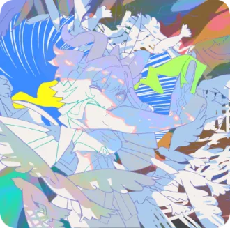

# 星趴卡牌图鉴/地图事件
> 分类：图鉴
> 来源：https://wiki.biligame.com/starengine/%E6%98%9F%E8%B6%B4%E5%8D%A1%E7%89%8C%E5%9B%BE%E9%89%B4/%E5%9C%B0%E5%9B%BE%E4%BA%8B%E4%BB%B6

## 星趴·梦想号

 休眠终止
休眠终止 海盗王嘎呜刷新在场上。 

 大逃鲨
大逃鲨 地图上随机刷新四只鲨鱼强盗 

 恐怖追击
恐怖追击 海盗王嘎呜开始移动，随机追击玩家。 

 恐怖追击
恐怖追击 海盗王嘎呜开始移动，所有怪物攻击力+1。 

 鲨手降临
鲨手降临 地图上随机刷新两只鲨鱼首领。 

 鲨手降临
鲨手降临 地图上随机刷新两只鲨鱼首领，所有怪物攻击力+1、防御力+1。 

 鲨手降临
鲨手降临 地图上随机刷新两只鲨鱼首领，所有怪物攻击力+1、防御力+2。

## 御魂庆典

 天王寺登场
天王寺登场 天王寺登场，并刷新出两个冰冷蓝灵。 

 灵体入侵
灵体入侵 刷出2个冰冷蓝灵，1个狂躁红灵。BOSS开始行动。 

 精英出场
精英出场 地图上刷新出刀剑灵体和长戟灵体各一个。 

 强化精英出场
强化精英出场 地图上刷新出刀剑灵体和长戟灵体各一个，所有的怪物攻击力+1，防御力+1。 

 人人为我！
人人为我！ 摧毁场上所有长戟灵体和刀剑灵体，每摧毁一个为雅央恢复15%的生命并永久防御力+1，攻击力+1。随后所有的怪物攻击力+1，防御力+1。 

 人人为我！
人人为我！ 摧毁场上所有长戟灵体和刀剑灵体，每摧毁一个为雅央恢复15%的生命并永久防御力+1，攻击力+1。随后所有的怪物攻击力+2，防御力+2。 

 来我身边！
来我身边！ 地图上刷新出刀剑灵体和长戟灵体各一个，所有的怪物攻击力+1，防御力+1。 

 来我身边！
来我身边！ 地图上刷新出2个刀剑灵体和1个长戟灵体，所有的怪物攻击力+1，防御力+1。

## 水乡古镇

 准备就绪
准备就绪 刷新1个氛围机器人和3个爆竹呱呱。 

 好戏开场
好戏开场 舞狮嘎呜和指挥平台出场。 

 热闹非凡
热闹非凡 刷新3个爆竹呱呱，所有的怪物攻击力+1，防御力+1。 

 蛇龙降临
蛇龙降临 刷新1个氛围机器人和2个机械蛇龙，所有的怪物攻击力+1，防御力+1。 

 锣鼓喧天
锣鼓喧天 刷新1个氛围机器人和1个机械蛇龙，所有的怪物攻击力+1，防御力+1。 

 锣鼓喧天
锣鼓喧天 刷新2个氛围机器人和1个机械蛇龙，所有的怪物攻击力+1，防御力+1。

## 通用

 明胶追击
明胶追击 刷新1个果冻巫师，1个魔法茶壶。所有的怪物攻击力+1，防御力+1。 

 明胶追击
明胶追击 刷新1个果冻巫师，1个果冻护卫。所有的怪物攻击力+1，防御力+1。 

 茶话会
茶话会 刷新2个果冻护卫，2个魔法茶壶。所有的怪物攻击力+1，防御力+1。 

 茶话会
茶话会 刷新2个果冻护卫，2个果冻巫师。所有的怪物攻击力+1，防御力+2。

### 1

 原罪现身
原罪现身 天王寺登场。 

 学院戒严！
学院戒严！ 刷新1个果冻战士，3个魔法茶壶。

### 2

 检举揭发
检举揭发 学院安全官登场，所有玩家获得一张【是他干的】。 

 严阵以待
严阵以待 刷新1个果冻战士，2个果冻护卫。

## 通用

 水上乐园
水上乐园 龙虾机关启动，刷新4个蟹布罗。 

 蟹之狂欢
蟹之狂欢 刷新3个蟹布罗，所有的怪物攻击力+1，防御力+1。

### 选择天川苍鲤

 苍鲤登场！
苍鲤登场！ 苍鲤登场，刷新2个金小鱼，所有的怪物攻击力+1，防御力。 

 酩酊丑态
酩酊丑态 刷新3个金小鱼，所有的怪物攻击力+1，防御力。

### 选择天川真梦梓

 真梦梓出击！
真梦梓出击！ 真梦梓登场，刷新3个虾布罗，所有的怪物攻击力+1，防御力+1。 

 独木难支
独木难支 刷新2个虾布罗，所有的怪物攻击力+1，防御力+1。

## 幽魂暗巷

 舞会开始！
舞会开始！ 天王寺雅央登场，舞会开始！ 

 身体检查
身体检查 刷新3个惊喜猴子盒，1个圆锯猴助手。 

 强力帮手
强力帮手 刷新2个惊喜猴子盒，1个科学怪猿，所有的怪物攻击力+1，防御力+1。 

 全体集结！
全体集结！ 刷新1个科学怪猿，1个圆锯猴助手，所有的怪物防御力+1。 

 圆月之夜
圆月之夜 刷新2个科学怪猿，1个圆锯猴助手，所有的怪物攻击力+1，防御力+1。 

 圆月之夜
圆月之夜 刷新2个科学怪猿，1个圆锯猴助手，所有玩家获得【改造】*2，所有的怪物攻击力+1，防御力+1。

## 通用

 百鸟与凤
百鸟与凤 收集凤凰的力量 

 百鸟冲击
百鸟冲击 刷新2个迎宾燕，2个铜盏仙鹤

### 铜盏孔雀试炼

 与凤争风
与凤争风 刷新1个铜盏孔雀，2个迎宾燕 

 孔雀之舞
孔雀之舞 旗袍（孔雀意识）登场，刷新1个铜盏仙鹤 

 无彩
无彩 刷新1个铜盏孔雀，1个铜盏仙鹤

### 铜盏鸳鸯试炼

 鸳鸯比翼
鸳鸯比翼 刷新2个铜盏鸳鸯，2个迎宾燕 

 鸳之绊
鸳之绊 旗袍（鸳鸯意识）登场，刷新1个铜盏仙鹤 

 华彩
华彩 刷新2个铜盏鸳鸯，1个铜盏仙鹤
