# 星趴地图图鉴
> 分类：图鉴
> 来源：https://wiki.biligame.com/starengine/%E6%98%9F%E8%B6%B4%E5%9C%B0%E5%9B%BE%E5%9B%BE%E9%89%B4

点击模式查看详细信息(显示在下方)！ 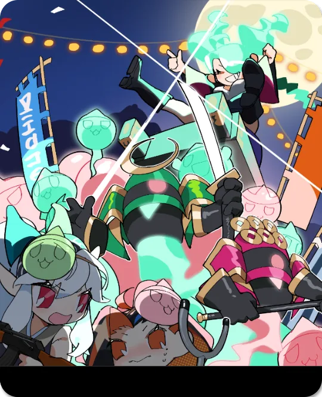匹配！PVE合作挑战和其他玩家合作攻略关卡
匹配！PVP标准对战和其他玩家对战获得胜利 房间大厅可自由创建房间与其他玩家进行对局
单人模式单人游玩关卡来熟悉游戏

### 选择地图

玩家在匹配模式中可以选择地图。 
对于合作挑战模式，玩家共有四个可选项，包括了当期版本地图（NEW）、两张游戏内已经实装的地图（轮换）以及随机地图。轮换地图在每次大版本更新后将会调换为与前两张地图不同的其他地图。若玩家选择随机地图，则将会在已有的全部地图中随机挑选一张地图作为本局游戏的地图。 
对于标准对战模式，玩家共有三个可选项，包括了两张游戏内已经实装的地图以及随机地图。若玩家选择随机地图，则将会在已有的全部地图中随机挑选一张地图作为本局游戏的地图。

### 选择难度（仅合作挑战模式）

玩家可以选择合作挑战模式的游戏难度，包括了普通、困难、噩梦以及疯狂。极限难度不在难度选择的可选列。

### 邀请玩家

对于合作挑战模式，在进入匹配状态前玩家可以点击邀请玩家，以此邀请好友列表中的玩家进入当前队列。 
对于标准对战模式，该功能将被禁用。

### 匹配计时

当玩家点击开始匹配后，游戏会对你的匹配时长进行计时。当你的累计匹配时长到达五分钟的整数倍时，游戏会弹出弹窗提醒你是否继续匹配，若你选择继续匹配则将继续处于匹配状态，若你选择放弃匹配则将自动退出匹配状态。 
比较有意思的是，若你的匹配时长达到了一小时整，则上方的计时器会从0分0秒重新开始计时，这很有可能是一个显示bug。

### 默认设置

在匹配模式下，合作挑战模式将默认设置为思考时间中、不跳过剧情。标准对战模式将默认设置为思考时间中、获取星星所需星币15/30/50。

## 地图选项(合作挑战模式)

击败海盗王嘎呜，保护梦想号！ 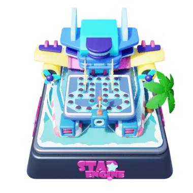
 
 
 星趴·梦想号 擒鬼先擒王！ 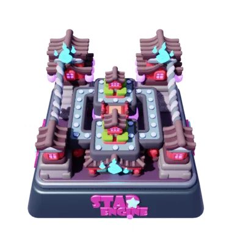
 
 
 御魂庆典 爆竹可是驱邪的好东西！ 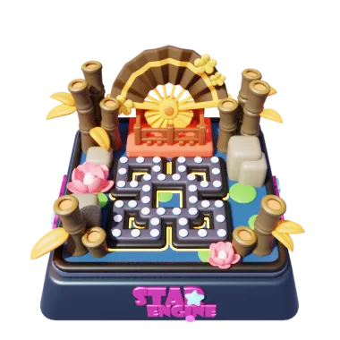
 
 
 水乡古镇 古老的魔法学院发生了冲突！但地点竟是学院食堂？ 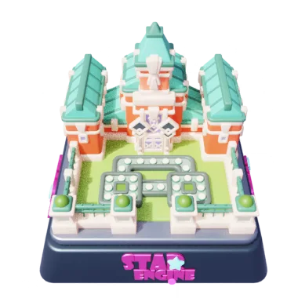
 
 
 魔法学院 龙宫里有什么神奇的宝贝呢！？ 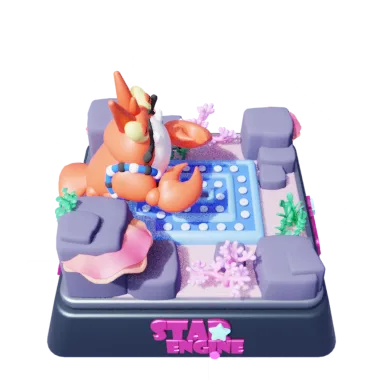
 
 
 龙宫游乐园 后街的巷子里正在举办一场疯狂的演唱会，与会者竟然...？? 
 
 
 幽魂暗巷 隆兴饭店的中庭，连廊和拱桥组成了一个精致的庭院。 
 
 
 园林中庭 限时（2026-06-25~09-02） 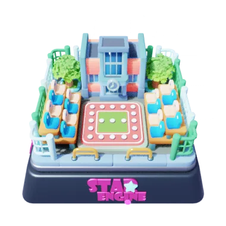
 
 
 海选赛运动场 限时（2026-06-25~09-02） 
 
 
 淘汰赛运动场 限时（2026-06-25~09-02） 
 
 
 决赛大赛场 限时（2026-09-03~10-14） 
 
 
 异变图书馆 金色的幻境森林中隐藏着什么样的秘密？ 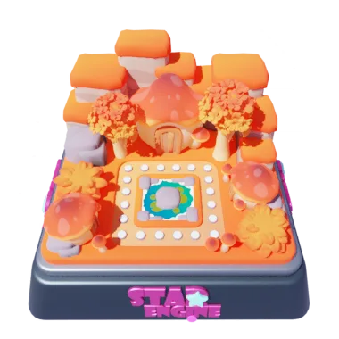
 
 
 森秋幻境

## 地图选项(标准对战模式)

运用自己的计谋，以及亿点点运气的来取得胜利吧！ 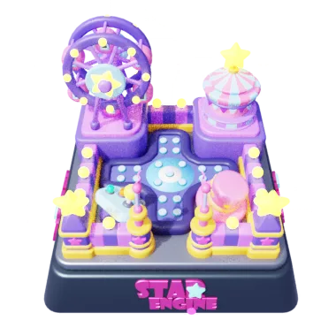
 
 
 游乐园 团子千奇百怪，内圈战火连天。 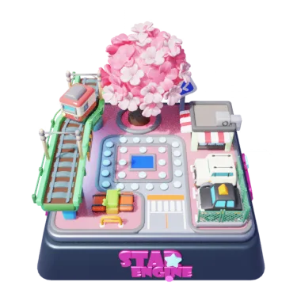
 
 
 樱花小镇 请注意来往车辆！ 
 
 
 十字路口站 小偷出没，请看好你的钱袋子！ 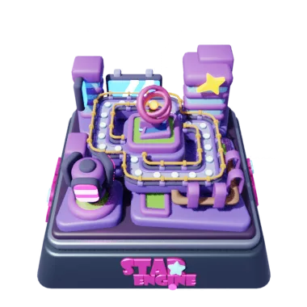
 
 
 魅影都市 限时（每年圣诞节前后复刻） 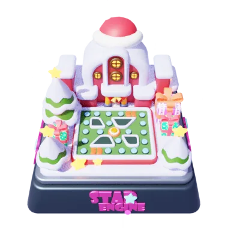
 
 
 礼物广场 高回报伴随着高风险！小心断桥！ 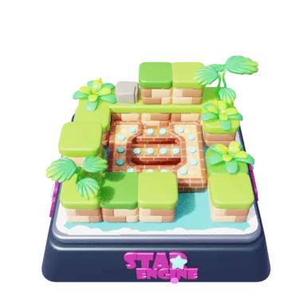
 
 
 丛林冒险

## 游戏机制(合作挑战模式)

玩家合作，攻克难关！

- 游玩地图
  - 星趴·梦想号（p1217.md）
  - 御魂庆典（p1216.md）
  - 水乡古镇（p646.md）
  - 魔法学院（p645.md）
  - 龙宫游乐园（p3537.md）
  - 幽魂暗巷（p3821.md）
  - 园林中庭（p4817.md）
  - 海选赛运动场（p6059.md）（限时）
  - 淘汰赛运动场（p6066.md）（限时）
  - 决赛大赛场（p6060.md）（限时）
  - 异变图书馆（p7133.md）（限时）
  - 森秋幻境（p9505.md）
- 思考时间
  - 短
  - 中
  - 长
- 难度
  - 普通
  - 困难
  - 噩梦
  - 疯狂
  - 极限（限时）
- 房间标签
  - 无标签
  - 完成任务
  - 快速通关
  - 新手局
  - 高端局
- 是否跳过剧情（仅龙宫游乐园与园林中庭）
  - 不跳过
  - 跳过

## 游戏机制(标准对战模式)

玩家对抗，争取胜利！

- 游玩地图
  - 游乐园（p4003.md）
  - 樱花小镇（p4017.md）
  - 十字路口站（p4052.md）
  - 魅影都市（p4023.md）
  - 丛林冒险（p4022.md）
- 思考时间
  - 短
  - 中
  - 长
- 升级所需星币
  - 15/30/50
  - 20/40/60
  - 20/40/70
- 房间标签
  - 无标签
  - 新手局
  - 高端局

## 单人模式

- 基础挑战
  - 挑战1——海盗王嘎呜
  - 挑战2——浣熊
  - 挑战3——对抗训练
- 练习模式
- 吉星小镇
  - 建造属于你的小镇！
