# 星趴·梦想号
> 分类：地图
> 来源：https://wiki.biligame.com/starengine/%E6%98%9F%E8%B6%B4%C2%B7%E6%A2%A6%E6%83%B3%E5%8F%B7

## 地图背景

梦想号是由恩菲尔德家族旗下的海运公司‘红沙’运营的巨型豪华双体游轮，是该级别中的首艘双体游轮。从绿洲市的‘拉卡拉港’起航，需5天抵达联合城的‘南风峡湾’。途中将经过几个特色鲜明的岛屿，是热门的旅游线路。

## 地图事件

普通
困难
噩梦
疯狂
极限

| 图像 | 名称 | 描述 | 触发条件 | 备注 |
| --- | --- | --- | --- | --- |
|  | 大逃鲨 | 刷新4个海盗鲨鱼 | 进度达到1 | 该地图事件触发后，会在地图上随机4个坐标处刷新4个海盗鲨鱼（p3533.md） |
| 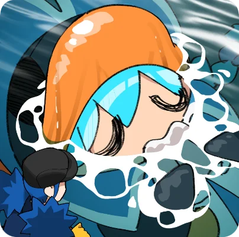 | 休眠终止 | 海盗王嘎呜登场 | 进度达到3 | 该地图事件触发后，会在地图坐标F1处刷新海盗王嘎呜（p3536.md） |
|  | 鲨手降临 | 刷新2个海盗精锐 | 进度达到6 | 该地图事件触发后，会在地图上随机2个坐标处刷新2个海盗精锐（p3534.md） |
| 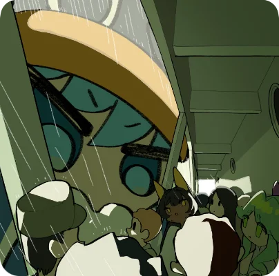 | 恐怖追击 | 海盗王嘎呜开始行动，随机追击角色 | 进度达到11 | 该地图事件触发后，海盗王嘎呜（p3536.md）开始行动 |

| 图像 | 名称 | 描述 | 触发条件 | 备注 |
| --- | --- | --- | --- | --- |
|  | 大逃鲨 | 刷新4个海盗鲨鱼 | 进度达到1 | 该地图事件触发后，会在地图上随机4个坐标处刷新4个海盗鲨鱼（p3533.md） |
|  | 休眠终止 | 海盗王嘎呜登场 | 进度达到3 | 该地图事件触发后，会在地图坐标F1处刷新海盗王嘎呜（p3536.md） |
|  | 鲨手降临 | 刷新2个海盗精锐。所有怪物攻击力+1，防御力+1 | 进度达到6 | 该地图事件触发后，会在地图上随机2个坐标处刷新2个海盗精锐（p3534.md） |
|  | 恐怖追击 | 海盗王嘎呜开始行动，随机追击角色 | 进度达到11 | 该地图事件触发后，海盗王嘎呜（p3536.md）开始行动 |

| 图像 | 名称 | 描述 | 触发条件 | 备注 |
| --- | --- | --- | --- | --- |
|  | 大逃鲨 | 刷新4个海盗鲨鱼 | 进度达到1 | 该地图事件触发后，会在地图上随机4个坐标处刷新4个海盗鲨鱼（p3533.md） |
|  | 休眠终止 | 海盗王嘎呜登场 | 进度达到3 | 该地图事件触发后，会在地图坐标F1处刷新海盗王嘎呜（p3536.md） |
|  | 鲨手降临 | 刷新2个海盗精锐。所有怪物攻击力+1，防御力+1 | 进度达到5 | 该地图事件触发后，会在地图上随机2个坐标处刷新2个海盗精锐（p3534.md） |
|  | 恐怖追击 | 海盗王嘎呜开始行动。所有怪物攻击力+1 | 进度达到9 | 该地图事件触发后，海盗王嘎呜（p3536.md）开始行动 |
|  | 鲨鱼反攻 | 刷新4个海盗鲨鱼。所有怪物防御力+1 | 进度达到13 | 该地图事件触发后，会在地图上随机4个坐标处刷新4个海盗鲨鱼（p3533.md） |

| 图像 | 名称 | 描述 | 触发条件 | 备注 |
| --- | --- | --- | --- | --- |
|  | 大逃鲨 | 刷新4个海盗鲨鱼 | 进度达到1 | 该地图事件触发后，会在地图上随机4个坐标处刷新4个海盗鲨鱼（p3533.md） |
|  | 休眠终止 | 海盗王嘎呜登场 | 进度达到3 | 该地图事件触发后，会在地图坐标F1处刷新海盗王嘎呜（p3536.md） |
|  | 鲨手降临 | 刷新2个海盗精锐。所有怪物攻击力+1，防御力+1 | 进度达到5 | 该地图事件触发后，会在地图上随机2个坐标处刷新2个海盗精锐（p3534.md） |
| 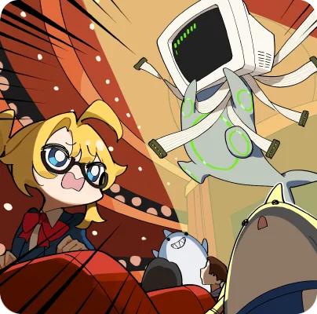 | 智械冲击 | 刷新1个智械海盗鲨，1个智械海王鲨 | 进度达到8且当前畸变组件包含危机四伏 | 该地图事件触发后，会在地图坐标A9处刷新1个智械海王鲨（p5778.md），并在地图坐标K9处刷新1个智械海盗鲨（p5777.md） |
| 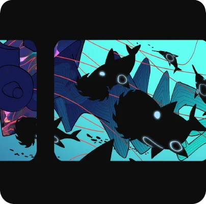 | 智械协同 | 刷新1个智械海盗鲨，1个智械中枢 | 进度达到8且当前畸变组件包含机械回归或精神混乱 | 该地图事件触发后，会在地图坐标A9处刷新1个智械海盗鲨（p5777.md），并在地图坐标K9处刷新1个智械中枢（p5779.md） |
|  | 恐怖追击 | 海盗王嘎呜开始行动。所有怪物攻击力+1 | 进度达到9 | 该地图事件触发后，海盗王嘎呜（p3536.md）开始行动 |
|  | 鲨鱼反攻 | 刷新2个海盗精锐，1个海王鲨。所有怪物攻击力+1，防御力+2 | 进度达到13 | 该地图事件触发后，会在地图上随机3个坐标处刷新2个海盗精锐（p3534.md）和1个海王鲨（p3535.md） |

| 图像 | 名称 | 描述 | 触发条件 | 备注 |
| --- | --- | --- | --- | --- |
|  | 大逃鲨 | 刷新1个海王鲨，4个海盗鲨鱼 | 进度达到1 | 该地图事件触发后，会在地图上随机5个坐标处刷新4个海盗鲨鱼（p3533.md）和1个海王鲨（p3535.md） |
|  | 休眠终止 | 海盗王嘎呜登场 | 进度达到3 | 该地图事件触发后，会在地图坐标F1处刷新海盗王嘎呜（p3536.md） |
|  | 鲨手降临 | 刷新2个海盗精锐。所有怪物攻击力+1，防御力+1 | 进度达到5 | 该地图事件触发后，会在地图上随机2个坐标处刷新2个海盗精锐（p3534.md） |
|  | 智械冲击 | 刷新1个智械海盗鲨，1个智械海王鲨 | 进度达到8且当前畸变组件包含危机四伏 | 该地图事件触发后，会在地图坐标A9处刷新1个智械海王鲨（p5778.md），并在地图坐标K9处刷新1个智械海盗鲨（p5777.md） |
|  | 智械协同 | 刷新1个智械海盗鲨，1个智械中枢 | 进度达到8且当前畸变组件包含机械回归或精神混乱 | 该地图事件触发后，会在地图坐标A9处刷新1个智械海盗鲨（p5777.md），并在地图坐标K9处刷新1个智械中枢（p5779.md） |
|  | 恐怖追击 | 海盗王嘎呜开始行动。所有怪物攻击力+1 | 进度达到9 | 该地图事件触发后，海盗王嘎呜（p3536.md）开始行动 |
|  | 鲨鱼反攻 | 刷新2个海盗精锐，1个海王鲨。所有怪物攻击力+1，防御力+2 | 进度达到13 | 该地图事件触发后，会在地图上随机3个坐标处刷新2个海盗精锐（p3534.md）和1个海王鲨（p3535.md） |

### 怪物属性

|  |  |
| --- | --- |
|  | 0

 0

 6

 0

 0

 6

 0

 0

 6

 0

 0

 6

 0

 0

 6 |
|  | 4

 1

 9

 4

 1

 10

 4

 1

 10

 4

 1

 10

 4

 1

 11 |
|  | 5

 6

 88

 6

 6

 99

 6

 6

 111

 7

 6

 122

 7

 6

 155 |
| 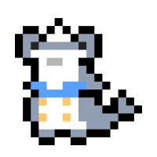 | 4

 2

 25

 4

 2

 30

 4

 2

 33

 4

 2

 33

 4

 2

 35 |
|  | 3

 0

 18

 4

 0

 18

 4

 1

 20

 5

 2

 22

 6

 2

 44 |
|  | 4

 1

 11

 4

 1

 12 |
|  | 4

 2

 22

 5

 3

 26 |
| 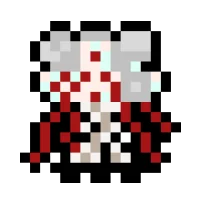 | 1

 1

 16

 1

 1

 18 |
|  | 0

 0

 4

 0

 0

 4 |

### 行动顺序

行动顺序 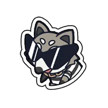小偷 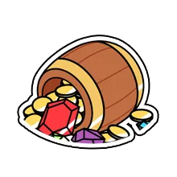宝藏桶 1号海王鲨 1号、2号海盗精锐 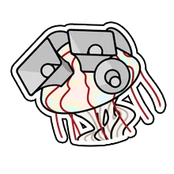智械中枢 2号海王鲨 3号、4号海盗精锐 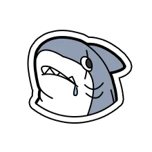海盗鲨鱼 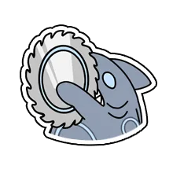智械海盗鲨 海盗王嘎呜 召唤的海盗鲨鱼 召唤的智械海盗鲨

## 地图专属筹码

大铁锚
受到伤害时，攻击力+1。回合开始时，失去1点攻击加成。 梦想号模型
移动速度+2，每有15点累计移动点数，主动技能冷却时间-1。 三叉戟
使用主动技能时，使一名未被强化的友方角色攻击力+1，防御力+1。

## 畸变组件

 精神混乱 -------
 如果玩家在本轮内没有发送短语或表情，则本轮结束时受到随机惩罚 地图事件加入：智械协同 怪物池加入怪物：智械海盗鲨 
 机械回归 -------
 非首领怪物被击倒后，20%原地刷新一个智械海盗鲨 地图事件加入：智械协同 怪物池加入怪物：智械海盗鲨 
 危机四伏 -------
 所有恢复地块转变为天降横祸地块 停留在天降横祸地块后，随机位置刷新1个智械海盗鲨 地图事件加入：智械冲击 
 能量紊乱 -------
 角色回合开始时，其战斗卡牌的费用随机变为0-4 
 百战精锐 -------
 首领与精英怪物的生命值上限-20% 首领与精英怪物受到伤害后，本轮受到伤害-1，攻击力+1（无法叠加） 
 狂风 -------
 角色与怪物的移动速度+2。如果角色或怪物移动的最终移动点数大于10，其主动技能冷却时间-1 
 暴雨 -------
 使用效果牌时，受到1点伤害，本回合攻击力+1 
 神秘宝藏 -------
 游戏开始时随机刷新1个宝藏桶，之后每隔5轮，随机刷新1个新的宝藏桶 宝藏桶每次最多受到1点伤害，击倒它的角色获得1个随机筹码 
 灵光一闪 -------
 获得卡牌时，33%复制该卡牌并加入手牌（每回合最多触发3次） 
 敏捷 -------
 角色闪避成功后，获得1层反击 
 过载模式 -------
 角色与怪物获得主动技能冷却缩减1，使用主动技能后本轮防御力-1 角色出牌数+1，一回合最多使用3张效果牌 
 打劫 -------
 游戏开始时，所有角色额外获得6星币，进度+1 筹码商店的价格不会上涨 
 雷云 -------
 地图随机2个区域出现雷云，角色在雷云中停留受到2点伤害，智械怪物在雷云中停留恢复3点生命值 
 晕船 -------
 如果角色移动的最终点数大于8，则回合结束时在所在的地块放置【谜之物体】 
 海盗王的号令 -------
 首领与精英怪物的攻击力+1、防御力+1 首领怪物使用主动技能后，恢复所有怪物3点生命值

## 地图特殊效果/状态

 丨 海王祝福 丨 攻击力+1，防御力+1。  丨 三叉戟 丨 攻击力+1，防御力+1。

## 地图

任务 击败海盗鲨鱼0\4 所有玩家获得 强化筹码*1 击败海盗精锐0\2 所有玩家获得 强化筹码*1,海盗嘎呜失去6点防御力 击败海盗鲨鱼0\9 所有玩家获得 强化筹码*1,进度-1

大逃鲨
大逃鲨 刷新4个海盗鲨鱼 2

休眠终止
休眠终止 海盗王嘎呜登场 45

鲨手降临
鲨手降临 刷新2个鲨鱼精锐 78910

恐怖追击
恐怖追击 海盗王嘎呜开始行动，随机追击角色 1213141516171819 地块统计
 
 
 
 
 
 A8=疾行
A9=卡牌奖励
A10=全员事件

B7=天降横祸
B9=怪物
B11=传送门

C3=恢复
C4=天降横财
C5=起始点3
C6=怪物
C9=商店
C11=天降横财

D2=传送门
D9=全员事件
D12=恢复

E1=全员事件
E2=天降横祸
E3=怪物突击门
E4=卡牌奖励
E5=起始点2
E6=疾行
E7=全员事件
E8=怪物
E9=怪物突击门
E10=天降横祸
E13=怪物

F1=筹码商店
F11=商店
F12=天降横财
F13=保障点

G1=全员事件
G2=天降横祸
G3=怪物突击门
G4=卡牌奖励
G5=起始点1
G6=疾行
G7=全员事件
G8=怪物
G9=怪物突击门
G10=天降横祸
G13=怪物

H2=传送门
H9=全员事件
H12=恢复

I3=恢复
I4=天降横财
I5=起始点4
I6=怪物
I9=商店
I11=天降横财

J7=天降横祸
J9=怪物
J11=传送门

K8=疾行
K9=卡牌奖励
K10=全员事件
 #fe1fee=A9->A10,F13->G13,K9->K8,G2->G1,E2->D2,E9->E8,G9->G10,F11->F12
#00f1f9=A9->A8,F13->E13,K9->K10,G2->H2,E2->E1,E9->E10,G9->G8,F11->G10
 起始点1=90
起始点2=90
起始点3=90
起始点4=90
 11
 13
 F1=普通~极限:休眠终止>1004
A9=疯狂~极限:智械冲击>1057,疯狂~极限:智械协同>1056
K9=疯狂~极限:智械冲击>1056,疯狂~极限:智械协同>1058

### 2024年08月16日

不同于当前的PVP房间机制，【合作挑战】是一个由4名玩家组队在全新地图【星趴·梦想号】中通过策略击倒怪物获取资源并强化自身，通力合作来击败BOSS赢得整局游戏的胜利的一个全新玩法模式。 
█ 新增 
◆ 地图【星趴·梦想号】试玩版。 
◆ 怪物 [ 海盗鲨鱼 ]、[ 海盗精锐 ]、[ 海盗王嘎鸣 ] 
█ 关键机制 
◆ 玩家需要在进度条走满前击败BOSS（海盗王嘎呜）以赢得胜利，对局中将会有部分事件触发进度条的增加或者减少，每次玩家被怪物击倒也会增加进度条，玩家需要在对局中控制自己的生命值以避免进度条的推进过快。 
◆ 地图中会按照规则刷新BOSS及各种怪物，怪物不受事件、地块格、陷阱的影响，击败它们可以获得各种强化筹码、金币等奖励，利用这些奖励提升角色属性去挑战BOSS（海盗王嘎呜）赢得胜利。 
◆ 在【合作挑战】模式内，升级的条件与PVP相同，但是升级后会扣除本次升级所需星币，并获得强化筹码奖励，需要注意的是角色被击倒后，身上的星币将不再掉落或转移。 
◆ 强化筹码可提供强力的属性或效果，是PVE局内成长的重要途径。利用好这些强力的加成搭配好相应的策略即可通过各种挑战赢得胜利。

### 2024年08月30日

█ 新增 
◆ 【星趴·梦想号】正式开放！

### 2025年01月24日

█ 数值变动 
◆ 平衡了梦想号、御魂庆典的怪物数值和地图事件等。 
◆ 具体变动难以考据

### 2025年03月21日

█ 数值变动 
◆ 星趴·梦想号 [ 略微下调了普通&困难难度下的各怪物数值 ] 
◆ 御魂庆典 [ 略微下调了噩梦难度下刀剑灵体的数值 ] 
◆ 水乡古镇 [ 略微下调了噩梦难度下各怪物的数值 ] 
◆ 具体变动难以考据

### 2025年06月06日

这里是梦想号，紧急呼叫！重复，紧急呼叫！ 
█ 新增 
◆ 难度 [ 疯狂 ]、[ 极限 ] ;其中[ 疯狂 ]难度为常驻，[ 极限 ]难度限时开启：2025/06/06~2025/07/04。 
◆ 怪物 [ 海王鲨(精英) ] 
◆ 筹码 [ 大铁锚 ]、[ 梦想号模型 ]、[ 三叉戟 ] 
 █ 数值变动 
◆ 调整了星趴·梦想号的事件进度，并增加了新的筹码任务。 
◆ 降低了各难度下海盗王嘎呜的攻击与防御，下调了海盗精锐携带的星币。

### 2025年10月31日

█ 新增 
◆ 通用事件 [ 取长补短 ] 
◆ 通用筹码 [ 优雅之羽 ]、[ 探天卫星 ] 
 █ 数值变动 
◆ 调整了通用筹码 [ 会员推荐信 ] 稀有度，由紫色调整为蓝色，并修改描述由“轮次奖励卡牌数量 +2”，调整为“轮次奖励卡牌数量 +1”。

### 2025年11月21日

█ 数值变动 
◆ 怪物 [海盗精锐] 普通模式下 
4220 调整为 
4225↑ 、困难模式下 
4227 调整为 
4230↑ 。 
◆ 怪物 [海王鲨] 普通模式下 
3018 、困难模式下 
4018 、噩梦模式下 
4120 这三个模式下都不刷海王鲨，这数值一开始就存在？
