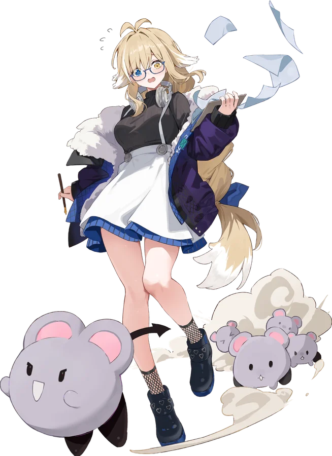
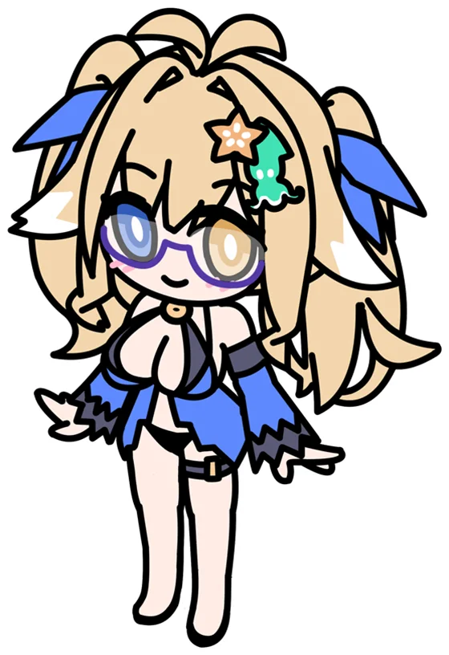
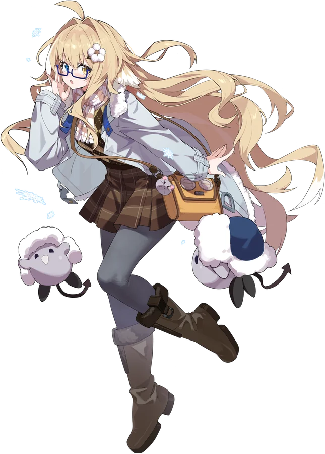
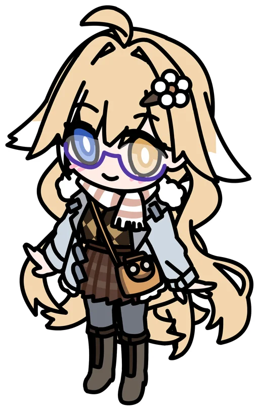
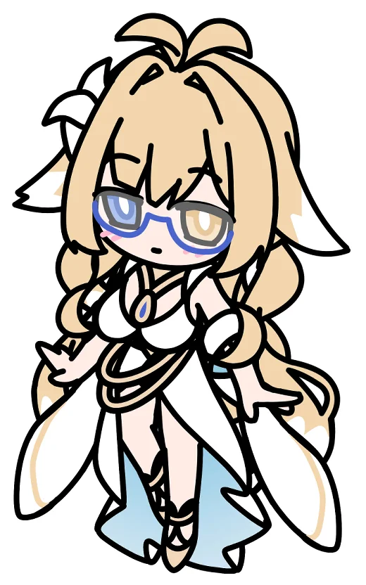

# 凛（新人调查员）
> 分类：角色 · 编号 121 · 时期 第三期 · 女
> 来源：https://wiki.biligame.com/starengine/%E5%87%9B

米泽家的大小姐。按理说应该是三神教的护法之一，但是忍受不了那些繁文缛节让大哥给安排了一出“离家出走”。现任职于“联合城异常调查处(UAID)”，职位是初级调查员。但因为笨手笨脚常常被上司训斥。

## 战斗数值

| 攻击 | 防御 | 生命 |
| --- | --- | --- |
| 1 | 1 | 9 |

## 技能

### 主动技能：活体书页（冷却 3）

获得1张活体书页；效果牌射程+3，持续1回合。

### 被动技能：调查发现

事件触发后，获得1张活体书页。

**PVE**：事件触发后，获得1张活体书页。每次使用活体书页后，活体书页伤害永久+1。

## 基础资料

- 姓名：克利西亚·米泽·凛
- 英文名：Rin
- 日文名：リン
- 从属组织：米泽家族,联合城异常调查处(UAID)
- 上线时间：202505091730
- 生日：5月25日
- 喜欢食物：巧克力饼干
- 初始骰子：文件夹骰子
- 礼物：普通的饮料、新款平板电脑、水手服
- 徽章：阳炎、阴影

## PVE 特性

- 达到1星时立刻获得10星币
- 初始星币+6
- 达到3星时攻击力+1、防御力+1、移动速度+1

## 皮肤（共 5 套）

> 皮肤编号取自素材文件名；「默认」「羁绊皮肤」也是独立皮肤。

### 1. 默认（初始）

- 素材编号：121
- 立绘：
- 立绘（和谐版）：
- Q版立绘：
- 头像：
- Q版头像：
- 半身像（星币<20）：
- 半身像（星币≥20）：

### 2. 羁绊皮肤（羁绊解锁）

- 素材编号：121_Max
- 立绘：
- 立绘（和谐版）：
- Q版立绘：
- 头像：
- Q版头像：
- 半身像（星币<20）：
- 半身像（星币≥20）：

### 3. 海湾假日（蓝品质）

- 素材编号：121_01
- 立绘：
- 立绘（和谐版）：
- Q版立绘：
- 头像：
- Q版头像：
- 半身像（星币<20）：
- 半身像（星币≥20）：

**皮肤故事**：凛自从“离家出走”以后，就很少出现在调查处、出租屋和雅央家以外的地方。

难得调查处组织了旅游，凛经过一番激烈的思想斗争，还是随着同事一同前往。

这也是出于交际的考虑，毕竟总不能一直什么公共活动都不参加，这样显得她很不合群。

不过别看凛弱气的外表，运动能力意外地不错，下水游泳或海里冲浪都不在话下。

但是很不凑巧，最近的疲劳使她这次更倾向于海边散步，而冲浪却成为了“交际”的一环。

“海边散散步、帮同事们烧烤，也挺好的，不是吗？”

### 4. 冬日暖意（紫品质）

- 素材编号：121_02
- 立绘：
- Q版立绘：
- 头像：
- Q版头像：
- 半身像（星币<20）：
- 半身像（星币≥20）：

**皮肤故事**：对于凛而言，每年的年末她都有一项重要的任务。

坐在沙发上换衣服的凛拨通了电话。

“起床没，等下去老地方买蛋糕，你要吃什么口味的？”

“呃，它那里有薯片味道的吗？”雅央很认真地问道。

“那我给你带个榴莲味的好了。”凛并没有接雅央的话茬。

“唉别别别！你还是给我带个芝士蓝莓的吧…”

“那晚上想吃点啥，美咲被御主大人临时叫走了，可能晚饭才能来了，她说她想吃咖喱。你呢？”

“那我也咖喱吧，哦不要放洋葱！”

“嗯，知道了，那我买完东西再去你家，等会见。”凛正准备挂断电话。

“每年都要你们来陪我，真不好意思哈。”雅央突然说了这么一句话。

凛愣了一下，她和雅央从小到大玩了这么长时间，她今天是怎么了？

“啊！那个啥！今天外面还怪冷的！你多穿点！还有叫美咲也多穿点别着凉感冒给我传染了！那就这样！”雅央挂断了电话。

凛回过神来后，掏出了她最暖和的衣服，里面甚至还有一条雅央去年送她和美咲的围巾。

“真是个笨蛋。”凛边笑边走出了家门。

### 5. 永恒圣火（彩品质）

- 素材编号：121_03
- 立绘：
- 立绘（和谐版）：
- Q版立绘：
- 头像：
- Q版头像：
- 半身像（星币<20）：
- 半身像（星币≥20）：

**皮肤故事**：“科长，这样吗？”凛对着镜头毫不紧张，她已经完全习惯了调查科的“奇怪”任务。

“这东西就对你有反应，之前都像根擀面棍一样，只有你才行，抱歉！”异常调查科的科长隔着厚厚的玻璃窗，双手合十摆出了“对不起”的姿势。

“没什么啦，我平时都不怎么出现场，这种活动大家能信任我也是对我的肯定啊。”凛并没有觉得科长他们对不起自己，反而觉得科长和科员们应该给自己更多的活儿干，而不是在大后方摆弄这些“异常”。

“你要知道，虽然是你大哥推荐你来这里的，但若没有真本事，怎么可能留你呢？”科长一边说道，一边指挥旁边的人拍下照片。

“你能和很多‘异常’产生共鸣，并且很好地解析这些东西，这才是你对我们最大的帮助。不是每个人都要去现场才能发挥作用，我们从没把你当‘走后门’的人，因为你对我们来说是必须的。”

凛没有说话，只是默默地按照摄影的要求摆出下一个姿势。

是啊，一向腼腆的凛因为各种原因，靠着和大哥的“演戏”逃离了家里的高压环境，而异常调查科的同事们则接受了她。她现在觉得已经很开心了，至少不是为了“某件事”活着。

凛清理了一下思绪，摆出了下一个动作。

“那今天这个摄影是干什么的呢？归档吗？”凛好奇地问道，因为这种奇怪的任务一般都有它的“目的”。

“嗯，下周要举行大型运动会，别的部门要点宣传海报。”科长平淡地说道。

“哦，宣传海报啊？懂了。”凛下意识地回复道。

“啊？宣传海报？不是为了归档？”凛突然反应过来，好像有什么不对。

“嗯？秘书没告诉你吗？没你想的那么复杂，只是大家都觉得你可以和这东西共鸣，形象又……算了！弄完我请大家去喝两杯！”科长赶快岔开了话题。

听到接下来收工后科长请客，大家都欢呼起来。凛此时只想把刚才的感动收回来，不过，这也算是自己当下生活的一环吧。

## 表情（共 15 个）

| # | 名称 | 品质 | 获取方式 | 图片 |
| --- | --- | --- | --- | --- |
| 1 | 表情1 |  |  |  |
| 2 | 表情2 |  |  |  |
| 3 | 表情3 |  |  |  |
| 4 | 表情4 |  |  |  |
| 5 | 表情5 |  |  |  |
| 6 | 表情6 |  |  |  |
| 7 | 表情7 |  |  |  |
| 8 | 表情8 |  |  |  |
| 9 | 表情9 |  |  |  |
| 10 | 表情10 |  |  |  |
| 11 | 表情11 |  |  |  |
| 12 | 表情12 |  |  |  |
| 13 | 表情13 |  |  |  |
| 14 | 表情14 |  |  |  |
| 15 | 表情15 |  |  |  |

## 装扮

官方 wiki 未提供该角色的 /获取 页，头像、名片、卡牌、骰子清单暂缺。

## 人物传记

时常因为工作郁闷会去雅央那里过周末，做得一手连雅央和美咲都赞不绝口的料理。

## 画廊其他素材

- 起始点：
- 像素头像：
- Lv4羁绊等级奖励：
- Lv5羁绊等级奖励：
- 缔结契约名片奖励：
- 海湾假日皮肤名片：
- 冬日暖意皮肤名片：
- 永恒圣火皮肤名片：
