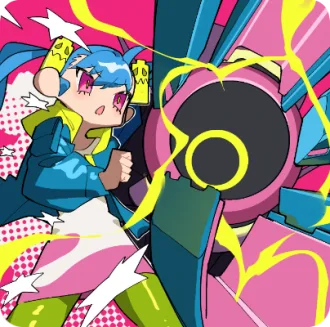

# 全力攻击
> 分类：卡牌/手牌
> 编号：10010
> 类型：Attack
> 来源：https://wiki.biligame.com/starengine/%E5%85%A8%E5%8A%9B%E6%94%BB%E5%87%BB

## 卡牌效果

合作挑战（PVE）：攻击力+6，本次攻击的最终攻击力+50%

## 资料

- **编号**：10010
- **类型**：Attack
- **英文名**：Powerful Attack
- **来源**：基础卡牌

## 详解

注意：全力攻击仅在合作挑战模式出现。

玩家在单次战斗中如若使用两张全力攻击，那么第二张全力攻击仅会增加攻击力，不会触发最终攻击力+50%的效果。即：

<math>最终攻击力 = \lceil(\operatorname{random}(1, 6)+\operatorname{random}(攻击力下限, 攻击力上限)) * 1.5\rceil</math>

玩家使用蓄力后，会添加一张全力攻击到手牌中，关于卡牌蓄力的相关信息，请查阅对应页面。

## 花絮

*全力攻击卡面中心的角色具体如下：
**梅加斯。

## 历史

*2026年2月6日
**对文本进行了标准化。
*2024年11月29日
**引入游戏。

## 图片

