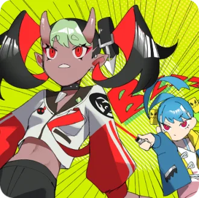

# 激光
> 分类：卡牌/手牌
> 编号：20001
> 类型：Effect
> 来源：https://wiki.biligame.com/starengine/%E6%BF%80%E5%85%89

## 卡牌效果

标准对战（PVP）：指定6格内的敌方角色，造成3点伤害

## 资料

- **编号**：20001
- **类型**：Effect
- **对象**：Entity
- **英文名**：Laser Beam
- **来源**：基础卡牌
- **附录**：CARD-007 / 激光笔？呲一下…

## 详解

注意：激光仅在标准对战模式出现，不要与合作挑战模式的专属卡牌对怪激光混淆。

该卡牌指定的对象为“敌方角色”，因此无法对地图中的小浣熊使用，因为小浣熊属于怪物。

## 花絮

*激光卡面上的卡牌编号与附录内容目前在游戏内已不可见。
*激光卡面中心的角色具体如下：
**帕帕拉(前)。
**梅加斯(后)。
*激光异画卡面中心的角色具体如下：
**南希露。

## 历史

*2026年2月6日
**对文本进行了标准化。
*2025年7月4日
**移除了卡面上的卡牌编号与附录。
*2024年2月29日
**引入游戏。

## 图片

