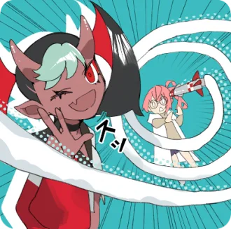

# 错误的目标
> 分类：卡牌/手牌
> 编号：20017
> 类型：Counter
> 来源：https://wiki.biligame.com/starengine/%E9%94%99%E8%AF%AF%E7%9A%84%E7%9B%AE%E6%A0%87

## 卡牌效果

标准对战（PVP）：被效果牌指定时可以使用，将效果随机转移给其他敌对角色

## 资料

- **编号**：20017
- **类型**：Counter
- **英文名**：Random Select
- **来源**：基础卡牌
- **附录**：CARD-024 / 你找打你的人去啊！

## 详解

注意：错误的目标仅在标准对战模式出现。

## 花絮

*错误的目标卡面上的卡牌编号与附录内容目前在游戏内已不可见。
*错误的目标卡面中心的角色具体如下：
**帕帕拉(左)。
**露佳(右)。

## 历史

*2026年2月6日
**对文本进行了标准化。
*2025年7月4日
**移除了卡面上的卡牌编号与附录。
*2024年2月29日
**引入游戏。

## 图片

