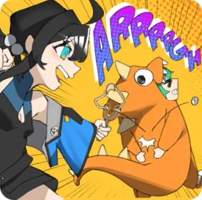

# 皮筋弹弓
> 分类：卡牌/手牌
> 编号：20012
> 类型：Effect
> 来源：https://wiki.biligame.com/starengine/%E7%9A%AE%E7%AD%8B%E5%BC%B9%E5%BC%93

## 卡牌效果

标准对战（PVP）：指定10格内的敌方角色，造成2点伤害

## 资料

- **编号**：20012
- **类型**：Effect
- **对象**：Entity
- **英文名**：Slingshot
- **来源**：基础卡牌
- **附录**：CARD-008 / 打你家玻璃

## 详解

注意：皮筋弹弓仅在标准对战模式出现。

该卡牌指定的对象为“敌方角色”，因此无法对地图中的小浣熊使用，因为小浣熊属于怪物。

## 花絮

*皮筋弹弓卡面上的卡牌编号与附录内容目前在游戏内已不可见。
*皮筋弹弓卡面中心的角色具体如下：
**姬梦朝(左)。

## 历史

*2026年2月6日
**对文本进行了标准化。
*2025年7月4日
**移除了卡面上的卡牌编号与附录。
*2024年2月29日
**引入游戏。

## 图片

