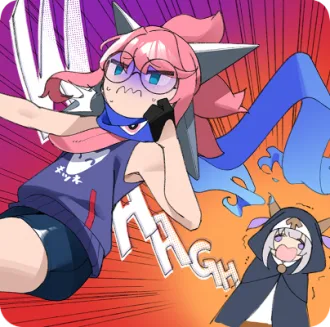

# 丧心病狂
> 分类：卡牌/手牌
> 编号：20020
> 类型：Effect
> 来源：https://wiki.biligame.com/starengine/%E4%B8%A7%E5%BF%83%E7%97%85%E7%8B%82

## 卡牌效果

标准对战（PVP）：自身攻击力+5，持续1次攻击
下次战斗时敌方角色无法选择闪避，如果没有击倒敌方角色，则自己被击倒

## 资料

- **编号**：20020
- **类型**：Effect
- **对象**：none
- **英文名**：All or Nothing
- **来源**：基础卡牌
- **附录**：CARD-021 / 彻底-疯狂！

## 详解

注意：丧心病狂仅在标准对战模式出现。

## 花絮

*丧心病狂卡面上的卡牌编号与附录内容目前在游戏内已不可见。
*丧心病狂卡面中心的角色具体如下：
**小町(左)。
**阿兰娜(右)。

## 历史

*2026年2月6日
**对文本进行了标准化。
*2025年7月4日
**移除了卡面上的卡牌编号与附录。
*2024年2月29日
**引入游戏。

## 图片

