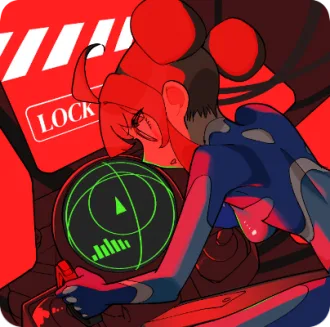

# 轨道炮
> 分类：卡牌/手牌
> 编号：21001
> 类型：Effect
> 来源：https://wiki.biligame.com/starengine/%E8%BD%A8%E9%81%93%E7%82%AE

## 卡牌效果

合作挑战（PVE）：指定5格内的一个怪物，造成6点伤害

## 资料

- **编号**：21001
- **类型**：Effect
- **对象**：Entity
- **英文名**：Railgun
- **来源**：基础卡牌
- **附录**：→↑↓↓→

## 花絮

*轨道炮卡面上的卡牌编号与附录内容目前在游戏内已不可见。

## 历史

*2026年2月6日
**对文本进行了标准化。
*2025年7月4日
**移除了卡面上的附录。
*2024年8月30日
**引入游戏。

## 图片

