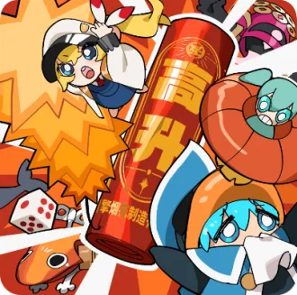

# 高升炮
> 分类：卡牌/手牌
> 编号：21009
> 类型：Effect
> 来源：https://wiki.biligame.com/starengine/%E9%AB%98%E5%8D%87%E7%82%AE

## 卡牌效果

合作挑战（PVE）：指定10格内的一个怪物，造成3点伤害，移除目标炒热气氛越战越勇且本轮目标无法反击

## 资料

- **编号**：21009
- **类型**：Effect
- **对象**：Entity
- **英文名**：Firecrackers
- **来源**：地图卡牌:水乡古镇

## 详解

注意：高升炮仅在合作挑战模式的地图水乡古镇中作为专属卡牌出现。

关于该卡牌的获取方式，请查阅对应页面。

## 花絮

*高升炮卡面中心的角色具体如下：
**芬妮。
**爆竹呱呱。
**长戟灵体。
**指挥平台。
**海盗王嘎呜。

## 历史

*2026年2月6日
**对文本进行了标准化。
*2025年1月24日
**引入游戏。

## 图片

