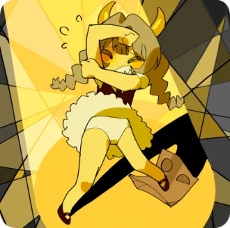

# 是他干的
> 分类：卡牌/手牌
> 编号：21010
> 类型：curse
> 来源：https://wiki.biligame.com/starengine/%E6%98%AF%E4%BB%96%E5%B9%B2%E7%9A%84

## 卡牌效果

合作挑战（PVE）：选择一个友方角色，造成1点伤害并施加【问题学生】，随后自身获得3星币。回合结束时如果本卡在手牌中，则自身受到1点伤害

## 资料

- **编号**：21010
- **类型**：curse
- **对象**：Entity
- **英文名**：It's His Fault!
- **来源**：地图卡牌:魔法学院

## 详解

注意：是他干的仅在合作挑战模式的地图魔法学院中作为专属卡牌出现。

现在玩家不能通过筹码魔法秘典或角色小町的被动技能复制该卡牌。（因为其技能只对效果牌生效）

但是吉尔·斯汀雷丢弃该卡牌时仍然可以触发“恢复1点生命值”的效果。（因为其技能有丢弃诅咒牌的效果描述）

## 花絮

*是他干的卡面中心的角色具体如下：
**阿兰娜。

## 历史

*2026年6月25日
**现在该卡牌对玩家只会造成1点伤害，而非先前的2点。
*2026年4月17日
**将卡牌类型由“效果牌”调整为“诅咒牌”。
*2026年2月6日
**对文本进行了标准化。
*2025年4月3日
**引入游戏。

## 图片

