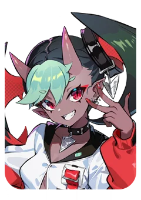
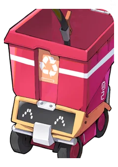
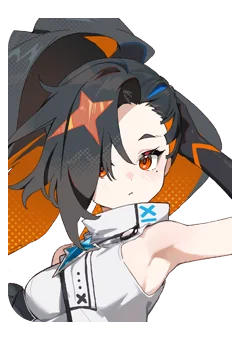
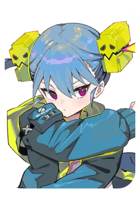

# 星趴角色图鉴
> 分类：图鉴
> 来源：https://wiki.biligame.com/starengine/%E6%98%9F%E8%B6%B4%E8%A7%92%E8%89%B2%E5%9B%BE%E9%89%B4

 商业之主（p565.md） 
 古怪神探（p567.md） 
 社恐修女（p569.md） 
 暗影忍者（p571.md） 
 社员叔叔（p574.md） 
 猩红辣妹（p576.md） 
 游戏大师（p578.md） 
 看板娘（p215.md） 
 垃圾箱（p580.md） 
 肉弹战车（p582.md） 小猎手（p4677.md） 
 史莱姆（p584.md） 
 旗袍娘（p586.md） 
 命运少女（p588.md） 
 太刀使（p590.md） 绿洲女王（p620.md） 
 家政机器人（p637.md） 暗区少主（p854.md） 
 午夜闪光（p638.md） 
 网络魅影（p639.md） 新人调查员（p1232.md） 
 机械超人（p640.md） 风水师（p865.md） 三神御主（p3530.md） 枪匠（p4165.md） 沼之蛟龙（p4358.md） 毒苹果（p4676.md） 怪力乱神（p5439.md） 魔渊幼体（p6236.md） 金鳞御使（p9817.md） 
 超天酱（p641.md） 
 糖糖（p642.md） 吉尔（p3829.md） 多萝西（p3818.md） 汉娜（p6987.md） 雪莉（p7032.md） 关系图例
 盟友
 家人
 朋友
 敌对
 从属
 

 
 
 
 📜 人物档案
 点击关系图中的节点查看详情
 
 
 
 🔍
 点击人物节点 查看详细信息
