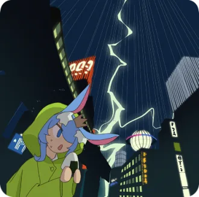

# 星趴卡牌图鉴/事件表
> 分类：图鉴
> 来源：https://wiki.biligame.com/starengine/%E6%98%9F%E8%B6%B4%E5%8D%A1%E7%89%8C%E5%9B%BE%E9%89%B4/%E4%BA%8B%E4%BB%B6%E8%A1%A8

| 事件 | 牌名 | 内容 | 说明 |
| --- | --- | --- | --- |
|  | 隐匿调查-阶段1
隐匿调查-阶段1 | 对邦妮6格内的非首领怪物施加1层标记。邦妮与事件触发者进入隐匿，持续1轮 |  |
|  | 隐匿调查
隐匿调查 | 对所有角色施加2层标记 |  |
|  | 隐匿调查-阶段2
隐匿调查-阶段2 | 对邦妮6格内的非首领怪物施加1层标记。邦妮与事件触发者获得1张战斗牌并进入隐匿，持续1轮 |  |
|  | 隐匿调查-阶段3
隐匿调查-阶段3 | 对非首领怪物施加1层标记。 邦妮与事件触发者获得1张战斗牌并进入隐匿，持续1轮 |  |
|  | 真相揭露
真相揭露 | 对首领施加2层标记。 所有角色获得1张战斗牌并进入隐匿，持续1轮 |  |
|  | 平均分配
平均分配 | 最高星币的角色和最低星币的角色均分资产 |  |
|  | 疾走
疾走 | 很急，所有角色下一次的移动骰出2个骰子 |  |
|  | 慷慨解囊
慷慨解囊 | 搞慈善，星币最多的角色失去5星币 |  |
|  | 服务器BUG
服务器BUG | 随机交换所有角色的位置 |  |
|  | 食品安全
食品安全 | 外卖有问题，所有角色立即受到1点伤害 
轮次开始时，受到1点伤害，持续3轮 |  |
|  | 全民刮彩
全民刮彩 | 所有人获得一次彩票选择机会 |  |
|  | 天使降临
天使降临 | 所有角色恢复2点生命值 |  |
|  | 天崩地裂
天崩地裂 | 噪音太大震耳欲聋，所有角色受到2点伤害 |  |
|  | 手牌抹×
手牌抹× | 所有角色丢弃1张手牌 |  |
|  | 玩家代表
玩家代表 | 你代表全体玩家骰点： 4~6你获得10星币，其他人获得5星币。 1~3你受到4伤害，其他人受到2伤害。 | 未实装 |
|  | 商店大酬宾
商店大酬宾 | 商店大活动，可购买卡牌+2 
持续3轮 |  |
|  | 拥挤通道
拥挤通道 | 假期游客暴涨，所有角色传送到彼此相连的随机的4个格子上 |  |
|  | 天降之物
天降之物 | 天上掉下礼物，所有角色获得3星币和1张卡牌 |  |
|  | 集中隔离
集中隔离 | 传染病爆发，所有角色传送到医院格 |  |
|  | 导电危机
导电危机 | 雷电警告，地图随机2个区域出现雷云
 轮次开始时，雷云会攻击范围内的所有角色，星币越多受到的伤害越高 |  |
|  | 雷区
雷区 | 所有角色脚底放置一个陷阱，停留的角色受到3点伤害 |  |
|  | 口袋漏了
口袋漏了 | 所有角色下次移动会掉落等同于移动步数的星币 |  |
|  | 战斗，爽！
战斗，爽！ | 所有角色获得1张牌：攻击(特大) |  |
|  | 人人平等
人人平等 | 所有角色生命值变为1点，下次受到伤害-10 |  |
|  | 手牌转移
手牌转移 | 获得上一行动顺位角色的手牌 |  |
|  | 雷暴将至
雷暴将至 | 进度+1，所有人获得1张卡牌 |  |
|  | 红温警告
红温警告 | 所有角色攻击力+5，持续1次攻击 | 所有角色攻击力+5，直到下次攻击后消失 |
|  | 小浣熊繁殖季
小浣熊繁殖季 | 随机地块生成2只小浣熊 |  |
|  | 海盗偷袭
海盗偷袭 | 随机地块生成2只鲨鱼海盗 |  |
|  | 天降神兵
天降神兵 | 进度-1 |  |
|  | 取长补短
取长补短 | 生命值最低的角色恢复4点生命值，生命值最高的角色受到4点伤害 |  |
|  | 失控的糖果皮纳塔
失控的糖果皮纳塔 | 随机地块生成1只糖果皮纳塔 |  |
