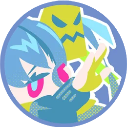

# 星趴卡牌图鉴/地块
> 分类：图鉴
> 来源：https://wiki.biligame.com/starengine/%E6%98%9F%E8%B6%B4%E5%8D%A1%E7%89%8C%E5%9B%BE%E9%89%B4/%E5%9C%B0%E5%9D%97

起始点帕露南停留在起始点回复2点生命，星币达标自动获得一星星 起始点芬妮 起始点阿兰娜 起始点小町 起始点派德曼 起始点帕帕拉 起始点恋 起始点米米 起始点Z3000 起始点潘大猛 起始点璐璐 起始点姬梦枫 起始点蓝海晴 起始点美咲 起始点娜蒂斯 起始点茉莉 起始点阿尔 起始点星魅琉华 起始点南希露 起始点凛 起始点梅加斯 起始点姬梦朝 起始点超绝最可爱天使酱 起始点主播女孩 起始点照 起始点摩西 起始点吉尔 起始点多萝西 起始点墨影 起始点真梦梓 起始点邦妮 起始点玲玲 起始点赛克斯 起始点远野汉娜 起始点橘雪莉 保障点停留在保障点回复2点生命，星币达标自动获得一星星 传送门随机传送到其他传送门 突击门可以选择是否对敌对玩家进行突击战斗 占卜玩家选择效果，系统判定目标 商店路过或者睬到此地块可以购买卡牌 全员事件系统随机触发全员事件 猜猜乐押注后每个角色猜奇偶数，获得胜利的人分得奖金。 彩票自选1-12内不可重复的数字，开奖后清空 炮台可指定一名敌对角色，对其造成2点伤害。 疾行可以投点再次进行移动 医院判定生病则住院并且恢复2点生命。在此格免疫一切伤害。 卡牌奖励获得2张卡牌 天降横财获得随机数量的星币 个人命运触发自己角色的随机事件 天降横祸受到2点伤害 跳跃传送至对应的跳跃格 怪物刷新一只怪物 恢复恢复2点生命 怪物突击门可以选择是否对一只怪物进行突击战斗 礼物踩到或在此地块停留可以获得或归还一个礼物 惊奇糖果机使用星币可随机获得糖果 筹码商店可以在此格购买额外的筹码 机关控制台操控场景的机关 思维强化主动技能冷却时间－2﹐获得一层【心智】 Wanted？
