# 照（三神御主）
> 分类：角色 · 编号 124 · 时期 第三期 · 女
> 来源：https://wiki.biligame.com/starengine/%E7%85%A7

“三神教”现任的教主。三神教作为联合城比较有影响力的组织，人员组成结构复杂。作为“教主”的照很少露面，但是作为一般人的照则是非常喜欢外出游玩。她本人也不拘泥非要穿着传统服饰以彰显自己的“教主”地位，相反她很喜欢穿一些符合她身型的衣服。

## 战斗数值

| 攻击 | 防御 | 生命 |
| --- | --- | --- |
| 2 | 1 | 9 |

## 技能

### 主动技能：降神（冷却 3）

指定一个角色施加降神（照-降神），本轮自身增加降神（照-降神）目标的攻击力与防御力。降神（照-降神）持续1回合。

**PVE**：指定一个角色施加降神（照-降神），本轮自身增加降神（照-降神）目标50%的攻击力与防御力。降神（照-降神）目标攻击后，照会消耗1层狐光（每层使自身追击攻击力+1）并进行追击，降神（照-降神）持续1回合。

### 被动技能：狐火

使用主动技能时，夺取目标狐火（狐火）的星币。自身或拥有降神（照-降神）的目标使用费用2及以上的攻击牌时，自身获得1层狐火（狐火）。

**PVE**：自身或拥有降神（照-降神）的目标使用费用2及以上的攻击牌时，自身获得1层狐光（每层使自身追击攻击力+1）。

**技能细节**：【降神】增加的攻击力与防御力数值满足：<math>增加的攻击力或防御力=\left\lceil\frac{目标的攻击力或防御力}{2}\right\rceil</math>
【降神】目标攻击后，如果本次攻击未能击倒对方，则照会发动追击；反之，则不发动追击。当照追击时，其伤害由照当前的攻击力、【狐光】层数与对方当前的防御力决定，其计算公式为：<math>追击伤害=照的面板攻击力+【狐光】层数-对方当前的防御力</math>，照的追击伤害至少为1（不考虑技能和筹码减伤）。
追击伤害的来源为【降神】目标，因此击倒怪物后的星币归目标所有，也能触发目标的造成伤害相关效果。（如赛克斯的渊蚀印记）

## 基础资料

- 姓名：照
- 英文名：Teru
- 日文名：テル
- 从属组织：三神教
- 上线时间：202507041730
- 生日：2月19日
- 喜欢食物：烤鳗鱼
- 初始骰子：塞钱箱骰子
- 礼物：居家服、精酿的啤酒、手作巧克力
- 徽章：冰原、大气

## PVE 特性

- 达到1星时攻击力+1
- 初始星币+6
- 达到3星时攻击力+1、防御力+1、移动速度+1

## 皮肤（共 5 套）

> 皮肤编号取自素材文件名；「默认」「羁绊皮肤」也是独立皮肤。

### 1. 默认（初始）

- 素材编号：124
- 立绘：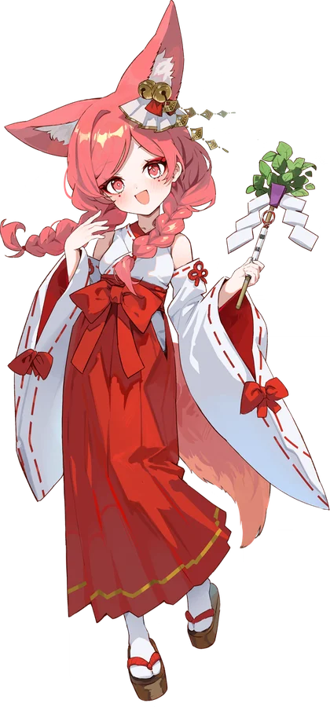
- Q版立绘：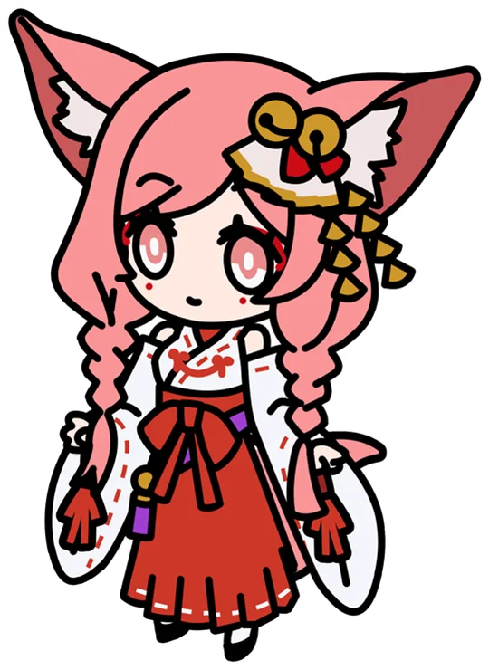
- 头像：
- Q版头像：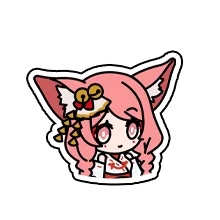
- 半身像（星币<20）：
- 半身像（星币≥20）：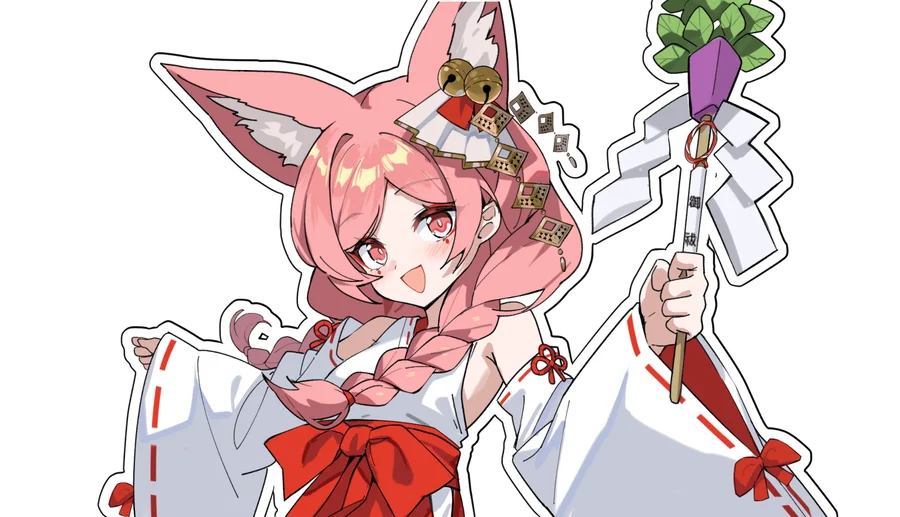

### 2. 羁绊皮肤（羁绊解锁）

- 素材编号：124_Max
- 立绘：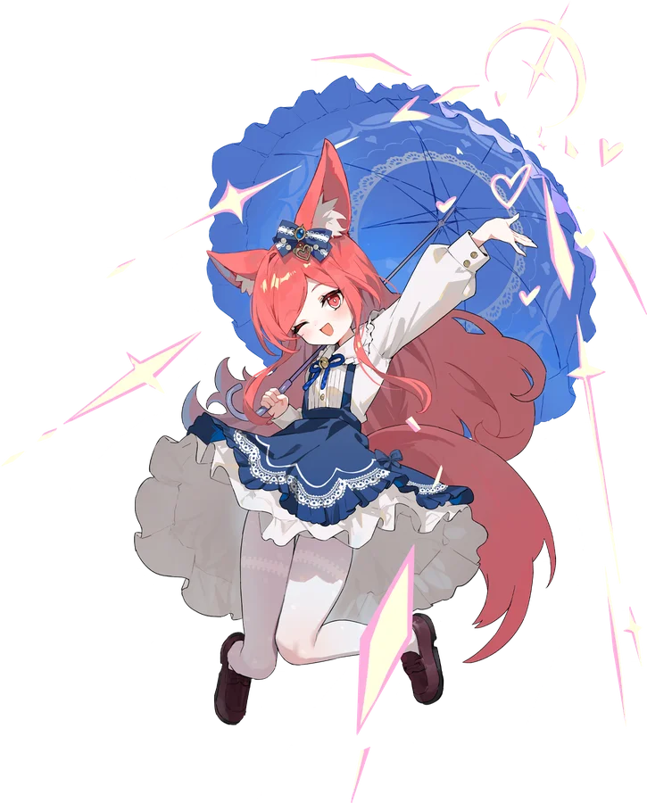
- Q版立绘：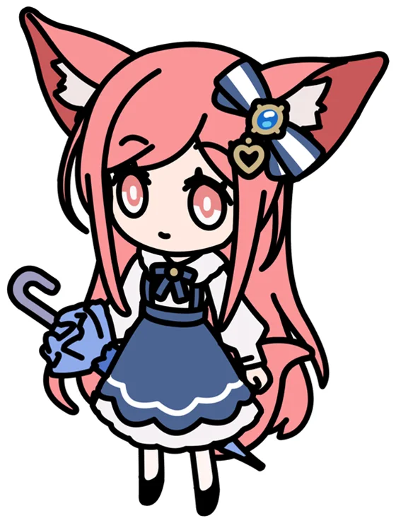
- 头像：
- Q版头像：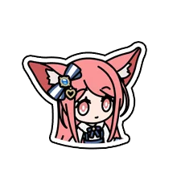
- 半身像（星币<20）：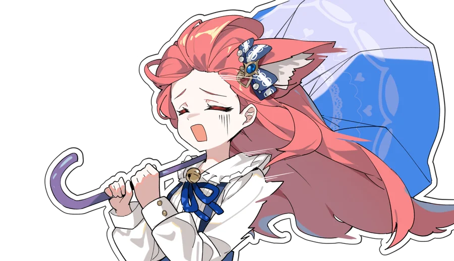
- 半身像（星币≥20）：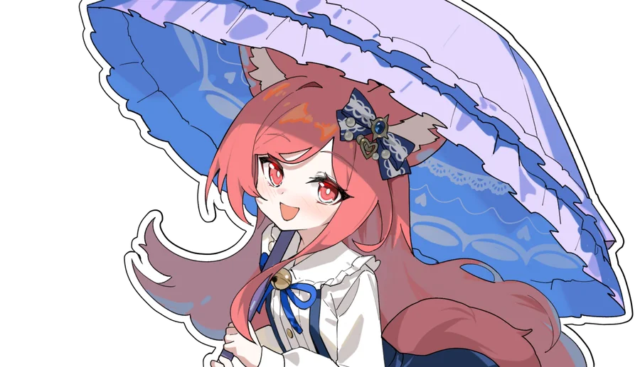

### 3. 小护士（蓝品质）

- 素材编号：124_01
- 立绘：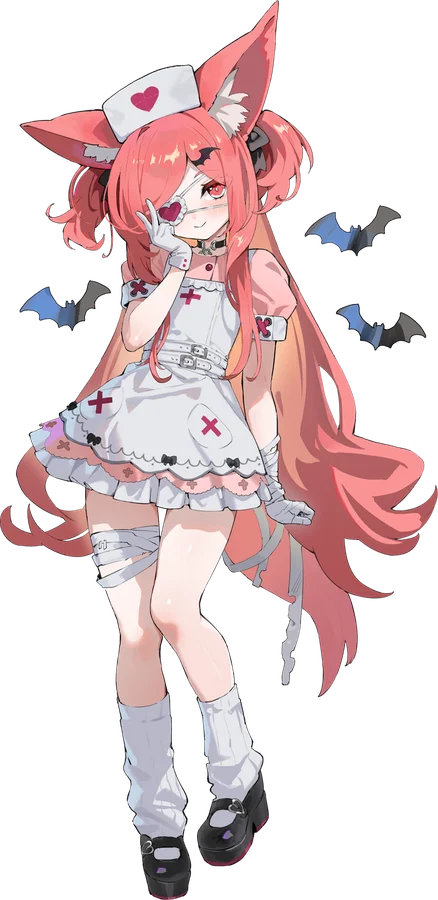
- Q版立绘：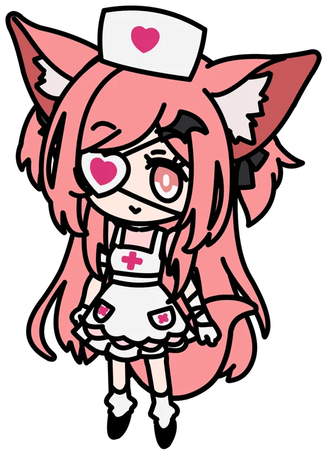
- 头像：
- Q版头像：
- 半身像（星币<20）：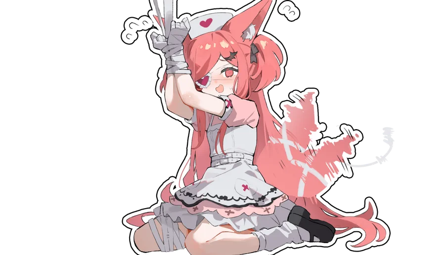
- 半身像（星币≥20）：

**皮肤故事**：“御…御主大人…今天真的要穿这个出去吗？”

看着镜子里的御主，凛难免犯了嘀咕。

“唉，没事没事，你别害怕，跟在我后面就行了，今天你是姐姐哦！”照对着镜子摆了几个造型，嘿嘿一笑，感觉很是满意。

“但是我一个平时都不怎么出门的人，突然要陪你去参加这种活动，难免…”

“那你帮我把美咲找回来，我就放你去干别的事情。”

凛无力地瘫坐在地上，眼泪快从眼眶里涌出来了。

今天是御魂庆典，联合城很多人都跑到街上玩起了角色扮演。照平时就很喜欢穿洋装，今天就更加不会放过这个机会了。但是原本作为随身护卫的美咲不知为何今天请假了，照临时起意，把休假中的凛拉回三神宫当护卫。

“那么，我可爱的凛姐姐~能陪我去参加今天的庆典吗？”身着小护士装扮的照突然转身，伏下了身子。

戴着单边眼罩的御主缓慢的爬到凛的身旁，现在只有一只眼睛直勾勾的盯着凛，加之妩媚的笑容和诡异的动作，使得凛越看越恐怖。

“御御…御主大人…噫！！！”

照爬到凛的耳边，然后轻声地说道：“今天就拜托你了~姐姐~”

“好…好的....”

凛欲哭无泪。

### 4. 魔旅歌姬（橙品质）

- 素材编号：124_02
- 立绘：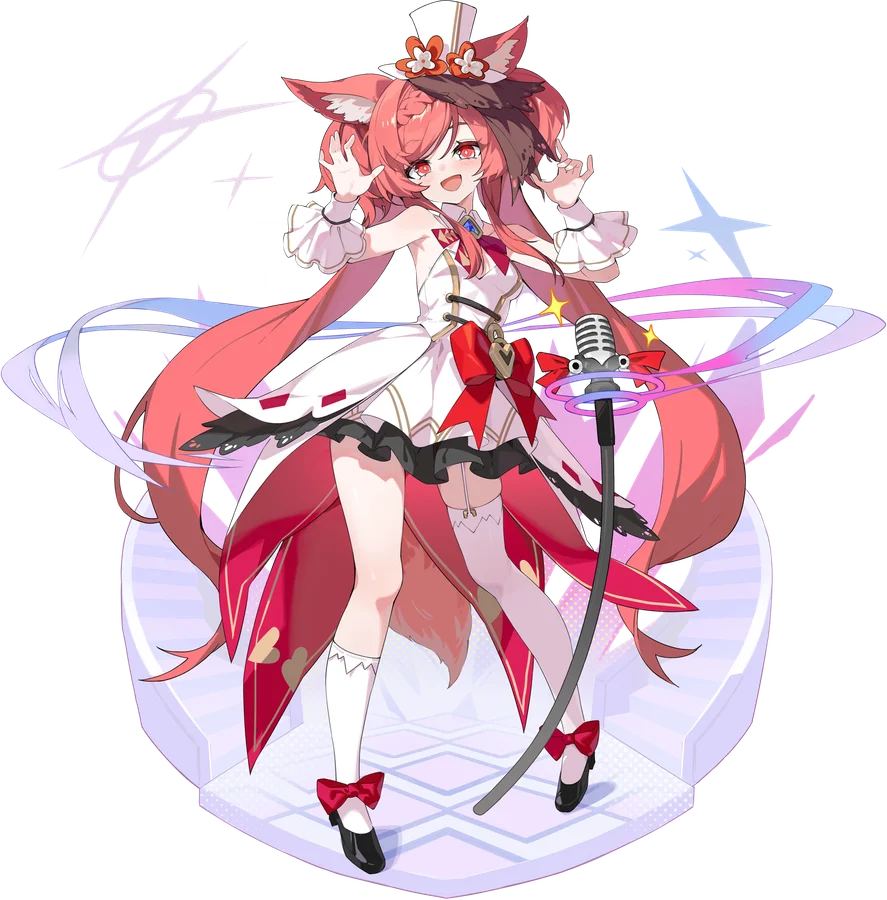
- Q版立绘：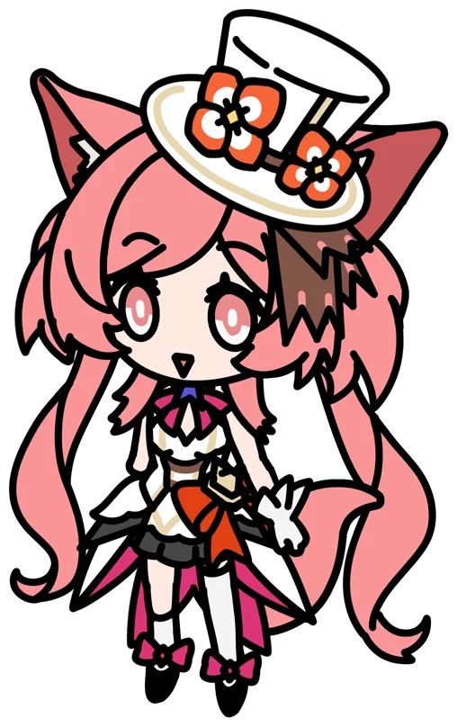
- 头像：
- Q版头像：
- 半身像（星币<20）：
- 半身像（星币≥20）：

**皮肤故事**：在恋的构想中，作为一个合格的魔术剧团，魔术表演只是基础，拥有更多元的表演形式才能更好地留住观众。

在构想中，让人气超高的照加入自己的小剧团再合适不过了。

照本身的天性让她在舞台上如鱼得水，她设计的各类动作和巧妙构思，必定会为现场观众带来意想不到的感官体验。更何况，谁也没见过这样厉害的人在台上唱唱跳跳的场景——新奇感和期待值绝对拉满。

“可是，这怎么可能？那位大人真的会接受我们的邀请吗？”米米在一旁看着演出服的照片问道。

恋一把夺过照片，轻轻拍了拍。“所以我才特意为她准备了这套衣服。按照她的性格，她一定会上当…一定会来的！”

恋充满信心。仿佛她已经看到了那个身材娇小的身影在舞台上大放异彩，用动听的歌声打动无数观众的场景。

### 5. 踏秋寻芳（紫品质）

- 素材编号：124_03
- 立绘：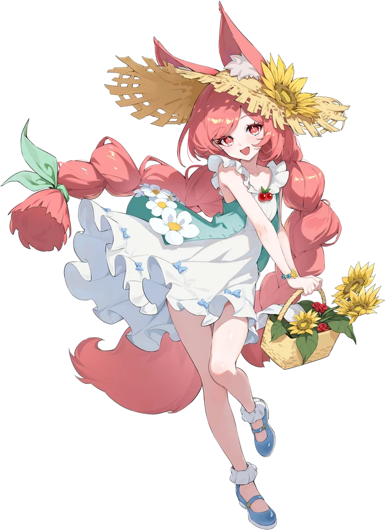
- Q版立绘：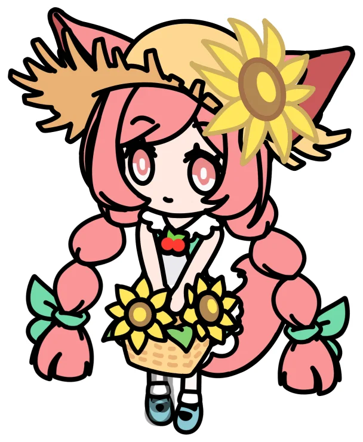
- 头像：
- Q版头像：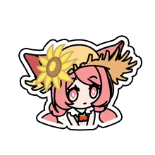
- 半身像（星币<20）：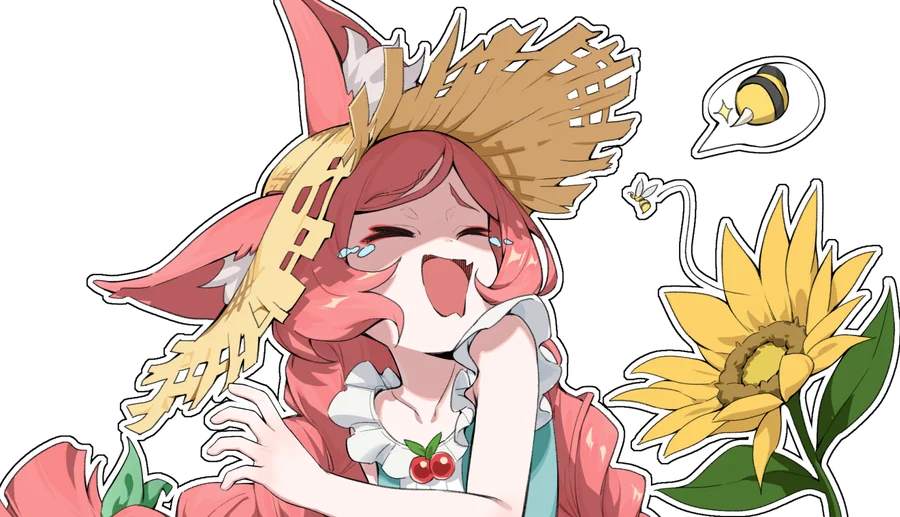
- 半身像（星币≥20）：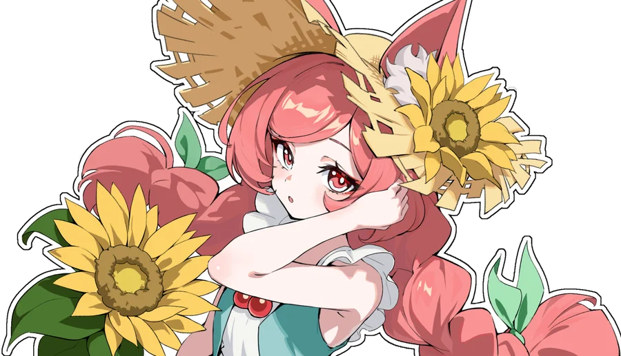

**皮肤故事**：在这个被高楼大厦环绕的城市里，能有这么一块巨大的农田实属不易。

这里原本计划建造什么已不得而知，后来不知因何缘故搁置了，这片占地数十亩的空地便成了钢铁森林中的一片田园。

联合城政府每年都会组织市民投票选出要种植的作物，去年正巧轮到了向日葵，今年这里自然便化作了一片金黄的向日葵花海。

向来喜欢热闹的照，因为工作缘故被美咲牢牢地按在三神教的神社里抽不开身，只能趁闲暇来到这片附近的农田，感受属于今年秋天的美景。

她头上别着一朵小向日葵，身穿一袭素色白裙，在明媚的阳光下开心得不得了。

相比之下，被强行拉来作陪的雅央和凛可就没那么自在了——毕竟护卫照的安全本就是她们的职责。

不过，这也是四个人为数不多能够聚在一起的日子，确实得好好感谢眼前这片向日葵田呢！

## 表情（共 15 个）

| # | 名称 | 品质 | 获取方式 | 图片 |
| --- | --- | --- | --- | --- |
| 1 | 表情1 |  |  |  |
| 2 | 表情2 |  |  |  |
| 3 | 表情3 |  |  |  |
| 4 | 表情4 |  |  |  |
| 5 | 表情5 |  |  |  |
| 6 | 表情6 |  |  |  |
| 7 | 表情7 |  |  |  |
| 8 | 表情8 |  |  |  |
| 9 | 表情9 |  |  |  |
| 10 | 表情10 |  |  |  |
| 11 | 表情11 |  |  |  |
| 12 | 表情12 |  |  |  |
| 13 | 表情13 |  |  |  |
| 14 | 表情14 |  |  |  |
| 15 | 表情15 |  |  |  |

## 装扮

官方 wiki 未提供该角色的 /获取 页，头像、名片、卡牌、骰子清单暂缺。

## 人物传记

照有时候会偷偷溜去雅央那里玩，这让美咲和组织内的长老很是头疼。

## 画廊其他素材

- 起始点：
- 像素头像：
- Lv4羁绊等级奖励：
- Lv5羁绊等级奖励：
- 缔结契约名片奖励：
- 小护士皮肤名片：
- 魔旅歌姬皮肤名片：
- 踏秋寻芳皮肤名片：
