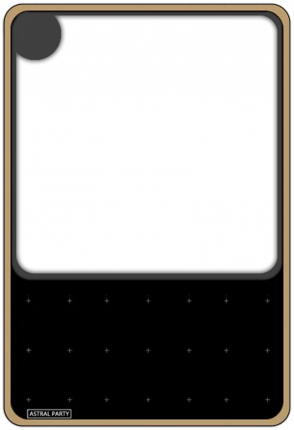

# 龙宫游乐园
> 分类：地图
> 来源：https://wiki.biligame.com/starengine/%E9%BE%99%E5%AE%AB%E6%B8%B8%E4%B9%90%E5%9B%AD

## 地图背景

绿洲市的一座水上乐园。本体由恩菲尔德家族运营，属于联合公司资产。虽然开业时间不长，但已吸引大量游客。园区内的大型设施均获得一致好评，因此每天需限流，以防止游客过多引发不必要的问题。

## 地图剧情

观看剧情（p5210.md）

### 选择天川苍鲤

真梦梓出击！

真梦梓出击！
真梦梓出击！

真梦梓登场，刷新3个虾布罗，所有的怪物攻击力+1，防御力+1。

独木难支

独木难支
独木难支

刷新2个虾布罗，所有的怪物攻击力十1，防御力+1。

任务 击败大噪门和练家子0\2 秘宝现世：所有玩家获得强化筹码*1 击败蟹布罗0\6 所有玩家获得 强化筹码*1 击败虾布罗0\2 所有玩家获得 强化筹码*1 击败虾布罗0\4 所有玩家获得 强化筹码*1,进度-1 收集4个葫芦0\4 "小姑娘还是再练几年吧！"

水上乐园
水上乐园 龙虾机关启动，刷新4个蟹布罗。 2345678

蟹之狂欢
蟹之狂欢 刷新3个蟹布罗，所有的怪物攻击力十1，防御力+1。 101112131415

任务 击败大噪门和练家子0\2 秘宝现世：所有玩家获得强化筹码*1 击败蟹布罗0\6 所有玩家获得 强化筹码*1 击败虾布罗0\2 所有玩家获得 强化筹码*1 击败虾布罗0\4 所有玩家获得 强化筹码*1,进度-1 收集4个葫芦0\4 "小姑娘还是再练几年吧！" 水上乐园
水上乐园 龙虾机关启动，刷新4个蟹布罗。 2345678 蟹之狂欢
蟹之狂欢 刷新3个蟹布罗，所有的怪物攻击力十1，防御力+1。 101112131415

任务 击败大噪门和练家子0\2 秘宝现世：所有玩家获得强化筹码*1 击败蟹布罗0\6 所有玩家获得 强化筹码*1 击败虾布罗0\2 所有玩家获得 强化筹码*1 击败虾布罗0\4 所有玩家获得 强化筹码*1,进度-1 收集4个葫芦0\4 "小姑娘还是再练几年吧！" 水上乐园
水上乐园 龙虾机关启动，刷新4个蟹布罗。 2345678 蟹之狂欢
蟹之狂欢 刷新3个蟹布罗，所有的怪物攻击力十1，防御力+1。 101112131415

任务 击败大噪门和练家子0\2 秘宝现世：所有玩家获得强化筹码*1 击败蟹布罗0\6 所有玩家获得 强化筹码*1 击败虾布罗0\2 所有玩家获得 强化筹码*1 击败虾布罗0\4 所有玩家获得 强化筹码*1,进度-1 收集4个葫芦0\4 "小姑娘还是再练几年吧！" 水上乐园
水上乐园 龙虾机关启动，刷新4个蟹布罗。 2345678 蟹之狂欢
蟹之狂欢 刷新3个蟹布罗，所有的怪物攻击力十1，防御力+1。 101112131415

### 选择天川真梦梓

苍鲤登场!

苍鲤登场!
苍鲤登场!

苍鲤登场，刷新2个金小鱼，所有的怪物攻击力+1，防御力。

酩酊丑态

酩酊丑态
酩酊丑态

刷新3个金小鱼，所有的怪物攻击力+1，防御力+1。 任务 击败大噪门和练家子0\2 秘宝现世：所有玩家获得强化筹码*1 击败蟹布罗0\6 所有玩家获得 强化筹码*1 击败金小鱼0\3 所有玩家获得 强化筹码*1 击败金小鱼0\6 所有玩家获得强化筹码*1,进度-1 苍鲤的金鳞层数到达110\11 "喝多了可是会误事的。" 水上乐园
水上乐园 龙虾机关启动，刷新4个蟹布罗。 2345678 蟹之狂欢
蟹之狂欢 刷新3个蟹布罗，所有的怪物攻击力十1，防御力+1。 101112131415 任务 击败大噪门和练家子0\2 秘宝现世：所有玩家获得强化筹码*1 击败蟹布罗0\6 所有玩家获得 强化筹码*1 击败金小鱼0\3 所有玩家获得 强化筹码*1 击败金小鱼0\6 所有玩家获得强化筹码*1,进度-1 苍鲤的金鳞层数到达110\11 "喝多了可是会误事的。" 水上乐园
水上乐园 龙虾机关启动，刷新4个蟹布罗。 2345678 蟹之狂欢
蟹之狂欢 刷新3个蟹布罗，所有的怪物攻击力十1，防御力+1。 101112131415 任务 击败大噪门和练家子0\2 秘宝现世：所有玩家获得强化筹码*1 击败蟹布罗0\6 所有玩家获得 强化筹码*1 击败金小鱼0\3 所有玩家获得 强化筹码*1 击败金小鱼0\6 所有玩家获得强化筹码*1,进度-1 苍鲤的金鳞层数到达110\11 "喝多了可是会误事的。" 水上乐园
水上乐园 龙虾机关启动，刷新4个蟹布罗。 2345678 蟹之狂欢
蟹之狂欢 刷新3个蟹布罗，所有的怪物攻击力十1，防御力+1。 101112131415 任务 击败大噪门和练家子0\2 秘宝现世：所有玩家获得强化筹码*1 击败蟹布罗0\6 所有玩家获得 强化筹码*1 击败金小鱼0\3 所有玩家获得 强化筹码*1 击败金小鱼0\6 所有玩家获得强化筹码*1,进度-1 苍鲤的金鳞层数到达110\11 "喝多了可是会误事的。" 水上乐园
水上乐园 龙虾机关启动，刷新4个蟹布罗。 2345678 蟹之狂欢
蟹之狂欢 刷新3个蟹布罗，所有的怪物攻击力十1，防御力+1。 101112131415

## 登场怪物

|  |  |
| --- | --- |
|  | 0

 0

 6

 0

 0

 6

 0

 0

 6

 0

 0

 6

 0

 0

 6 |
|  | 4

 1

 9

 4

 1

 10

 4

 1

 10

 4

 1

 10

 4

 1

 11 |
|  | 6

 6

 99

 6

 6

 99

 6

 6

 99

 6

 6

 99 |
|  | 4

 1

 99

 4

 1

 111

 5

 2

 120

 6

 2

 150 |
|  | 4

 4

 99

 4

 4

 99

 4

 4

 99

 4

 4

 99 |
|  | 1

 1

 88

 2

 2

 100

 3

 3

 110

 4

 4

 135 |
|  | 2

 1

 7

 3

 1

 8

 3

 2

 8

 4

 2

 9 |
|  | 3

 1

 20

 3

 2

 22

 4

 2

 24

 4

 2

 26 |
|  | 2

 0

 6

 3

 0

 7

 5

 0

 8

 6

 0

 11 |
|  | 3

 0

 18

 3

 0

 20

 4

 1

 20

 4

 1

 24 |
|  | 3

 3

 13

 4

 4

 14

 5

 4

 15

 5

 5

 16 |

## 地图专属筹码

惊涛御守
使用效果牌时，受到1点伤害。获得卡牌时，回复1点生命值。 迷幻海鲜汤
你的战斗骰点只会是1或者6点。 无限之蛇
回合开始时，获得卡牌直至手牌达到 8 张。出牌数+1。 交错双鲤
攻击骰点只会是6点，且无法被反击。 小蛇玩偶
受到伤害时，受到伤害-2，攻击力+2，持续 1 回合。 小鲤鱼玩偶
使用主动技能后，获得1层【反击】。反击时，攻击力、防御力永久+1。

## 地图专有卡牌

   
 毒牙
毒牙 移除目标2层【金鳞】，本次攻击无法被反击

## 地图特殊效果/状态

 丨 逆鳞 丨 每层增加2点攻击并减少2点受到伤害，回合结束时清除。  丨 金鳞 丨 每层增加1点攻击与防御。  丨 湖沼之王 丨 玩家每捡起一个葫芦，增加1点攻击力。  丨 小蛇玩偶 丨 每层增加2点攻击并减少2点受到伤害，回合开始时清除。  丨 小鲤鱼玩具 丨 每层增加1点攻击与防御。

### 2025年07月04日

传说在龙宫有秘宝可以帮助少女化为真龙，秘宝只有一个，却有两名少女需要它！怎么办，只能二选其一了呀！ 
█ 新增 
◆ 地图【龙宫游乐园】 
◆ 怪物 [ 天川真梦梓(Boss) ]、[ 天川苍鲤(Boss) ]、[ 大嗓门(精英) ]、[ 练家子(精英) ]、[ 蟹布罗 ]、[ 虾布罗 ]、[ 金小鱼 ] 
◆ 筹码 [ 惊涛御守 ]、[ 迷幻海鲜汤 ] 
◆ 卡牌 [ 毒牙 ] 
█ 关键机制 
◆ 玩家需要击倒2只精英怪获得道具，并从两位NPC中投票选择支持一方，而另一方则会成为本次的敌对Boss。

### 2025年08月01日

█ 新增 
◆ 特殊任务 [ 苍鲤的金鳞层数到达11-“喝多了可是会误事的” ]、[ 收集4个葫芦-“小姑娘还是再练几年吧！” ] 
◆ 筹码 [ 小蛇玩偶 ]、[ 小鲤鱼玩偶 ]、[ 无限之蛇 ]、[ 交错双鲤 ] 
█ 数值变动 
◆ 怪物 [ 虾布罗 ] 普通模式下 
3120 调整为 
3118↓ 、困难模式下 
3222 调整为 
3220↓ 、噩梦模式下 
4225 调整为 
4224↓ 。 
◆ 怪物 [ 金小鱼 ] 普通模式下 
306 调整为 
2↓06 、困难模式下 
407 调整为 
3↓07 。

### 2025年10月31日

█ 新增 
◆ 通用事件 [ 取长补短 ] 
◆ 通用筹码 [ 优雅之羽 ]、[ 探天卫星 ] 
█ 数值变动 
◆ 调整了通用筹码 [ 会员推荐信 ] 稀有度，由紫色调整为蓝色，并修改描述由“轮次奖励卡牌数量 +2”，调整为“轮次奖励卡牌数量 +1”。

### 2025年11月21日

█ 数值变动 
◆ 怪物 [ 天川真梦梓 ] 普通模式下 
4190 调整为 
4199↑ 、困难模式下 
4199 调整为 
41111↑ 。 
◆ 怪物 [ 天川苍鲤 ] 普通模式下 
1180 调整为 
1188↑ 、困难模式下 
2290 调整为 
22100↑ 。 
◆ 怪物 [ 虾布罗 ] 普通模式下 
3118 调整为 
3120↑ 、困难模式下 
3220 调整为 
3222↑ 。 
◆ 怪物 [ 大嗓门 ] 普通模式下 
3015 调整为 
3018↑ 、困难模式下 
3016 调整为 
3020↑ 。 
◆ 怪物 [ 练家子 ] 普通模式下 
3312 调整为 
3313↑ 、困难模式下 
4413 调整为 
4414↑ 。
