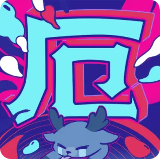

# 符卡-祸
> 分类：卡牌/手牌
> 编号：20028
> 类型：Effect
> 来源：https://wiki.biligame.com/starengine/%E7%AC%A6%E5%8D%A1-%E7%A5%B8

## 卡牌效果

标准对战（PVP）：指定10格内的一个角色，造成1点伤害，回合结束时，如果在手牌中，使自身受到1点伤害

合作挑战（PVE）：指定10格内的一个怪物，造成1点伤害，回合结束时，如果在手牌中，使自身受到1点伤害

## 资料

- **编号**：20028
- **类型**：Effect
- **对象**：Entity
- **英文名**：Talisman Card - Misfortune
- **来源**：角色卡牌:风水师

## 详解

注意：符卡-祸仅在场上存在姬梦朝时出现。该卡牌虽然属于专属卡牌，但是在标准对战模式中不仅仅姬梦朝可以获取并使用。

在标准对战模式中，该卡牌指定的对象为“敌方角色”，因此无法对地图中的小浣熊使用，因为小浣熊属于怪物。

## 历史

*2026年2月6日
**对文本进行了标准化。
*2025年1月24日
**引入游戏。

## 图片

