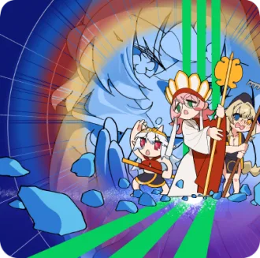

# 命运的指引
> 分类：卡牌/手牌
> 编号：20032
> 类型：Effect
> 来源：https://wiki.biligame.com/starengine/%E5%91%BD%E8%BF%90%E7%9A%84%E6%8C%87%E5%BC%95

## 卡牌效果

合作挑战（PVE）：在1-6中选择一个数字，作为下次移动的最终点数
主动技能冷却时间-1，本回合出牌数+1

## 资料

- **编号**：20032
- **类型**：Effect
- **对象**：none
- **英文名**：Guidance of Fate
- **来源**：角色卡牌:蓝海晴

## 详解

注意：命运的指引仅在合作挑战模式、场上存在潜能激发的蓝海晴时出现。该卡牌虽然属于专属卡牌，但是不仅仅蓝海晴可以获取并使用。

若玩家在一回合内使用了多张遥控骰子与命运的指引，那么最后的移动骰点以最后一张卡牌选定的移动骰点为准。

关于该卡牌的获取方式，请查阅对应页面。

## 花絮

*命运的指引卡面背景的角色即该卡牌的归属者蓝海晴。
*命运的指引卡面中心的三个角色参考了经典名著《西游记》中的人物形象，具体如下：
**孙悟空——美咲(左)。
**唐僧——天王寺雅央(中)。
**猪八戒——凛(右)。
*命运的指引卡面中心的三个角色选定美咲、天王寺雅央与凛的原因应为该三人为照的三位护法，即便照在该卡面中没有出现。

## 历史

*2026年2月6日
**对文本进行了标准化。
*2025年9月5日
**引入游戏。

## 图片

