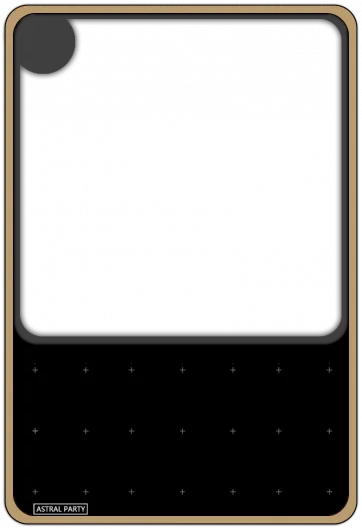
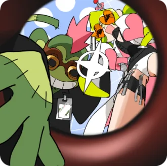
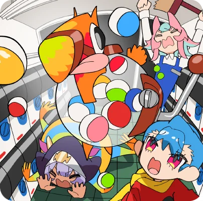
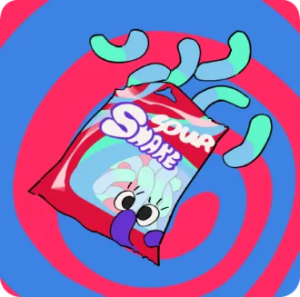

# 幽魂暗巷
> 分类：地图
> 来源：https://wiki.biligame.com/starengine/%E5%B9%BD%E9%AD%82%E6%9A%97%E5%B7%B7

## 地图背景

运河区的暗巷一隅堪称神秘之地，汇聚了各类奇特的小商品店，其中魔法用品店尤为知名。每年在此举行的魔物庆典吸引大量热衷‘装神弄鬼’的玩家前来角色扮演，至于是否有真‘鬼怪’混入，无人知晓。这些活动已经成为了运河区的一大特色。

## 地图事件

全体集结！

全体集结！
全体集结！

刷新1个科学怪猿，1个圆锯猴助手，所有的怪物防御力+1。

圆月之夜

圆月之夜
圆月之夜

刷新2个科学怪猿，1个圆锯猴助手，所有玩家获得2层【改造】。所有的怪物攻击力+1，防御力+1。

任务 有角色首次获得1颗星星0\1 该玩家获得1张支援口香糖 击败圆锯猴助手0\3 所有玩家获得 强化筹码*1 击倒人工生命体-天崩0\1 所有玩家获得 强化筹码*1 击败科学怪猿0\3 所有玩家获得强化筹码*1,进度-1 击倒人工生命体-噩兆0\1 所有玩家获得 强化筹码*1

舞会开始！
舞会开始！ 科学怪人登场，舞会开始！ 23

身体检查
身体检查 刷新3个惊喜猴子盒，1个圆锯猴助手。 56

狂躁的皮纳塔
狂躁的皮纳塔 刷新2个糖果皮纳塔，所有怪物攻击力+1。 8

强力帮手
强力帮手 刷新2个惊喜猴子盒，1个科学怪猿，所有的怪物攻击力+1，防御力+1。 101112131415

任务 有角色首次获得1颗星星0\1 该玩家获得1张支援口香糖 击败圆锯猴助手0\3 所有玩家获得 强化筹码*1 击倒人工生命体-天崩0\1 所有玩家获得 强化筹码*1 击败科学怪猿0\3 所有玩家获得强化筹码*1,进度-1 击倒人工生命体-噩兆0\1 所有玩家获得 强化筹码*1 舞会开始！
舞会开始！ 科学怪人登场，舞会开始！ 23 身体检查
身体检查 刷新3个惊喜猴子盒，1个圆锯猴助手。 56 狂躁的皮纳塔
狂躁的皮纳塔 刷新2个糖果皮纳塔，所有怪物攻击力+1。 8 强力帮手
强力帮手 刷新2个惊喜猴子盒，1个科学怪猿，所有的怪物攻击力+1，防御力+1。 101112131415

任务 有角色首次获得1颗星星0\1 该玩家获得1张支援口香糖 击败圆锯猴助手0\3 所有玩家获得 强化筹码*1 击倒人工生命体-天崩0\1 所有玩家获得 强化筹码*1 击败科学怪猿0\3 所有玩家获得强化筹码*1,进度-1 击倒人工生命体-噩兆0\1 所有玩家获得 强化筹码*1 舞会开始！
舞会开始！ 科学怪人登场，舞会开始！ 23 身体检查
身体检查 刷新3个惊喜猴子盒，1个圆锯猴助手。 56 狂躁的皮纳塔
狂躁的皮纳塔 刷新2个糖果皮纳塔，所有怪物攻击力+1。 8 强力帮手
强力帮手 刷新2个惊喜猴子盒，1个科学怪猿，所有的怪物攻击力+1，防御力+1。 101112131415

任务 有角色首次获得1颗星星0\1 该玩家获得1张支援口香糖 击败圆锯猴助手0\3 所有玩家获得 强化筹码*1 击倒人工生命体-天崩0\1 所有玩家获得 强化筹码*1 击败科学怪猿0\3 所有玩家获得强化筹码*1,进度-1 击倒人工生命体-噩兆0\1 所有玩家获得 强化筹码*1 舞会开始！
舞会开始！ 科学怪人登场，舞会开始！ 23 身体检查
身体检查 刷新3个惊喜猴子盒，1个圆锯猴助手。 56 狂躁的皮纳塔
狂躁的皮纳塔 刷新2个糖果皮纳塔，所有怪物攻击力+1。 8 强力帮手
强力帮手 刷新2个惊喜猴子盒，1个科学怪猿，所有的怪物攻击力+1，防御力+1。 101112131415

## 登场怪物

|  |  |
| --- | --- |
|  | 0

 0

 6

 0

 0

 6

 0

 0

 6

 0

 0

 6

 0

 0

 6 |
|  | 0

 0

 9

 0

 0

 9

 0

 0

 9

 0

 0

 9 |
|  | 4

 0

 8

 4

 0

 9

 5

 0

 10

 5

 0

 11 |
|  | 3

 1

 16

 3

 1

 18

 4

 1

 20

 4

 2

 22 |
|  | 4

 2

 22

 4

 2

 24

 5

 3

 26

 5

 3

 27 |
|  | 4

 1

 26

 4

 1

 28

 5

 2

 30

 6

 2

 33 |
|  | 4

 2

 26

 4

 2

 29

 5

 3

 30

 6

 3

 33 |
|  | 5

 3

 38

 6

 3

 42

 7

 4

 45

 7

 5

 50 |
|  | 3

 0

 8

 4

 0

 9

 5

 0

 9

 5

 0

 10 |

## 地图专属筹码

计时器
获得【改造】时，额外获得 1 层。每 2 层【改造】，使自身攻击力+1。 重生人偶
被击倒后，进度不变，攻击力、防御力、生命值上限+1。 糖果会员证
怪奇糖果机售价下降为3星币。使用糖果卡牌时，主动技能冷却时间-1。

## 地图专有卡牌

  
 支援口香糖
支援口香糖 指定一个角色，恢复2点生命值，并移除【改造】 自身本回合出牌数+1 
  
 能量补充棒
能量补充棒 指定一名拥有【改造】的角色，攻击力+2，移动速度+2，持续2回合。随后对目标施加2层【改造】 
  
 大聪明软糖
大聪明软糖 指定一名角色获得3张卡牌，并移除【改造】

## 地图特殊效果/状态

 丨 深度改造 丨 无法被攻击或选中，受到伤害降低为0。  丨 改造 丨 层数归零时，受到当前生命值的伤害。

### 2025年09月28日

雅央这次搞出了一些稀奇古怪的发明，本来好好的派对被搅和的天翻地覆，不可原谅，必须阻止她！诶？可是她飞在空中诶...先解决她的发明吧！ 
█ 新增 
◆ 地图【幽魂暗巷】 
◆ 怪物 [ 科学怪人 ]、[ 人工生命体-天崩 ]、[ 人工生命体-噩兆 ]、[ 人工生命体-混乱 ]、[ 惊喜猴子盒 ]、[ 圆锯猴助手 ]、[ 科学怪猿 ] 
◆ 地块 [ 怪奇糖果机 ] 
◆ 卡牌 [ 支援口香糖 ]、[ 能量补充棒 ]、[ 大聪明软糖 ] 
█ 关键机制 
◆ 角色们会被怪物施加“改造”状态，如果一段时间内没有解除，会有很可怕的后果！不过不用担心，找怪奇糖果机购买神奇的糖果来应对吧！

### 2025年10月31日

█ 新增 
◆ 筹码 [ 计时器 ]、[ 重生人偶 ]、[ 糖果会员证 ] 
◆ 事件 [ 失控的糖果皮纳塔 ] 
◆ 怪物 [ 糖果皮纳塔 ] 
◆ 通用事件 [ 取长补短 ] 
◆ 通用筹码 [ 优雅之羽 ]、[ 探天卫星 ] 
█ 数值变动 
◆ 调整了通用筹码 [ 会员推荐信 ] 稀有度，由紫色调整为蓝色，并修改描述由“轮次奖励卡牌数量 +2”，调整为“轮次奖励卡牌数量 +1”。

### 2025年11月21日

█ 数值变动 
◆ 怪物 [ 圆锯猴助手 ] 普通模式下 
3115 调整为 
3116↑ 、困难模式下 
3116 调整为 
3118↑ 。 
◆ 怪物 [ 人工生命体-天崩 ] 普通模式下 
4125 调整为 
4126↑ 。 
◆ 怪物 [ 人工生命体-噩兆 ] 普通模式下 
4225 调整为 
4226↑ 、困难模式下 
4228 调整为 
4229↑ 。 
◆ 怪物 [ 人工生命体-混乱 ] 普通模式下 
5336 调整为 
5338↑ 、困难模式下 
6336 调整为 
6342↑ 。
