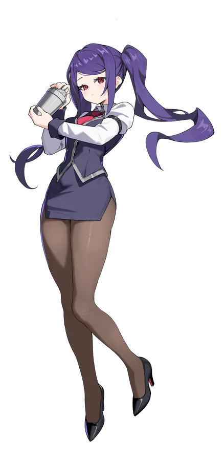

# 吉尔·斯汀雷（吉尔）
> 分类：角色 · 编号 303 · 时期 联动 · 女
> 来源：https://wiki.biligame.com/starengine/%E5%90%89%E5%B0%94%C2%B7%E6%96%AF%E6%B1%80%E9%9B%B7

吉尔是一位获得BTC认证的调酒师，在名为“VA-11 Hall-A”( 昵称:瓦尔哈拉/Valhalla )的酒吧里工作。

## 战斗数值

| 攻击 | 防御 | 生命 |
| --- | --- | --- |
| 1 | 1 | 10 |

## 技能

### 主动技能：调制饮料（冷却 3）

选择3张手牌，根据所选手牌类型对自身依次发动效果：

效果牌或诅咒牌：恢复1点生命值。

攻击牌：攻击力+1，持续1回合。

防御牌：防御力+1，持续1回合。

随后丢弃这3张手牌并获得等量卡牌。

**PVE**：选择3张手牌，根据所选手牌类型对一个角色依次发动效果：

效果牌或诅咒牌：恢复1点生命值。

攻击牌：攻击力+1，持续1回合。

防御牌：防御力+1，持续1回合。

随后丢弃这3张手牌并获得等量卡牌。

### 被动技能：改变生活

调制饮料时选择3种不同类型的卡牌时，吉尔获得3星币。

调制饮料时选择3张同类型的卡牌时，使目标移动速度+3，持续1回合。

## 基础资料

- 姓名：吉尔·斯汀雷
- 英文名：Jill Stingray
- 日文名：ジル·スティソグレイ
- 从属组织：赛博朋克酒保行动
- 上线时间：202509281730
- 生日：6月27日
- 喜欢食物：啤酒
- 初始骰子：/
- 礼物：/、/、/
- 徽章：/、/

## PVE 特性

- 达到1星时立刻获得10星币
- 初始星币+6
- 达到3星时攻击力+1、防御力+1、移动速度+1

## 皮肤（共 1 套）

> 皮肤编号取自素材文件名；「默认」「羁绊皮肤」也是独立皮肤。

### 1. 默认（初始）

- 素材编号：303
- 立绘：
- Q版立绘：
- 头像：
- Q版头像：
- 半身像（星币<20）：
- 半身像（星币≥20）：

## 表情（共 10 个）

| # | 名称 | 品质 | 获取方式 | 图片 |
| --- | --- | --- | --- | --- |
| 1 | 表情1 |  |  |  |
| 2 | 表情2 |  |  |  |
| 3 | 表情3 |  |  |  |
| 4 | 表情4 |  |  |  |
| 5 | 表情5 |  |  |  |
| 6 | 表情6 |  |  |  |
| 7 | 表情7 |  |  |  |
| 8 | 表情8 |  |  |  |
| 9 | 表情5_JP（日服） |  |  |  |
| 10 | 表情8_JP（日服） |  |  |  |

## 装扮

官方 wiki 未提供该角色的 /获取 页，头像、名片、卡牌、骰子清单暂缺。

## 人物传记

是蓝眼睛黑猫福尔(Fore)的单亲妈妈。吉尔的闲暇时光通常在网上冲浪，并努力抵抗那些不必要的“剁手”冲动，以免下一个月交不上房租。尽管她过着平淡的生活，但各种稀奇古怪的事件却总是不请自来，比如传闻中有人看到了一个“幽灵女孩”。

## 画廊其他素材

- 起始点：
- 像素头像：
