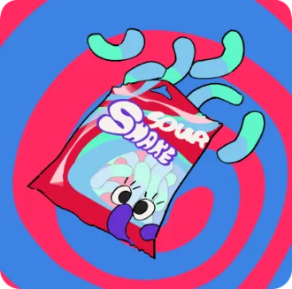

# 大聪明软糖
> 分类：卡牌/手牌
> 编号：21016
> 类型：Effect
> 来源：https://wiki.biligame.com/starengine/%E5%A4%A7%E8%81%AA%E6%98%8E%E8%BD%AF%E7%B3%96

## 卡牌效果

合作挑战（PVE）：指定一名角色获得3张卡牌，并移除【改造】

## 资料

- **编号**：21016
- **类型**：Effect
- **对象**：Entity
- **英文名**：Smartie Gummy
- **来源**：地图卡牌:幽魂暗巷

## 详解

注意：大聪明软糖仅在合作挑战模式的地图幽魂暗巷中作为专属卡牌出现。

使用大聪明软糖可以触发潘大猛的潜能激发效果。

## 历史

*2026年2月6日
**对文本进行了标准化。
*2025年9月28日
**引入游戏。

## 图片

