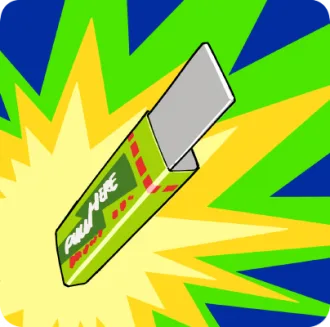

# 支援口香糖
> 分类：卡牌/手牌
> 编号：21014
> 类型：Effect
> 来源：https://wiki.biligame.com/starengine/%E6%94%AF%E6%8F%B4%E5%8F%A3%E9%A6%99%E7%B3%96

## 卡牌效果

合作挑战（PVE）：指定一个角色，恢复2点生命值，并移除【改造】
自身本回合出牌数+1

## 资料

- **编号**：21014
- **类型**：Effect
- **对象**：Entity
- **英文名**：Support Gum
- **来源**：地图卡牌:幽魂暗巷

## 详解

注意：支援口香糖仅在合作挑战模式的地图幽魂暗巷中作为专属卡牌出现。

使用支援口香糖可以触发潘大猛的潜能激发效果。

## 历史

*2026年2月6日
**对文本进行了标准化。
*2025年9月28日
**引入游戏。

## 图片

