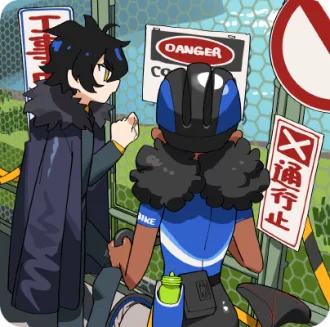

# 丛林冒险
> 分类：地图
> 来源：https://wiki.biligame.com/starengine/%E4%B8%9B%E6%9E%97%E5%86%92%E9%99%A9

## 地图背景

联合城不远处的原始森林，与其说是丛林冒险，不如说是废弃建筑探险。这里保存着许多古代遗留的稀奇古怪建筑，部分经过现代人改造后成为游乐项目，供游客度假使用。但仍有部分建筑年久失修，被封闭管理，擅自进入可能有危险。

## 地图事件

 全境封锁
全境封锁 卡牌“路障”的出现概率大幅提高！
