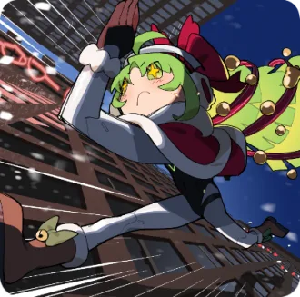
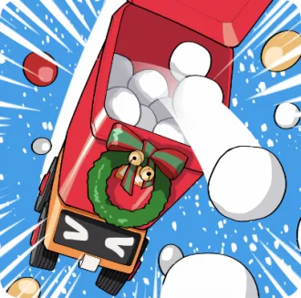

# 礼物广场
> 分类：地图
> 来源：https://wiki.biligame.com/starengine/%E7%A4%BC%E7%89%A9%E5%B9%BF%E5%9C%BA

## 地图背景

位于中城区十字路口站后侧的广场，每年年末都会举办节日庆典。期间，政府联合相关机构会摆放数以万计的礼物盒点缀广场。前来广场的人也会收到工作人员发放的小礼物。虽然这些礼物多为普通纪念品，但节日氛围十分浓厚。

## 地图事件

 最终冲刺
最终冲刺 礼物格效果翻倍，礼物守卫获得强化！

## 地图专有卡牌

 文件:Card00 Effect .png 
 定向加速
定向加速 移动+3，可自由选择方向。 
 文件:Card00 Effect .png 
 雪球攻击
雪球攻击 指定9格内一个玩家，造成1点伤害，且对方下次移动速度-4。

## 地图

| # | A | B | C | D | E | F | G | H | I | J | K | L | M | N | O | P | Q |
| --- | --- | --- | --- | --- | --- | --- | --- | --- | --- | --- | --- | --- | --- | --- | --- | --- | --- |
| 1 |  |  |  |  |  |  |  |  |  |  |  |  |  |  |  |  |  |
| 2 |  |  |  |  |  |  |  |  |  |  |  |  |  |  |  |  |  |
| 3 |  |  |  |  |  |  |  |  |  |  |  |  |  |  |  |  |  |
| 4 |  |  |  |  |  |  |  |  |  |  |  |  |  |  |  |  |  |
| 5 |  |  |  |  |  |  |  |  |  |  |  |  |  |  |  |  |  |
| 6 |  |  |  |  |  |  |  |  |  |  |  |  |  |  |  |  |  |
| 7 |  |  |  |  |  |  |  |  |  |  |  |  |  |  |  |  |  |
