# 摩西（枪匠）
> 分类：角色 · 编号 125 · 时期 第三期 · 男
> 来源：https://wiki.biligame.com/starengine/%E6%91%A9%E8%A5%BF

【太秦艺术馆】兼职美术修复师。虽然是兼职的，但比起在【虹之镜】当服务生的时间还是多得多，被库拉拉称为酒吧的幽灵打工人。本人其实是处理“异常事件”的高手，【虹之镜】的高级战斗员之一。

## 战斗数值

| 攻击 | 防御 | 生命 |
| --- | --- | --- |
| 1 | 1 | 11 |

## 技能

### 主动技能：弱点解析（冷却 2）

指定一个角色施加破绽（下一次交战时，攻击和防御骰点最大为3）。

**PVE**：指定一个怪物施加破绽（与摩西交战时，攻击和防御骰点变为0）。

如果拥有破绽（与摩西交战时，攻击和防御骰点变为0）的怪物挑战摩西，则摩西将进行反击。

### 被动技能：精密技巧

闪避成功后，下次攻击的攻击力+4。

**PVE**：闪避成功或反击后，获得1层精密技巧（每层使自身攻击力+2、闪避最小骰点+1。），最高叠加3层。

## 基础资料

- 姓名：赛迪·摩西
- 英文名：Moses
- 日文名：モーゼス
- 从属组织：虹之镜酒吧,太秦艺术馆
- 上线时间：202510311730
- 生日：8月20日
- 喜欢食物：可生食的蔬菜
- 初始骰子：弹药盒骰子
- 礼物：普通的饮料、礼盒巧克力、非常牛的电脑配件
- 徽章：冰原、大气

## PVE 特性

- 达到1星时攻击力+1
- 达到2星时攻击力+2
- 达到3星时攻击力+1、移动速度+2

## 皮肤（共 3 套）

> 皮肤编号取自素材文件名；「默认」「羁绊皮肤」也是独立皮肤。

### 1. 默认（初始）

- 素材编号：125
- 立绘：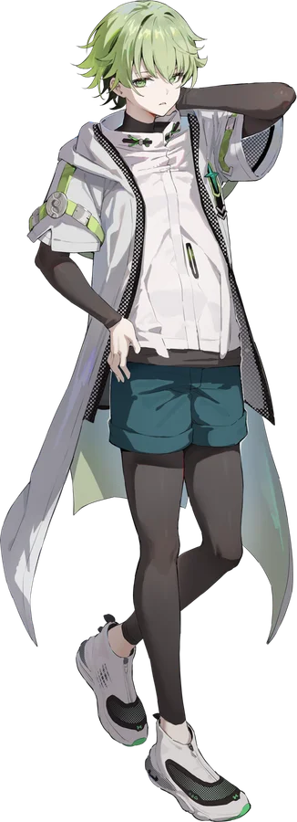
- Q版立绘：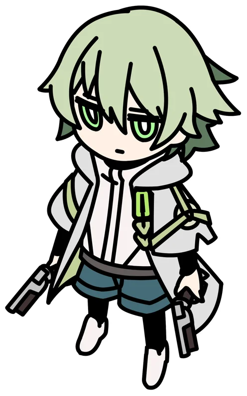
- 头像：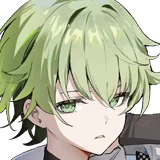
- Q版头像：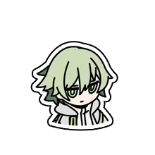
- 半身像（星币<20）：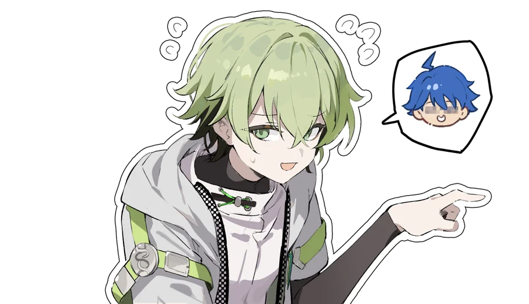
- 半身像（星币≥20）：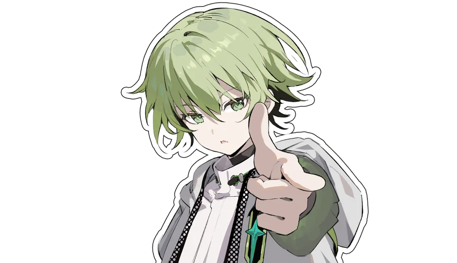

### 2. 羁绊皮肤（羁绊解锁）

- 素材编号：125_Max
- 立绘：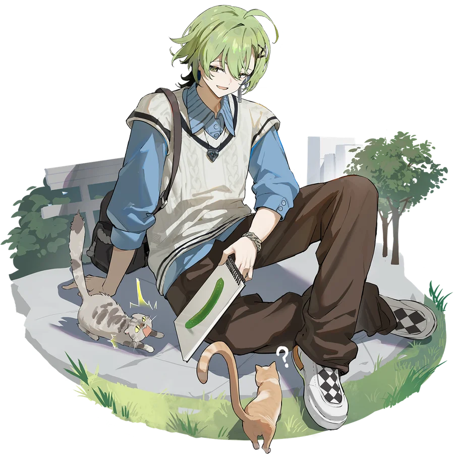
- Q版立绘：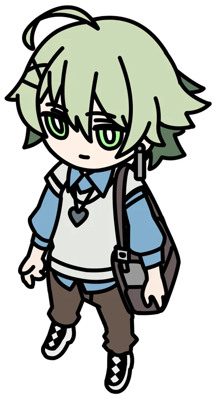
- 头像：
- Q版头像：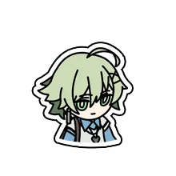
- 半身像（星币<20）：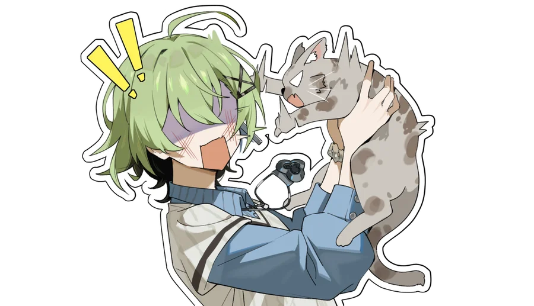
- 半身像（星币≥20）：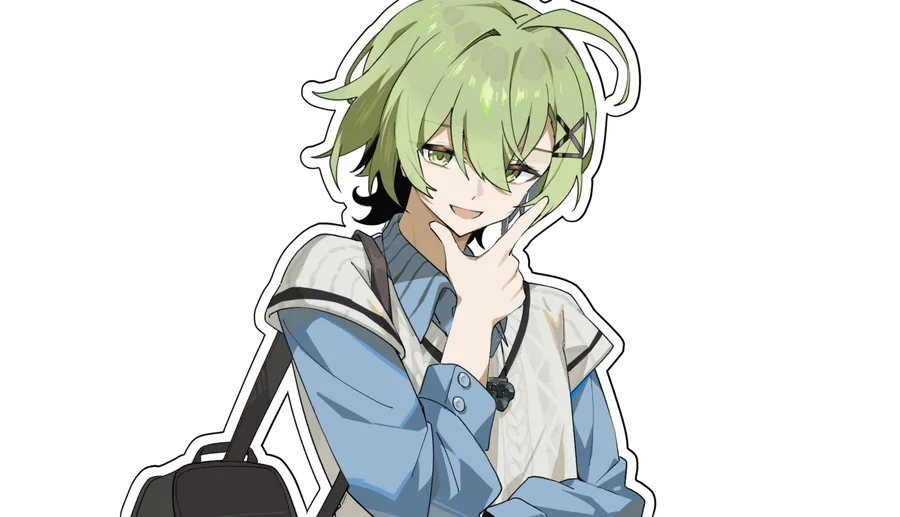

### 3. 特殊委派（紫品质）

- 素材编号：125_01
- 立绘：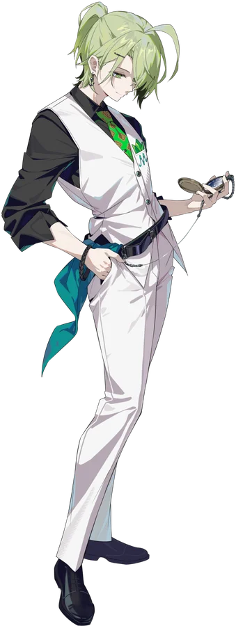
- Q版立绘：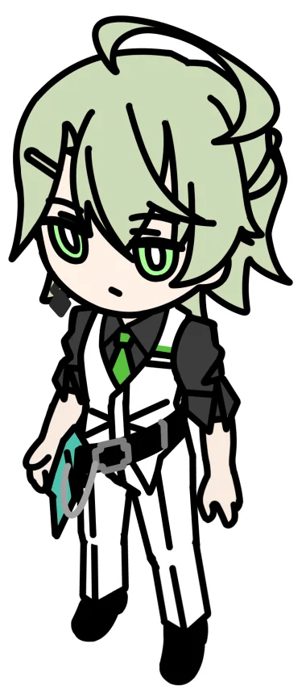
- 头像：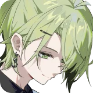
- Q版头像：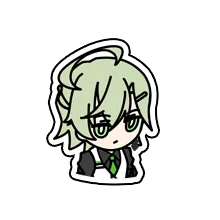
- 半身像（星币<20）：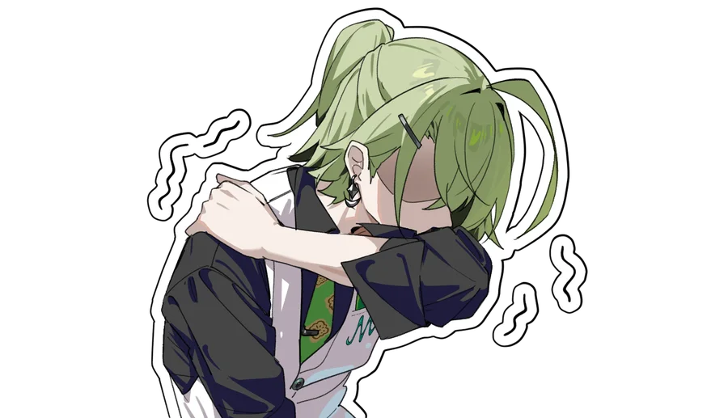
- 半身像（星币≥20）：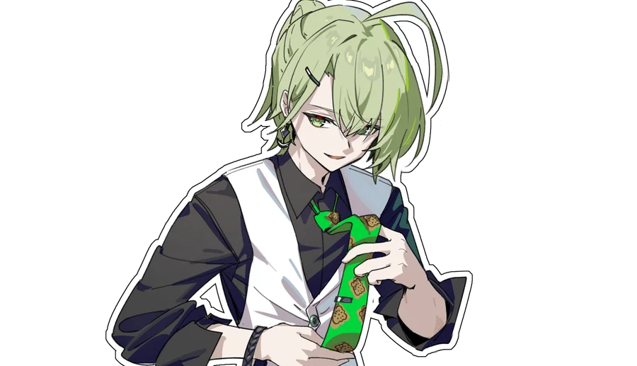

**皮肤故事**：“今天的目标已经清楚了吗？”库拉拉的声音从耳机里传来。

“嗯，她就算化成灰我也认得。”摩西随口回复道，然后用一个笑脸回复旁边的“同事”服务生。

“这身还挺合适你的，哈哈哈。”库拉拉突然笑了起来。

“是吗？我倒是觉得少了点轻浮感。”摩西回话道。

“差不多了，再轻浮就浮夸了。”库拉拉继续调侃。

“目标出现，该行动了，轻浮的家伙。”耳机里又传来了南希露的声音。

“喂喂喂别这么叫啊，你这宅女。”

“行了别斗嘴了都，专心完成任务。”此时老大的声音打断了所有人。

“了解。”众人回复道。

今天是特殊的委派任务，完成这一单，大家可以休息好久。

就像周五工作结束后期待周末的放松一样。

摩西带着无比愉悦的心情，开始了这次特殊的委派任务。

## 表情（共 12 个）

| # | 名称 | 品质 | 获取方式 | 图片 |
| --- | --- | --- | --- | --- |
| 1 | 表情1 |  |  |  |
| 2 | 表情2 |  |  | 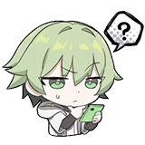 |
| 3 | 表情3 |  |  |  |
| 4 | 表情4 |  |  |  |
| 5 | 表情5 |  |  |  |
| 6 | 表情6 |  |  |  |
| 7 | 表情7 |  |  |  |
| 8 | 表情8 |  |  |  |
| 9 | 表情9 |  |  |  |
| 10 | 表情10 |  |  | 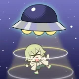 |
| 11 | 表情11 |  |  |  |
| 12 | 表情12 |  |  |  |

## 装扮

官方 wiki 未提供该角色的 /获取 页，头像、名片、卡牌、骰子清单暂缺。

## 人物传记

现在仍然在酒吧和艺术馆之间活动，不时收集一些关于失踪人员的情报。

## 画廊其他素材

- 起始点：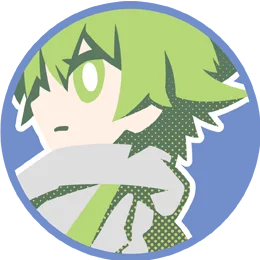
- 像素头像：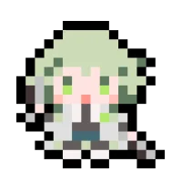
- Lv4羁绊等级奖励：
- Lv5羁绊等级奖励：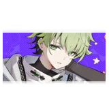
- 缔结契约名片奖励：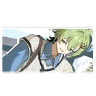
- 特殊委派皮肤名片：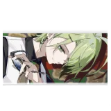
