# 真梦梓（沼之蛟龙）
> 分类：角色 · 编号 126 · 女
> 来源：https://wiki.biligame.com/starengine/%E7%9C%9F%E6%A2%A6%E6%A2%93

龙崎分家的天川家一直是三神教中核心的大家族。作为家族掌管人的女儿，真梦梓比所有同龄的孩子都显得异常刻苦勤奋。然而再怎么高压的环境，也掩盖不了同龄孩子们一样正常的好奇心，真梦梓就是一个充满好奇心的孩子。

## 战斗数值

| 攻击 | 防御 | 生命 |
| --- | --- | --- |
| 2 | 1 | 9 |

## 技能

### 主动技能：连锁反应（冷却 3）

丢弃4格内所有敌方角色的1张随机手牌。使用主动技能时，如果目标的手牌数少于4张，额外造成2点伤害。

**PVE**：自身获得1张撕咬，并使得5格内的所有友方角色获得1张卡牌，如果目标的手牌数量少于4张，则会额外获得1张卡牌。

### 被动技能：湖沼之王

受到伤害后，受到伤害-1，攻击力+1，持续至回合结束。

**PVE**：使其他角色获得卡牌的时候，真梦梓获得1层觉醒（到达8层时，转变为【真龙形态】）。

当觉醒（到达8层时，转变为【真龙形态】）达到8层时，真梦梓获得真龙形态（攻击力+4，主动技能不再拥有范围限制）。

拥有真龙形态（攻击力+4，主动技能不再拥有范围限制）时，将手牌中及技能之后获得的撕咬转变为龙之咆哮。

## 基础资料

- 姓名：天川真梦梓
- 英文名：Mamushi
- 日文名：真夢梓
- 从属组织：天川家族,龙崎家族,三神教
- 上线时间：202512051000
- 生日：8月21日
- 喜欢食物：布丁
- 初始骰子：布丁骰子
- 礼物：商品巧克力、新款平板电脑、小怪兽手办
- 徽章：山峦、冰原

## PVE 特性

- 达到1星时攻击力+1
- 初始星币+6
- 达到3星时攻击力+1、防御力+1、移动速度+1

## 皮肤（共 3 套）

> 皮肤编号取自素材文件名；「默认」「羁绊皮肤」也是独立皮肤。

### 1. 默认（初始）

- 素材编号：126
- 立绘：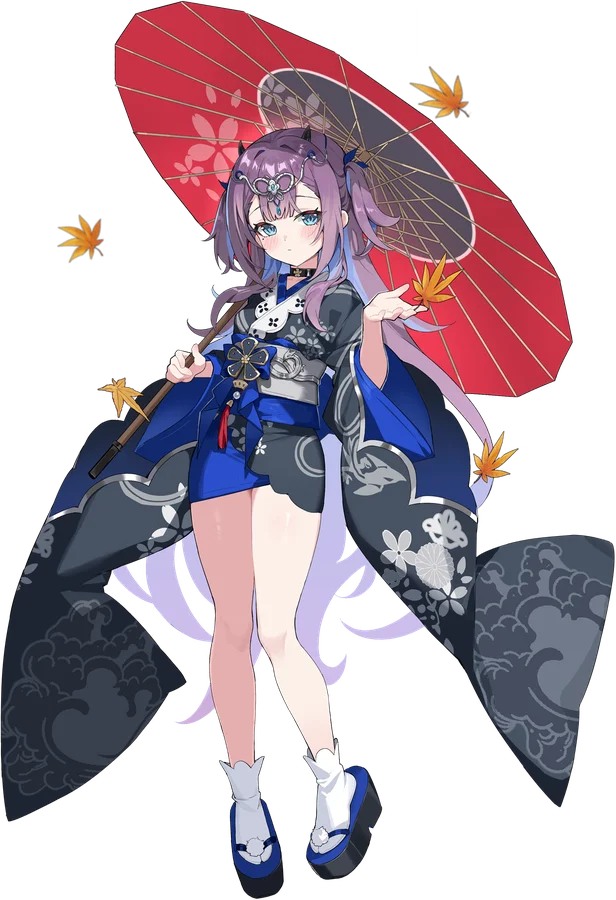
- Q版立绘：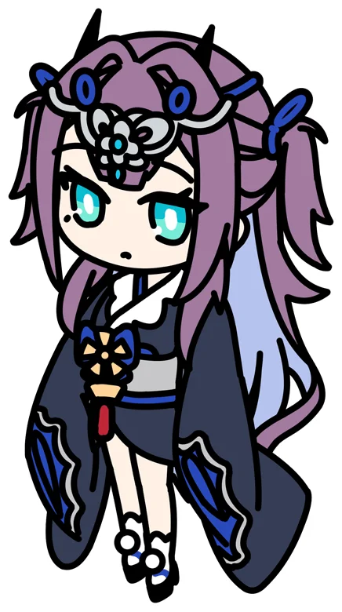
- 头像：
- Q版头像：
- 半身像（星币<20）：
- 半身像（星币≥20）：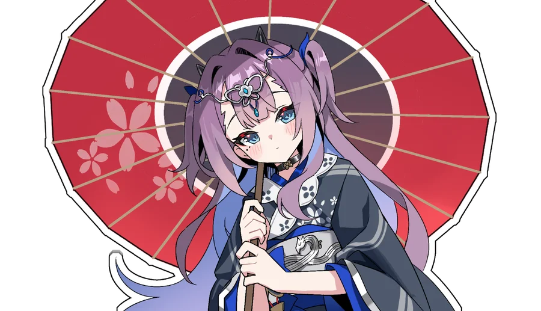

### 2. 羁绊皮肤（羁绊解锁）

- 素材编号：126_Max
- 立绘：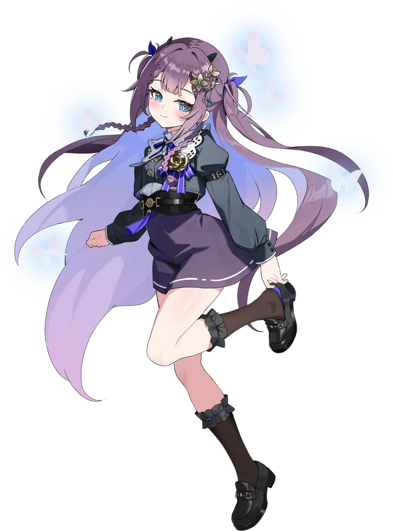
- Q版立绘：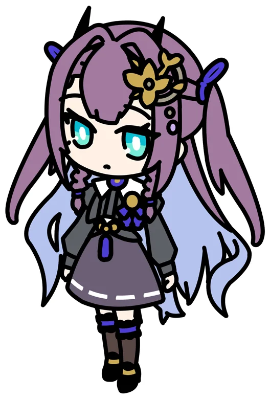
- 头像：
- Q版头像：
- 半身像（星币<20）：
- 半身像（星币≥20）：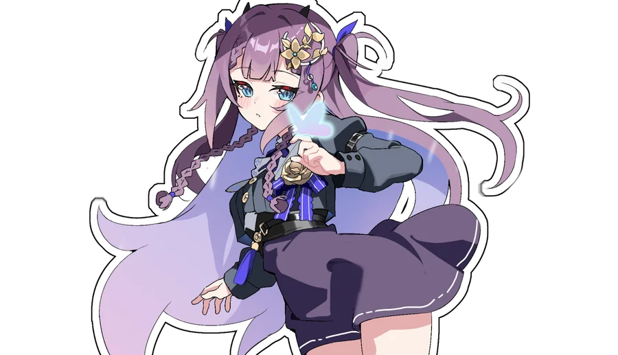

### 3. 冰上舞者（紫品质）

- 素材编号：126_01
- 立绘：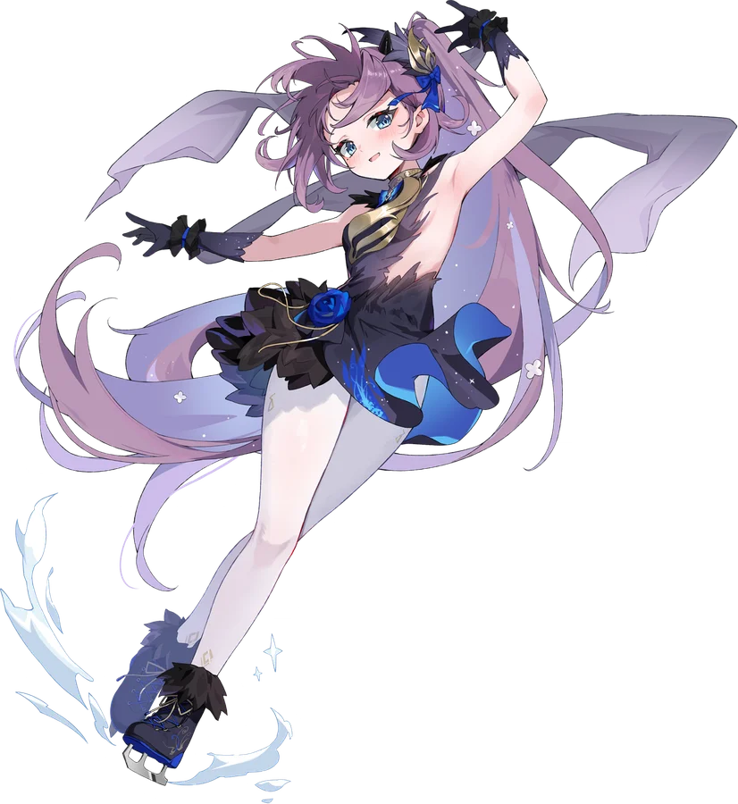
- Q版立绘：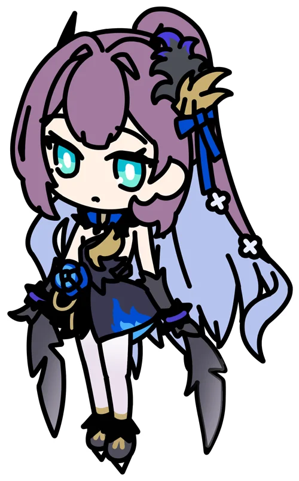
- 头像：
- Q版头像：
- 半身像（星币<20）：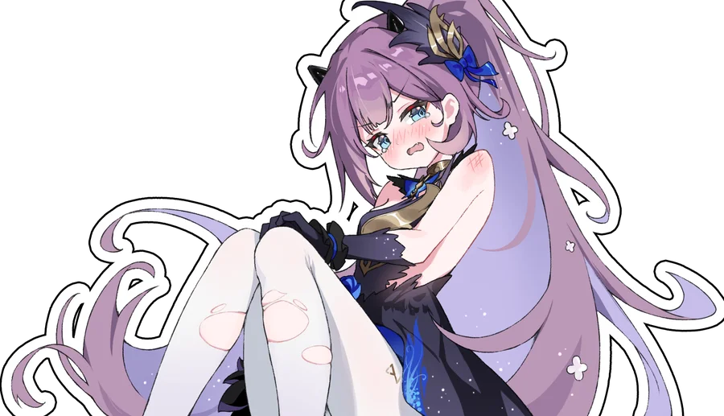
- 半身像（星币≥20）：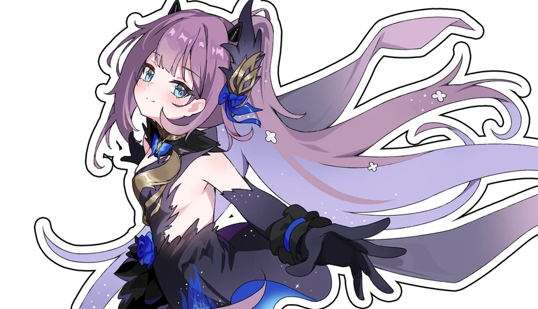

**皮肤故事**：“你什么时候开始练的啊？这也太酷了！”照看完真梦梓的表演，一个劲地夸赞，高兴得像个孩子。

“御主有所不知，我几年前还很怕生，连在家族人面前露脸都显得很拘谨。”真梦梓拿起姑姑递来的毛巾。

“有一天姑姑偷偷带着我跑到附近的溜冰场，看到那些在冰面起舞的人，觉得他们很有魅力。”

“当时我让她走，她非要再看看，我随口说了一句‘要不你也试试？’结果她就一直练到现在。”苍鲤无奈地耸了耸肩。

“虽然练了这么长时间，但还停留在两周跳呢。”显然真梦梓对自己的成长不是很满意。

“想什么呢，你只是当作业余运动来玩的，已经很好了！”苍鲤接过毛巾吐槽到。

“确实啊，我也觉得挺厉害的，再来几组？”照已经迫不及待地想看接下来的表演了。

“那继续滑两段吧，真的献丑了，御主。”

 那天，照回忆起在电视上看到过的花样滑冰解说词，什么叫做：“容颜如玉，身姿如松，翩若惊鸿，婉若游龙。”

## 表情（共 12 个）

| # | 名称 | 品质 | 获取方式 | 图片 |
| --- | --- | --- | --- | --- |
| 1 | 表情 |  |  | 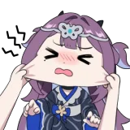 |
| 2 | 表情1 |  |  |  |
| 3 | 表情2 |  |  |  |
| 4 | 表情3 |  |  |  |
| 5 | 表情4 |  |  |  |
| 6 | 表情5 |  |  |  |
| 7 | 表情6 |  |  |  |
| 8 | 表情7 |  |  |  |
| 9 | 表情8 |  |  |  |
| 10 | 表情9 |  |  |  |
| 11 | 表情10 |  |  |  |
| 12 | 表情11 |  |  |  |

## 装扮

官方 wiki 未提供该角色的 /获取 页，头像、名片、卡牌、骰子清单暂缺。

## 人物传记

现在是正儿八经的天川家家主，掌管家族及外部的一切管理权。

## 画廊其他素材

- 起始点：
- 像素头像：
- Lv4羁绊等级奖励：
- Lv5羁绊等级奖励：
- 缔结契约名片奖励：
- 冰上舞者皮肤名片：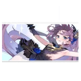
