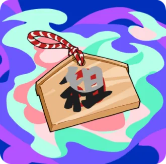

# 古怪的附灵物
> 分类：卡牌/手牌
> 编号：21017
> 类型：Effect
> 来源：https://wiki.biligame.com/starengine/%E5%8F%A4%E6%80%AA%E7%9A%84%E9%99%84%E7%81%B5%E7%89%A9

## 卡牌效果

合作挑战（PVE）：抉择：释放青魂；释放赤魂

## 资料

- **编号**：21017
- **类型**：Effect
- **对象**：Entity
- **英文名**：Quirky Enchanted
- **来源**：地图卡牌:御魂庆典

## 详解

注意：古怪的附灵物仅在合作挑战模式的地图御魂庆典中，当难度为极限时作为专属卡牌出现。

## 历史

*2026年2月6日
**对文本进行了标准化。
*2025年12月5日
**引入游戏。

## 图片

