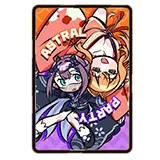

# 龙宫秘宝争夺战（下半场）
> 分类：活动
> 来源：https://wiki.biligame.com/starengine/%E9%BE%99%E5%AE%AB%E7%A7%98%E5%AE%9D%E4%BA%89%E5%A4%BA%E6%88%98%EF%BC%88%E4%B8%8B%E5%8D%8A%E5%9C%BA%EF%BC%89

## 活动任务

活动任务活动任务
08.01-08.31
 25/2525/25 
×1 累计参与PVE天数≥1天 1/1   
×2 累计参与PVE天数≥3天 3/3   
×2 累计参与PVE天数≥7天 7/7   
×3 累计参与PVE天数≥10天 10/10   
×1 合作挑战模式游玩次数≥1次 1/1   
×3 合作挑战模式游玩次数≥5次 5/5   
×3 合作挑战模式游玩次数≥10次 10/10   
×1 困难难度及以上援助蛟/鲤获得胜利≥1次 1/1   
×2 困难难度及以上援助蛟/鲤获得胜利≥5次 5/5   
×3 困难难度及以上援助蛟/鲤获得胜利≥10次 10/10   
×2 完成游戏后为其他玩家点赞≥5次 5/5   
×4 完成游戏后为其他玩家点赞≥10次 10/10   
×6 完成游戏后为其他玩家点赞≥20次 20/20   
×2 完成天川真梦梓的特殊任务 1/1   
×2 完成天川苍鲤的特殊任务 1/1   
×1 天川真梦梓和天川苍鲤的特殊任务均完成 1/1  

## 活动商店

门楼雪花球 ×10 限购3248 门楼雪花球 ×1 28 抽奖券 ×1 限购2020 时装券 ×1 限购1025 善财天宫-帕露南 ×1 限购1666 名片-善财天宫（动态） ×1 限购1500 名片-善财天宫 ×1 限购160 商业之主表情10（动态） ×1 限购1100 商业之主表情11（动态） ×1 限购1100 头像-蛟龙鼠 ×1 限购130 头像-天宫鼠 ×1 限购1120 卡牌-龙门 ×1 限购130 卡牌-天川家 ×1 限购1120 星币 ×10 3
