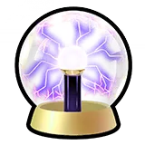
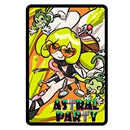

# 魔怪舞会（上半场）
> 分类：活动
> 来源：https://wiki.biligame.com/starengine/%E9%AD%94%E6%80%AA%E8%88%9E%E4%BC%9A%EF%BC%88%E4%B8%8A%E5%8D%8A%E5%9C%BA%EF%BC%89

## 活动任务

活动任务活动任务
09.28-10.31
 40/4040/40 
×2 累计参与PVE天数≥1天 1/1   
×2 累计参与PVE天数≥3天 3/3   
×3 累计参与PVE天数≥5天 5/5   
×3 累计参与PVE天数≥7天 7/7   
×3 累计参与PVE天数≥10天 10/10   
×2 合作挑战模式游玩次数≥1次 1/1   
×2 合作挑战模式游玩次数≥5次 5/5   
×3 合作挑战模式游玩次数≥10次 10/10   
×4 合作挑战模式游玩次数≥15次 15/15   
×2 击败科学怪人嘎呜5次 5/5   
×3 击败科学怪人嘎呜10次 10/10   
×4 击败科学怪人嘎呜15次 15/15   
×2 在幽魂暗巷中使用糖果≥1次 1/1   
×2 在幽魂暗巷中使用糖果≥5次 5/5   
×3 在幽魂暗巷中使用糖果≥10次 10/10   
×1 在幽魂暗巷中使用糖果≥20次 20/20   
×1 幽魂暗巷噩梦及以上难度胜利≥1次 1/1  

## 活动商店

闪电雪花球 ×10 限购3248 闪电雪花球 ×1 28 时装券 ×1 限购1025 科学怪探-芬妮 ×1 限购1666 名片-科学怪探（动态） ×1 限购1500 名片-科学怪探 ×1 限购160 古怪神探表情14（动态） ×1 限购1100 古怪神探表情15（动态） ×1 限购1100 头像-科学怪鼠 ×1 限购130 头像-怪探鼠鼠 ×1 限购1120 卡牌-不明液体 ×1 限购130 卡牌-怪人冲击 ×1 限购1120 星币 ×10 3
