# 邦妮（毒苹果）
> 分类：角色 · 编号 127 · 女
> 来源：https://wiki.biligame.com/starengine/%E9%82%A6%E5%A6%AE

与芬妮同期毕业于中城大学法学系，同样有博士学位。邦妮的性格非常极端，曾经干出过因为抓宿舍老鼠而差点点燃整个宿舍楼的举动。不过她思维明晰、头脑聪明，很多人称呼她为“毒苹果”。与芬妮在联合城齐名的大侦探，但是两人性格很合不来。

## 战斗数值

| 攻击 | 防御 | 生命 |
| --- | --- | --- |
| 2 | 1 | 9 |

## 技能

### 主动技能：隐匿行动（冷却 3）

指定一个敌方角色施加调查目标（被击倒时，触发【秘密调查】）与2层标记（受到伤害+1）。
拥有调查目标（被击倒时，触发【秘密调查】）的角色被击倒后，获得5星币。

**PVE**：指定一个怪物施加调查目标（被击倒时，触发【秘密调查】，并将【秘密调）与1层标记（受到伤害+1），并获得目标标记层数*2的星币。

### 被动技能：关键线索

将 【隐匿调查】 置入地图事件池。
攻击拥有标记（受到伤害+1）的角色时，攻击力+3。击倒拥有标记（受到伤害+1）的角色时，获得1张战斗牌。

**PVE**：将 【隐匿调查】 置入地图事件池。
攻击拥有标记（受到伤害+1）的怪物时，攻击力+3。击倒拥有标记（受到伤害+1）的怪物时，获得1张战斗牌。

## 基础资料

- 姓名：邦妮・莫拉 ・格伦伍德
- 英文名：Bonnie
- 日文名：ボニー
- 从属组织：中城大学
- 上线时间：202602061000
- 生日：1月1日
- 喜欢食物：苹果派
- 初始骰子：古董相机骰子
- 礼物：智能手机、小熊玩偶、水手服
- 徽章：熔岩、月光

## PVE 特性

- 达到1星时攻击力+1
- 初始星币+6
- 达到3星时攻击力+1、防御力+1、移动速度+1

## 皮肤（共 4 套）

> 皮肤编号取自素材文件名；「默认」「羁绊皮肤」也是独立皮肤。

### 1. 默认（初始）

- 素材编号：127
- 立绘：
- Q版立绘：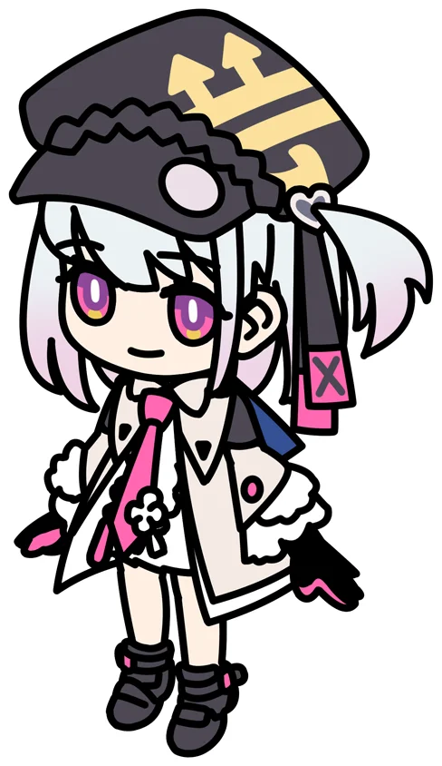
- 头像：
- Q版头像：
- 半身像（星币<20）：
- 半身像（星币≥20）：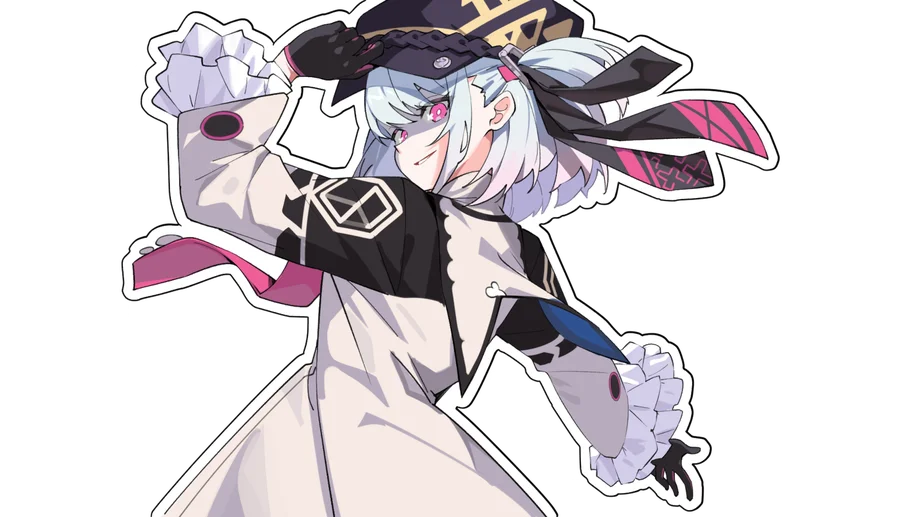

### 2. 羁绊皮肤（羁绊解锁）

- 素材编号：127_Max
- 立绘：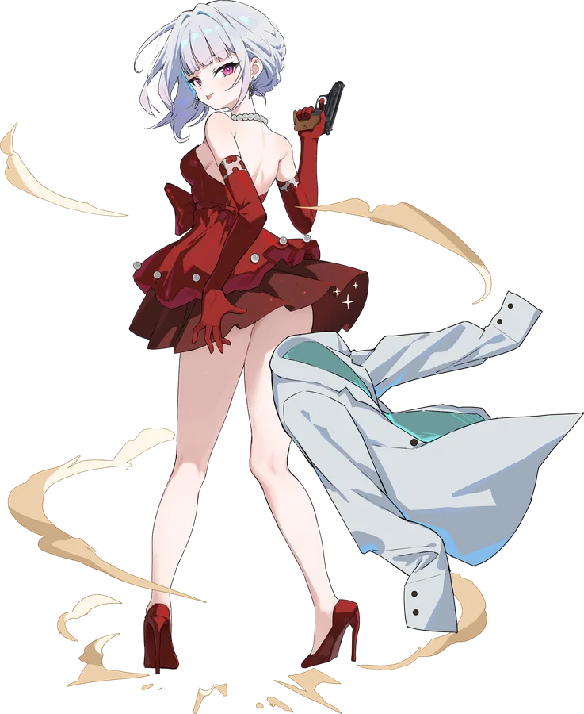
- 立绘（和谐版）：
- Q版立绘：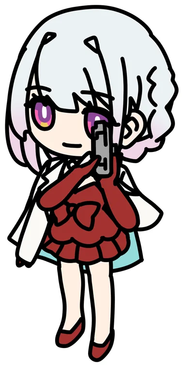
- 头像：
- Q版头像：
- 半身像（星币<20）：
- 半身像（星币≥20）：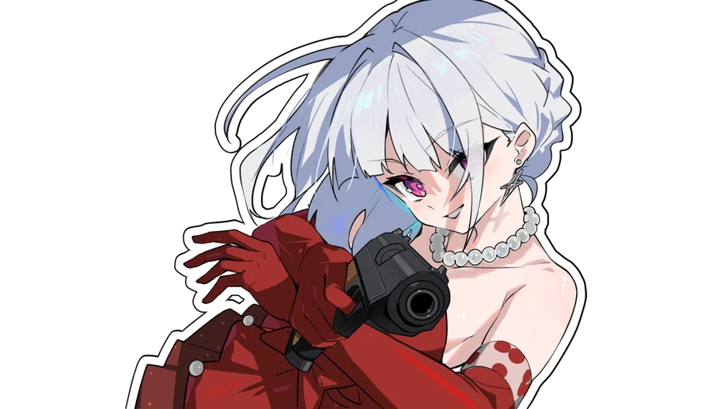

### 3. 紧急邀约（蓝品质）

- 素材编号：127_01
- 立绘：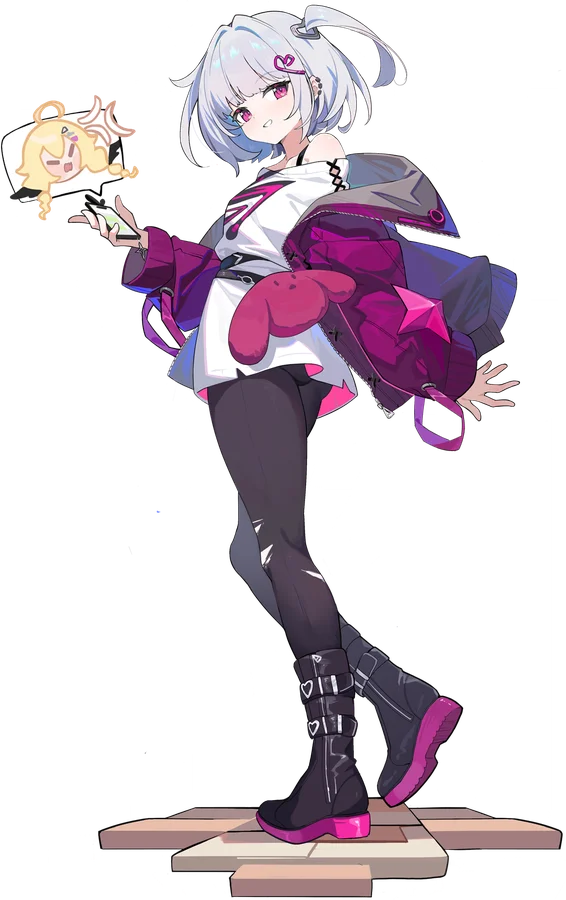
- 立绘（和谐版）：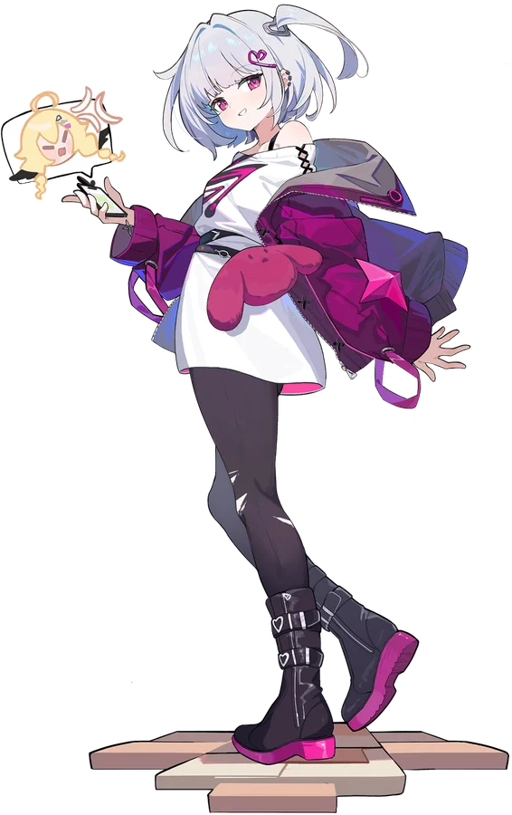
- Q版立绘：
- 头像：
- Q版头像：
- 半身像（星币<20）：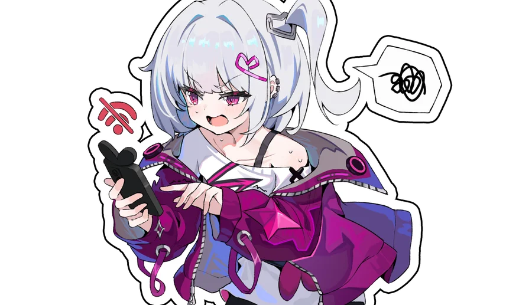
- 半身像（星币≥20）：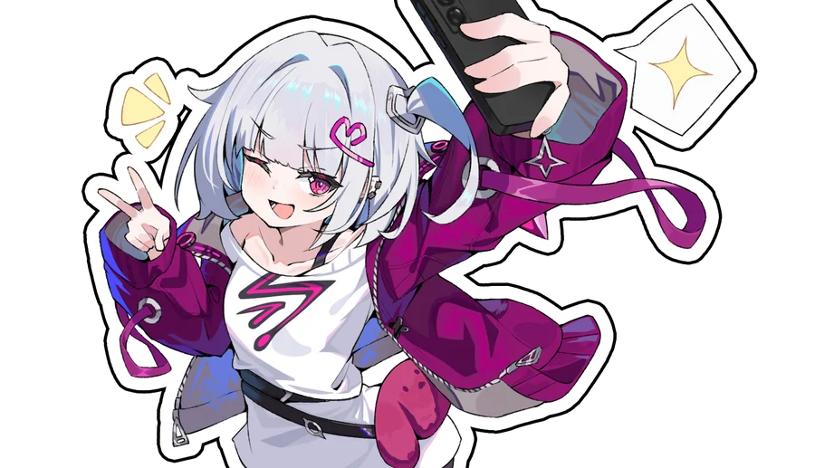

**皮肤故事**：“侦探大人好慢啊，难得我这有电影票让你出来看电影并且请你吃饭。”邦妮对着电话那头的人发起了牢骚，语气听起来更像是调侃。

“你这人真是的！哪有突然叫人到电影院！我告诉你，今天你要不给我合理的解释，我和你没完！”电话里传来了芬妮的声音，邦妮把电话拿远，听那头的芬妮嚎叫着。

“叫你看电影吃饭而已，用得着解释这么多吗？”

“你没理由会叫我吃饭看电影？我才不信咧！”芬妮还是不太相信，依然不依不饶。

“那刚好我就有空，你也知道的嘛，我也没什么其他的朋友，损友和仇人倒是不少。”

“我才不是你朋友呢！快说什么事情！”芬妮暴躁的声音越来越大。

“等你来了我再告诉你，啊不对，等你陪我看完电影吃完饭再告诉你。”邦妮怪怪地笑了一下。

“我不管！你快点先告诉我！”

“那就在电影院门口等你咯？”

“啊？喂！快告诉……嘟嘟嘟……”

“笨蛋吗？哪里那么多理由啊，嘿嘿。”邦妮一边自言自语，一边挂断了电话。

### 4. 小红帽（紫品质）

- 素材编号：127_02
- 立绘：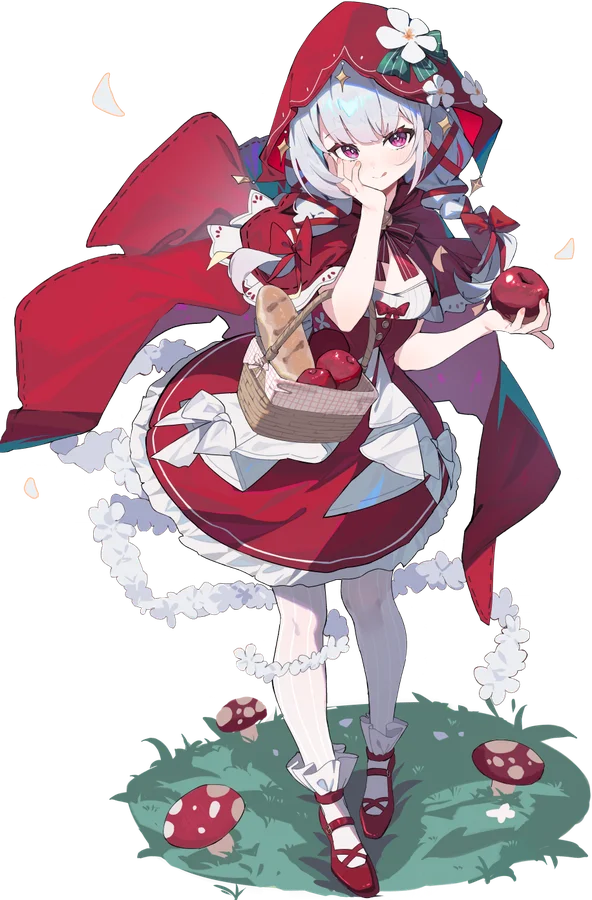
- Q版立绘：
- 头像：
- Q版头像：
- 半身像（星币<20）：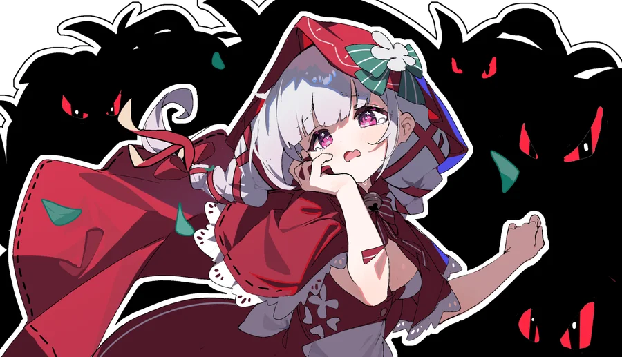
- 半身像（星币≥20）：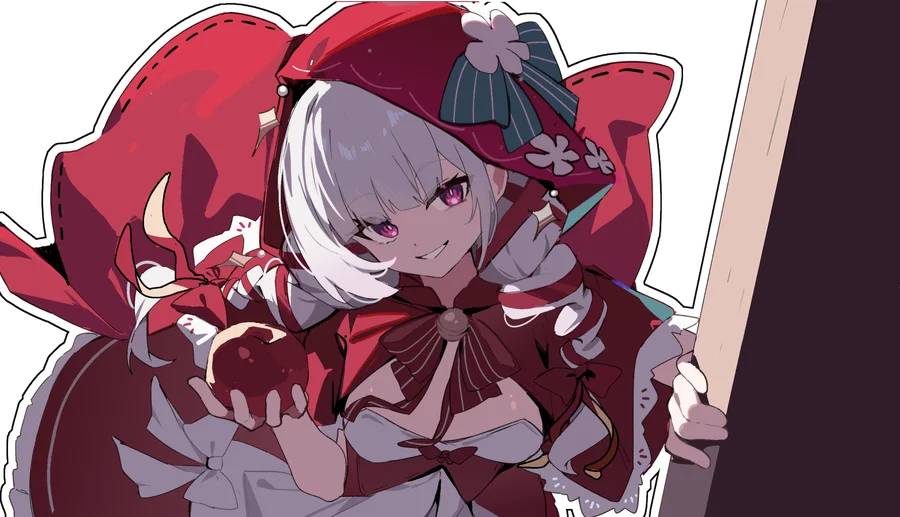

**皮肤故事**：“要我说，小红帽就应该果断出击！”

 “啊？你到底会不会讲故事啊？”芬妮拿着绘本，惊讶地看着对着小孩子们大放厥词的邦妮。

 “来，我告诉你，其实小红帽根本不是去看外婆的。她就是去杀死大灰狼的！”

 “哦哦哦？！”

 “她篮子里装的苹果，其实都是炸弹！”

 “哦哦哦哦哦！”小朋友们都兴奋地喊了起来，芬妮已经不知道该吐槽什么了。

 “她这身打扮，其实是为了伪装，把自己变得人畜无害，好让大灰狼放松警惕！然后再用苹果炸弹，毁掉整个森林！”

 “嗯？姐姐不是说去打大灰狼吗？”一个小姑娘突然歪着头问道。

 “对啊！你想啊，万一森林里还有别的怪物怎么办？干脆把森林都烧掉！这样就能一锅端了！”

 “不对！还有会飞的东西如果要逃跑了，就得……唔唔唔唔。”

 “好了好了，今天的绘本时间到此结束，自由活动吧~”

 芬妮捂住邦妮的嘴，把她拖离了孩子们的包围。

 再让她这样说下去，地球就完了。

## 表情（共 15 个）

| # | 名称 | 品质 | 获取方式 | 图片 |
| --- | --- | --- | --- | --- |
| 1 | 表情1 |  |  |  |
| 2 | 表情2 |  |  |  |
| 3 | 表情3 |  |  |  |
| 4 | 表情4 |  |  |  |
| 5 | 表情5 |  |  |  |
| 6 | 表情6 |  |  |  |
| 7 | 表情7 |  |  |  |
| 8 | 表情8 |  |  |  |
| 9 | 表情9 |  |  |  |
| 10 | 表情10 |  |  |  |
| 11 | 表情11 |  |  | 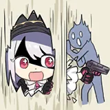 |
| 12 | 表情12 |  |  |  |
| 13 | 表情13 |  |  | 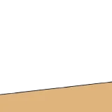 |
| 14 | 表情14 |  |  |  |
| 15 | 表情15 |  |  |  |

## 装扮

官方 wiki 未提供该角色的 /获取 页，头像、名片、卡牌、骰子清单暂缺。

## 人物传记

正在调查芬妮失踪的整个事件。

## 画廊其他素材

- 起始点：
- 像素头像：
- Lv4羁绊等级奖励：
- Lv5羁绊等级奖励：
- 缔结契约名片奖励：
- 紧急邀约皮肤名片：
- 小红帽皮肤名片：
