# 墨影（小猎手）
> 分类：角色 · 编号 111 · 男
> 来源：https://wiki.biligame.com/starengine/%E5%A2%A8%E5%BD%B1

南希露的“室友”，曾和南希露去世的搭档一起出线下任务。以“猫”的形态活动的生物，因为全身黑色自称“墨影”。性格有点大叔，但说话口气又比较小孩子。不知道是“猫”形态太久，还是怎么的，行为举止和思维越来越“猫化”。

## 战斗数值

| 攻击 | 防御 | 生命 |
| --- | --- | --- |
| 2 | 1 | 10 |

## 技能

### 主动技能：暗影融合（冷却 3）

吸收所有影子，每吸收一个影子使自己攻击力+1，防御力+1，持续1回合。

**PVE**：选择一个影子进行传送，随后吸收所有影子。每吸收一个影子使自己攻击力+1，持续1回合。

### 被动技能：双生之影

回合开始和攻击命中时，在墨影所在的地块放置一个【影子】，持续2回合。敌方角色与怪物停留在影子上时受到1点伤害。

## 基础资料

- 姓名：墨影
- 英文名：InkShadow
- 日文名：スミカゲ
- 从属组织：虹之镜酒吧
- 上线时间：202602061000
- 生日：未知
- 喜欢食物：高热量的油炸食品
- 初始骰子：毛线团骰子
- 礼物：商品巧克力、新款平板电脑、小怪兽手办
- 徽章：阴影、大气

## PVE 特性

- 达到1星时攻击力+1
- 达到2星时攻击力+2
- 达到3星时攻击力+1、移动速度+2

## 皮肤（共 2 套）

> 皮肤编号取自素材文件名；「默认」「羁绊皮肤」也是独立皮肤。

### 1. 默认（初始）

- 素材编号：111
- 立绘：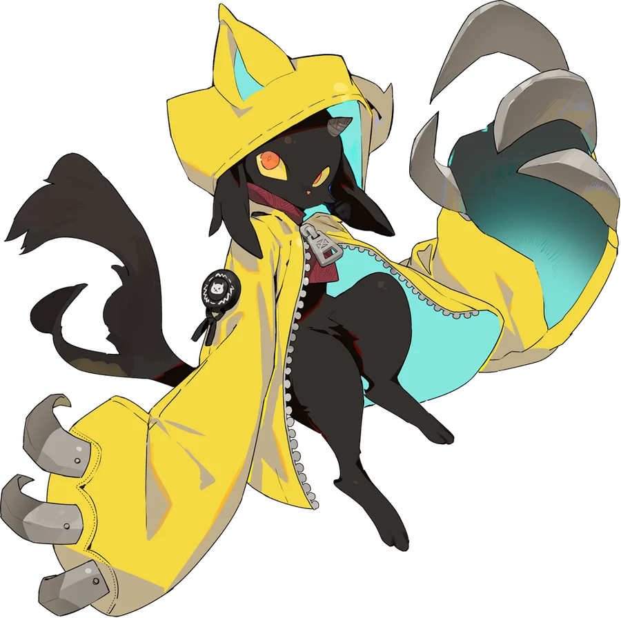
- Q版立绘：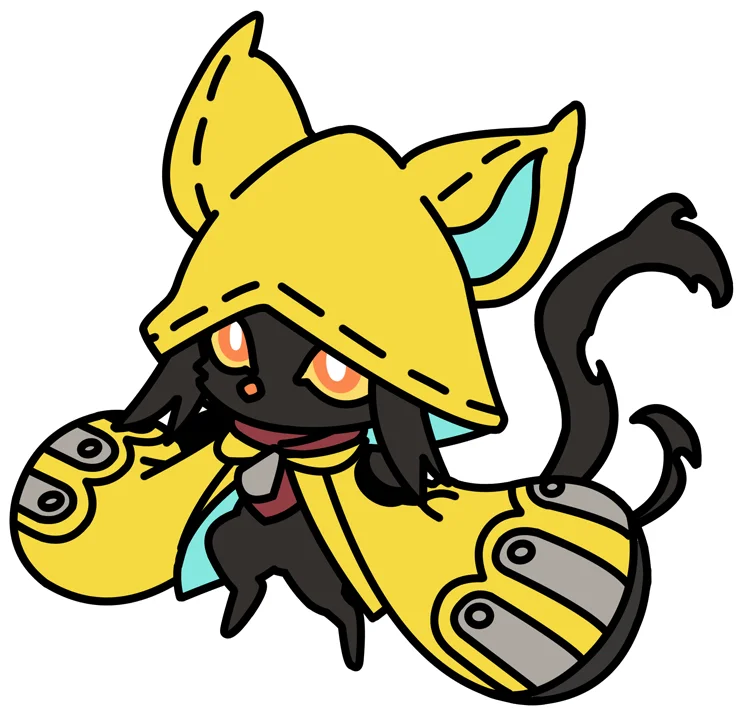
- 头像：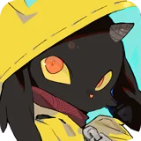
- Q版头像：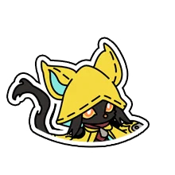
- 半身像（星币<20）：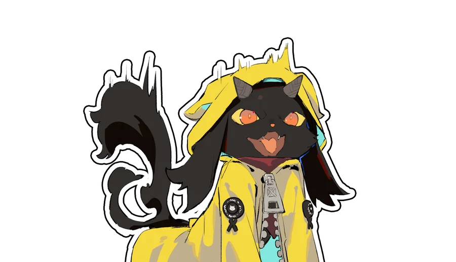
- 半身像（星币≥20）：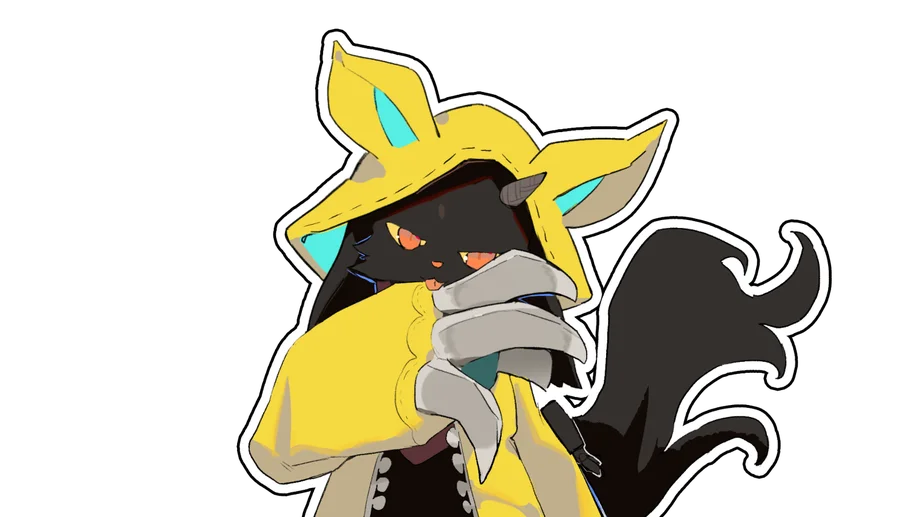

### 2. 羁绊皮肤（羁绊解锁）

- 素材编号：111_Max
- 立绘：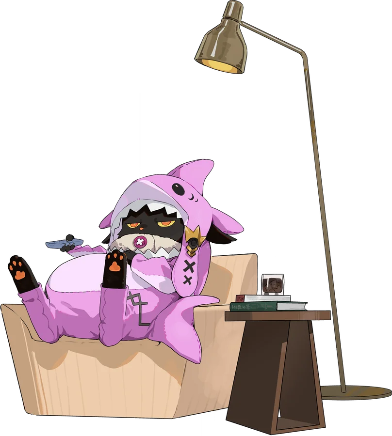
- Q版立绘：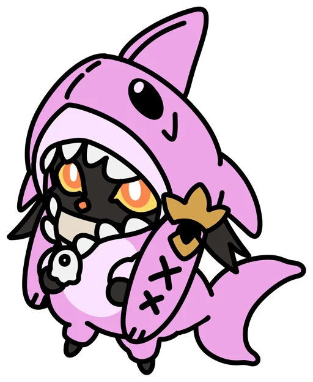
- 头像：
- Q版头像：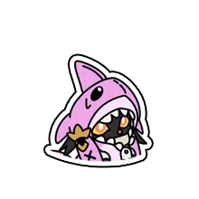
- 半身像（星币<20）：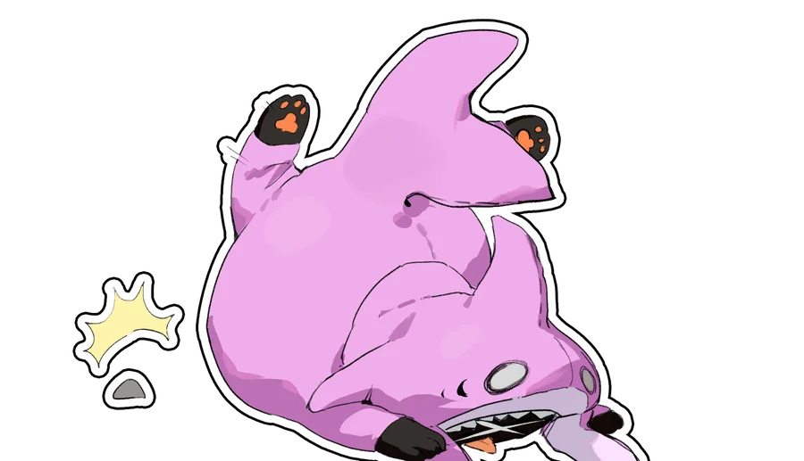
- 半身像（星币≥20）：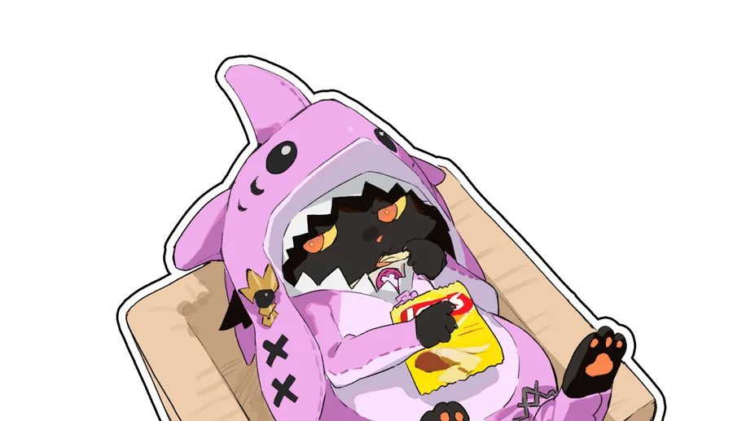

## 表情（共 8 个）

| # | 名称 | 品质 | 获取方式 | 图片 |
| --- | --- | --- | --- | --- |
| 1 | 表情1 |  |  |  |
| 2 | 表情2 |  |  | 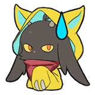 |
| 3 | 表情3 |  |  | 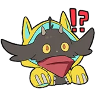 |
| 4 | 表情4 |  |  | 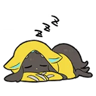 |
| 5 | 表情5 |  |  |  |
| 6 | 表情6 |  |  | 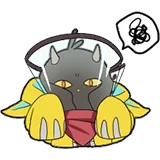 |
| 7 | 表情7 |  |  | 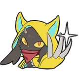 |
| 8 | 表情8 |  |  |  |

## 装扮

官方 wiki 未提供该角色的 /获取 页，头像、名片、卡牌、骰子清单暂缺。

## 人物传记

南希露的亲友茶发生意外的时候，他就在身边见证了一切。

## 画廊其他素材

- 起始点：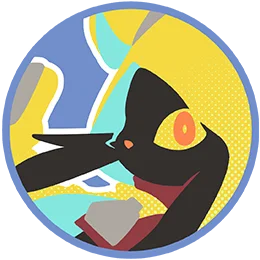
- 像素头像：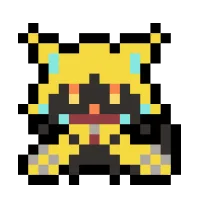
- Lv4羁绊等级奖励：
- Lv5羁绊等级奖励：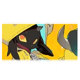
- 缔结契约名片奖励：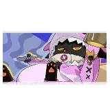
