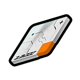

# 探天助手
> 分类：活动
> 来源：https://wiki.biligame.com/starengine/%E6%8E%A2%E5%A4%A9%E5%8A%A9%E6%89%8B

## 活动任务

活动任务活动任务
10.06-10.31
 2050/3300 
×30 登陆游戏（每日刷新） 1/1   
×20 完成游戏后为其他玩家点赞≥1次（每日刷新） 1/1   
×50 解锁Z3000 1/1   
×50 将角色Z3000的PVE等级升级到5级 1/1   
×50 活动期间累计参与派对，累计≥1天 1/1   
×100 活动期间累计参与派对，累计≥3天 3/3   
×100 活动期间累计参与派对，累计≥5天 5/5   
×150 活动期间累计参与派对，累计≥7天 7/7   
×200 活动期间累计参与派对，累计≥10天 10/10   
×50 累计完成标准或合作模式的对局≥1次 1/1   
×100 累计完成标准或合作模式的对局≥5次 5/5   
×100 累计完成标准或合作模式的对局≥10次 10/10   
×150 累计完成标准或合作模式的对局≥15次 15/15   
×100 星趴·梦想号胜利≥2次 2/2   
×100 御魂庆典胜利≥2次 2/2   
×100 水乡古镇胜利≥2次 2/2   
×100 魔法学院胜利≥2次 2/2   
×100 龙宫游乐园胜利≥2次 2/2   
×100 幽魂暗巷胜利≥2次 2/2  

## 活动商店

探天助手-Z3000 ×1 限购11500 名片-探天助手 ×1 限购1400 时装券 ×1 限购550 抽奖券 ×1 限购550 中级战斗宝典 ×1 限购550 手作巧克力 ×1 限购330 非常牛的电脑配件 ×1 限购330 小怪兽手办 ×1 限购330 水手服 ×1 限购330 陈年的红酒 ×1 限购330 星币 ×10 1 数据芯片 ×10 限购360
