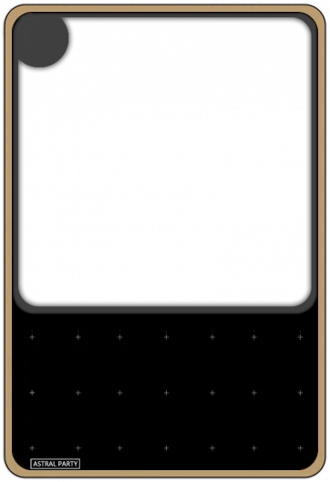
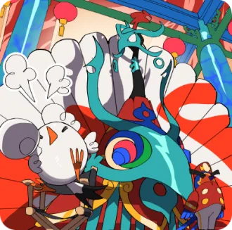
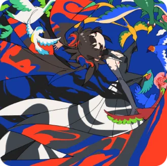
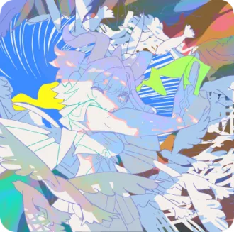
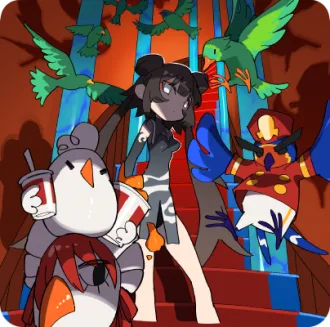
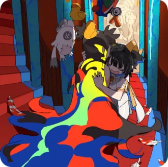
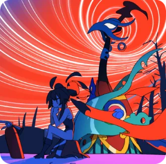
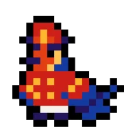
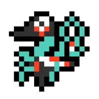
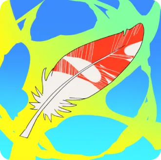

# 园林中庭
> 分类：地图
> 来源：https://wiki.biligame.com/starengine/%E5%9B%AD%E6%9E%97%E4%B8%AD%E5%BA%AD

## 地图背景

隆兴饭店坐落于凰区最繁华的‘天华街’。整条街长达数公里，汇聚了全联合城最顶级的餐饮、娱乐与购物综合体。但即使在寸土寸金的地段，隆兴饭店仍以规模宏大著称——其餐饮区域宽敞，甚至设有独立中庭，顾客在用餐后可在中庭散步、观赏。饭店右侧为酒店，左侧则是制作糕点的快餐店。

## 地图剧情

观看剧情（p5211.md）

### 铜盏孔雀试炼

与凤争风

与凤争风
与凤争风

刷新1个铜盏孔雀，2个迎宾燕

孔雀之舞

孔雀之舞
孔雀之舞

姬梦枫（孔雀意识）登场，刷新1个铜盏仙鹤。所有怪物攻击力＋1,防御力＋1

无彩

无彩
无彩

刷新1个铜盏孔雀，1个铜盏仙鹤。所有怪物攻击力＋1,防御力＋1

任务 击倒家禽服务员0\1 进入铜盏孔雀试炼 击倒迎宾燕0\3 所有角色获得 强化筹码*1 击倒铜盏仙鹤0\2 所有玩家获得 强化筹码*1 击倒铜盏孔雀0\1 所有玩家获得 强化筹码*1 进入姬梦枫的内心 击倒铜盏孔雀0\2 所有玩家获得 强化筹码*1 战胜姬梦枫（孔雀意识）0\1 姬梦枫解放

百鸟与凤
百鸟与凤 收集凤凰的力量 23456

百鸟冲击
百鸟冲击 刷新2个迎宾燕，2个铜盏仙鹤。所有怪物攻击力＋1,防御力＋1 891011121314151617

任务 击倒家禽服务员0\1 进入铜盏孔雀试炼 击倒迎宾燕0\3 所有角色获得 强化筹码*1 击倒铜盏仙鹤0\2 所有玩家获得 强化筹码*1 击倒铜盏孔雀0\1 所有玩家获得 强化筹码*1 进入姬梦枫的内心 击倒铜盏孔雀0\2 所有玩家获得 强化筹码*1 战胜姬梦枫（孔雀意识）0\1 姬梦枫解放 百鸟与凤
百鸟与凤 收集凤凰的力量 23456 百鸟冲击
百鸟冲击 刷新2个迎宾燕，2个铜盏仙鹤。所有怪物攻击力＋1,防御力＋1 891011121314151617

任务 击倒家禽服务员0\1 进入铜盏孔雀试炼 击倒迎宾燕0\3 所有角色获得 强化筹码*1 击倒铜盏仙鹤0\2 所有玩家获得 强化筹码*1 击倒铜盏孔雀0\1 所有玩家获得 强化筹码*1 进入姬梦枫的内心 击倒铜盏孔雀0\2 所有玩家获得 强化筹码*1 战胜姬梦枫（孔雀意识）0\1 姬梦枫解放 百鸟与凤
百鸟与凤 收集凤凰的力量 23456 百鸟冲击
百鸟冲击 刷新2个迎宾燕，2个铜盏仙鹤。所有怪物攻击力＋1,防御力＋1 8910111213141516

任务 击倒家禽服务员0\1 进入铜盏孔雀试炼 击倒迎宾燕0\3 所有角色获得 强化筹码*1 击倒铜盏仙鹤0\2 所有玩家获得 强化筹码*1 击倒铜盏孔雀0\1 所有玩家获得 强化筹码*1 进入姬梦枫的内心 击倒铜盏孔雀0\2 所有玩家获得 强化筹码*1 战胜姬梦枫（孔雀意识）0\1 姬梦枫解放 百鸟与凤
百鸟与凤 收集凤凰的力量 23456 百鸟冲击
百鸟冲击 刷新2个迎宾燕，2个铜盏仙鹤。所有怪物攻击力＋1,防御力＋1 8910111213141516

### 铜盏鸳鸯试炼

鸳鸯比翼

鸳鸯比翼
鸳鸯比翼

刷新2个铜盏鸳鸯，2个迎宾燕

鸳之绊

鸳之绊
鸳之绊

姬梦枫（鸳鸯意识）登场，刷新1个铜盏仙鹤。所有怪物攻击力＋1,防御力＋1

华彩

华彩
华彩

刷新2个铜盏鸳鸯，1个铜盏仙鹤。所有怪物攻击力＋1,防御力＋1 任务 收集2个神秘的蛋0\2 进入铜盏鸳鸯试炼 击倒迎宾燕0\3 所有角色获得 强化筹码*1 击倒铜盏仙鹤0\2 所有玩家获得 强化筹码*1 击倒铜盏鸳鸯0\2 所有玩家获得 强化筹码*1 进入姬梦枫的内心 击倒铜盏鸳鸯0\4 所有玩家获得 强化筹码*1 战胜姬梦枫（鸳鸯意识）0\1 姬梦枫解放 百鸟与凤
百鸟与凤 收集凤凰的力量 23456 百鸟冲击
百鸟冲击 刷新2个迎宾燕，2个铜盏仙鹤。所有怪物攻击力＋1,防御力＋1 891011121314151617 任务 收集2个神秘的蛋0\2 进入铜盏鸳鸯试炼 击倒迎宾燕0\3 所有角色获得 强化筹码*1 击倒铜盏仙鹤0\2 所有玩家获得 强化筹码*1 击倒铜盏鸳鸯0\2 所有玩家获得 强化筹码*1 进入姬梦枫的内心 击倒铜盏鸳鸯0\4 所有玩家获得 强化筹码*1 战胜姬梦枫（鸳鸯意识）0\1 姬梦枫解放 百鸟与凤
百鸟与凤 收集凤凰的力量 23456 百鸟冲击
百鸟冲击 刷新2个迎宾燕，2个铜盏仙鹤。所有怪物攻击力＋1,防御力＋1 891011121314151617 任务 收集2个神秘的蛋0\2 进入铜盏鸳鸯试炼 击倒迎宾燕0\3 所有角色获得 强化筹码*1 击倒铜盏仙鹤0\2 所有玩家获得 强化筹码*1 击倒铜盏鸳鸯0\2 所有玩家获得 强化筹码*1 进入姬梦枫的内心 击倒铜盏鸳鸯0\4 所有玩家获得 强化筹码*1 战胜姬梦枫（鸳鸯意识）0\1 姬梦枫解放 百鸟与凤
百鸟与凤 收集凤凰的力量 23456 百鸟冲击
百鸟冲击 刷新2个迎宾燕，2个铜盏仙鹤。所有怪物攻击力＋1,防御力＋1 8910111213141516 任务 收集2个神秘的蛋0\2 进入铜盏鸳鸯试炼 击倒迎宾燕0\3 所有角色获得 强化筹码*1 击倒铜盏仙鹤0\2 所有玩家获得 强化筹码*1 击倒铜盏鸳鸯0\2 所有玩家获得 强化筹码*1 进入姬梦枫的内心 击倒铜盏鸳鸯0\4 所有玩家获得 强化筹码*1 战胜姬梦枫（鸳鸯意识）0\1 姬梦枫解放 百鸟与凤
百鸟与凤 收集凤凰的力量 23456 百鸟冲击
百鸟冲击 刷新2个迎宾燕，2个铜盏仙鹤。所有怪物攻击力＋1,防御力＋1 8910111213141516

### 失控凤凰

进入方式：

- 在同一回合完成“击倒家禽服务员”与“收集2个神秘的蛋”两个任务后，在回合结束时选择“献上一切”；
- 或是在完成其中一个任务的回合结束时，选择“深入调查”，完成另一任务后即可进入该路线。

全面失控

全面失控
全面失控

失控凤凰登场，刷新1个铜盏孔雀，2个迎宾燕

绚烂华彩

绚烂华彩
绚烂华彩

刷新2个铜盏鸳鸯

最终试炼

最终试炼
最终试炼

刷新1个铜盏孔雀，1个铜盏鸳鸯。所有怪物防御力＋1 任务 击倒家禽服务员0\1 进入铜盏孔雀试炼 收集2个神秘的蛋0\2 进入铜盏鸳鸯试炼 击倒迎宾燕0\3 所有角色获得 强化筹码*1 击倒铜盏仙鹤0\2 所有玩家获得 强化筹码*1 击倒铜盏孔雀0\1 所有玩家获得 强化筹码*1 击倒铜盏鸳鸯0\2 所有玩家获得 强化筹码*1 战胜失控凤凰0\1 姬梦枫解放 百鸟与凤
百鸟与凤 收集凤凰的力量 23456 百鸟冲击
百鸟冲击 刷新2个迎宾燕，2个铜盏仙鹤。所有怪物攻击力＋1,防御力＋1 891011121314151617 任务 击倒家禽服务员0\1 进入铜盏孔雀试炼 收集2个神秘的蛋0\2 进入铜盏鸳鸯试炼 击倒迎宾燕0\3 所有角色获得 强化筹码*1 击倒铜盏仙鹤0\2 所有玩家获得 强化筹码*1 击倒铜盏孔雀0\1 所有玩家获得 强化筹码*1 击倒铜盏鸳鸯0\2 所有玩家获得 强化筹码*1 战胜失控凤凰0\1 姬梦枫解放 百鸟与凤
百鸟与凤 收集凤凰的力量 23456 百鸟冲击
百鸟冲击 刷新2个迎宾燕，2个铜盏仙鹤。所有怪物攻击力＋1,防御力＋1 891011121314151617 任务 击倒家禽服务员0\1 进入铜盏孔雀试炼 收集2个神秘的蛋0\2 进入铜盏鸳鸯试炼 击倒迎宾燕0\3 所有角色获得 强化筹码*1 击倒铜盏仙鹤0\2 所有玩家获得 强化筹码*1 击倒铜盏孔雀0\1 所有玩家获得 强化筹码*1 击倒铜盏鸳鸯0\2 所有玩家获得 强化筹码*1 战胜失控凤凰0\1 姬梦枫解放 百鸟与凤
百鸟与凤 收集凤凰的力量 23456 百鸟冲击
百鸟冲击 刷新2个迎宾燕，2个铜盏仙鹤。所有怪物攻击力＋1,防御力＋1 8910111213141516 任务 击倒家禽服务员0\1 进入铜盏孔雀试炼 收集2个神秘的蛋0\2 进入铜盏鸳鸯试炼 击倒迎宾燕0\3 所有角色获得 强化筹码*1 击倒铜盏仙鹤0\2 所有玩家获得 强化筹码*1 击倒铜盏孔雀0\1 所有玩家获得 强化筹码*1 击倒铜盏鸳鸯0\2 所有玩家获得 强化筹码*1 战胜失控凤凰0\1 姬梦枫解放 百鸟与凤
百鸟与凤 收集凤凰的力量 23456 百鸟冲击
百鸟冲击 刷新2个迎宾燕，2个铜盏仙鹤。所有怪物攻击力＋1,防御力＋1 8910111213141516

## 登场怪物

|  |  |
| --- | --- |
|  | 0

 0

 6

 0

 0

 6

 0

 0

 6

 0

 0

 6

 0

 0

 6 |
|  | 1

 1

 7

 1

 1

 8

 1

 2

 8

 1

 2

 8

 1

 2

 9 |
|  | 3

 1

 10

 4

 1

 11

 4

 2

 12

 5

 2

 13 |
|  | 4

 2

 18

 4

 2

 20

 5

 2

 20

 5

 2

 23 |
|  | 4

 2

 20

 5

 2

 22

 5

 2

 24

 6

 3

 26 |
|  | 5

 2

 40

 5

 3

 45

 6

 4

 50

 7

 4

 55 |
|  | 3

 2

 20

 4

 2

 22

 4

 3

 26

 5

 3

 28 |
|  | 4

 3

 55

 5

 4

 70

 5

 4

 88

 6

 5

 99 |
|  | 3

 2

 50

 3

 3

 65

 4

 4

 80

 5

 5

 90 |
|  | 0

 0

 150

 1

 1

 180

 1

 1

 240

 2

 1

 270 |

## 地图专属筹码

彩羽手环
使用主动技能后，获得1张【彩羽】。每使用3张【彩羽】后，获得1个筹码。 鸳鸯玉佩
拥有【鸳鸯连理】时，移动速度+2。解除【鸳鸯连理】时，攻击力、防御力永久+1。 孔雀扇
攻击命中后，自身获得2 层【温焰】。 被挑战时，消耗3层【温焰】，获得1层【反击】并恢复3点生命。

## 地图专有卡牌

  
 彩羽
彩羽 传送到5格内的地块，并恢复自身3点生命值。 
  
 振作起来
振作起来 来自大家的鼓励！ 

 灰烬之羽
灰烬之羽 不能被使用。回合开始时, 获得1层【温焰】。 移除4层【温焰】：此卡转变为【彩羽】。

## 地图特殊效果/状态

 丨 振作 丨 齐心协力，共克难关。  丨 遗落彩羽 丨 被击倒后，给予击倒者1张【彩羽】  丨 疾驰 丨 移动速度+2。  丨 高升炮 丨 无法反击  丨 神秘的蛋 丨 神秘的蛋，蕴含有微弱的凤凰之力。  丨 孔雀开屏 丨 受到治疗时如果铜盏孔雀在场，则增加 1 层【孔雀开屏】            拥有【孔雀开屏】的角色与铜盏孔雀交战时，每比铜盏孔雀多 1 层【孔雀开屏】】攻击力 +2 ，防御力 +2 。  丨 鸳鸯连理 丨 回合开始时，攻击力和防御力 -1 。            与其他拥有【鸳鸯连理】的角色接触（经过、传送）时，移除【鸳鸯连理】并恢复 2 点生命。  丨 温焰 丨 回合结束时受到 2 点伤害。受到治疗时，减少 1 层。并使攻击力 +1 ，持续 1 回合。

### 2026年2月6日

“隆兴饭店的中庭，连廊和拱桥组成了一个精致的庭院。未知力量将隆兴饭店员工尽数化为飞禽，姬梦枫也陷入昏迷。姬梦枫还能被拯救吗？” 
█ 新增 
◆ 地图【园林中庭】 
◆ 怪物 [ 姬梦枫（孔雀意识） ]、[ 姬梦枫（鸳鸯意识） ]、[ 铜盏鸳鸯 ]、[ 铜盏孔雀 ]、[ 铜盏仙鹤 ]、[ 家禽服务员 ]、[ 迎宾燕 ] 
█ 关键机制 
◆ 在龙星的试炼中，玩家需要击败凤凰之力具象化的铜盏孔雀或铜盏鸳鸯，拯救被控制的姬梦枫。 
◆ 孔雀给予治疗的考验：角色会被怪物施加【孔雀开屏】与【温焰】，治疗处于这些状态的角色，可以令他们获得额外的属性强化。 

◆ 鸳鸯给予移动的考验:角色会被施加【鸳鸯连理】，处于【鸳鸯连理】状态下的角色会被削弱，需要尽快接触其他【鸳鸯连理】状态下的角色来解除状态。

### 2026年2月27日

█ 数值变动 
◆ 怪物 [ 铜盏仙鹤 ] 困难模式下 
5224 调整为 
5222↓ 、噩梦模式下 
5325 调整为 
52↓24↓ 。 
◆ 怪物 [ 铜盏鸳鸯 ] 困难模式下 
4322 调整为 
42↓22 、噩梦模式下 
5326 调整为 
4↓326、疯狂模式下 
6428 调整为 
5↓3↓28 。 
◆ 任务 [ 击倒铜盏仙鹤 0\3 ] 调整为 [ 击倒铜盏仙鹤 0\2↓ ]

### 2026年3月13日

█ 新增 
◆ 地图【园林中庭-分支3】 玩家可以选择集齐神秘的蛋和彩羽来挑战更高难度的首领—失控凤凰，及她率领的孔雀与鸳鸯。 
◆ 筹码 [ 彩羽手环 ]、[ 鸳鸯玉佩 ]、[ 孔雀扇 ] 
◆ 事件 [ 全面失控 ]、[ 绚烂华彩 ]、[ 最终试炼 ] 
◆ 地图卡牌 [ 灰烬之羽 ] 
█ 数值变动 
◆ 进度 疯狂难度下,进度上限由 15 调整为 16↓ 。
