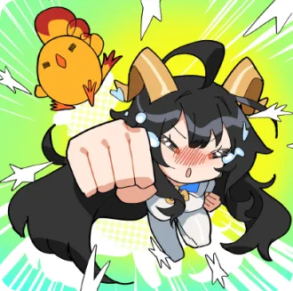

# 振作起来
> 分类：卡牌/手牌
> 编号：21021
> 类型：Effect
> 来源：https://wiki.biligame.com/starengine/%E6%8C%AF%E4%BD%9C%E8%B5%B7%E6%9D%A5

## 卡牌效果

合作挑战（PVE）：来自大家的鼓励！

## 资料

- **编号**：21021
- **类型**：Effect
- **对象**：Entity
- **英文名**：Keep it up!
- **来源**：地图卡牌:园林中庭

## 详解

注意：振作起来仅在合作挑战模式的地图园林中庭中、当本局游戏不跳过剧情时作为专属卡牌出现。

挑战胜利的条件为回合结束时，姬梦枫身上有至少一层鼓励。如果在进度条结束前，姬梦枫没有收到鼓励，将会挑战失败。

## 花絮

*振作起来卡面中心的角色具体如下：
**凤凰(左上)。
**姬梦朝(右下)。

## 历史

*2026年2月6日
**引入游戏。

## 图片

