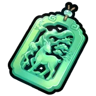

# 龙星的试炼（上半期）
> 分类：活动
> 来源：https://wiki.biligame.com/starengine/%E9%BE%99%E6%98%9F%E7%9A%84%E8%AF%95%E7%82%BC%EF%BC%88%E4%B8%8A%E5%8D%8A%E6%9C%9F%EF%BC%89

## 活动任务

活动任务活动任务
02.06-03.13
 40/4040/40 
×2 累计参与PVE天数≥1天 1/1   
×2 累计参与PVE天数≥3天 3/3   
×3 累计参与PVE天数≥5天 5/5   
×3 累计参与PVE天数≥7天 7/7   
×3 累计参与PVE天数≥10天 10/10   
×2 累计参与合作挑战≥5次 5/5   
×3 累计参与合作挑战≥10次 10/10   
×4 累计参与合作挑战≥15次 15/15   
×2 队伍在园林中庭中击败铜盏孔雀≥5次 5/5   
×3 队伍在园林中庭中击败铜盏孔雀≥10次 10/10   
×4 队伍在园林中庭中击败铜盏孔雀≥15次 15/15   
×2 队伍在园林中庭中击败铜盏鸳鸯≥5次 5/5   
×3 队伍在园林中庭中击败铜盏鸳鸯≥10次 10/10   
×4 队伍在园林中庭中击败铜盏鸳鸯≥15次 15/15   
×1 击败姬梦枫孔雀意识，达成结局 1/1   
×1 击败姬梦枫鸳鸯意识，达成结局 1/1  

## 活动商店

大肉包雪花球 ×10 限购3248 大肉包雪花球 ×1 28 抽奖券 ×1 限购2020 时装券 ×1 限购1025 后厨能手-茉莉 ×1 限购1666 名片-后厨能手（动态） ×1 限购1500 名片-后厨能手 ×1 限购160 家政机器人表情14（动态） ×1 限购1100 家政机器人表情15（动态） ×1 限购1100 头像-黑凤鼠鼠 ×1 限购130 头像-包子头鼠鼠 ×1 限购1120 卡牌-银杏叶 ×1 限购130 卡牌-凤凰附身 ×1 限购1120 星币 ×10 3
