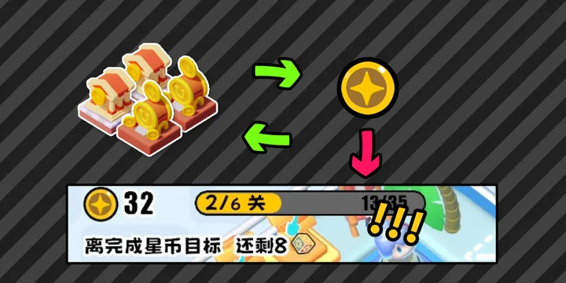
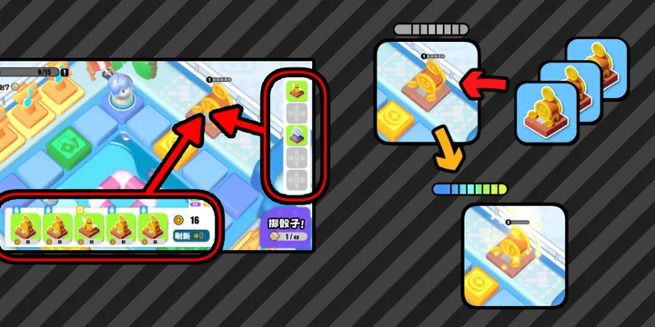
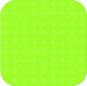
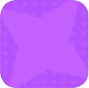

# 吉星小镇
> 分类：其他
> 来源：https://wiki.biligame.com/starengine/%E5%90%89%E6%98%9F%E5%B0%8F%E9%95%87

若要查阅吉星小镇活动，请点击此处。 吉星小镇是一种单人模式，玩家需要通过骰点与建筑来赚取星币并扩建自己的小镇。该模式于2026年2月6日被加入至单人模式。

## 提示

在吉星小镇里，玩家需要通过骰点与建筑来赚取星币并扩建自己的小镇。每隔一段时间，小镇都需要产出足够的星币来证明自己的发展潜力，努力赚取更多星币吧！

引导图一 将【建筑卡牌】拖拽到已经解锁的地块上，就可以部署该【建筑】并发挥它独特的功能。 
如果将【建筑卡牌】拖拽到与自己相同的【建筑】上，可以为已部署的【建筑】增加经验值。积累一定经验值后，【建筑】就会晋升并变得更强大。

引导图二

## 玩法

吉星小镇一共有六个关卡，玩家在每个关卡拥有8次骰点机会，若在8次骰点机会使用完前达到该关卡所需获取的星币数，则进入下一关卡，反之则会强制结束游戏并判定玩家失败。各级所需的星币数如下表所示：

| 关卡 | 关卡1 | 关卡2 | 关卡3 | 关卡4 | 关卡5 | 关卡6 |
| --- | --- | --- | --- | --- | --- | --- |
| 星币数 | 15 | 35 | 80 | 120 | 233 | 350 |

玩家初始拥有6块地皮、3座建筑（小金袋、存钱罐、骰子模型）与5格仓库，初始的3座建筑会置于玩家的仓库内。玩家可以消耗星币买地来增加地皮数量，最多可以拥有12块地皮，即购买6块地皮，玩家每次买地后会使下次买地价格上升，每次买地所需的星币数如下表所示：

| 买地次数 | 1 | 2 | 3 | 4 | 5 | 6 |
| --- | --- | --- | --- | --- | --- | --- |
| 星币数 | 10 | 25 | 40 | 55 | 70 | 85 |

同时，玩家可以在商店中购买更多建筑，并通过合并建筑提升建筑等级，若当前的商店中没有玩家想要购买的建筑，玩家可以消耗星币刷新商店，每次刷新商店后会使下一次刷新价格上升5星币，最多为50星币，刷新次数没有上限。 
玩家每完成一个关卡，可以从随机3个立牌中选择1个立牌，同时商店中更高品质的建筑的刷新概率会上升，如下表：

| 关卡 | 关卡1 | 关卡2 | 关卡3 | 关卡4 | 关卡5 | 关卡6 |
| --- | --- | --- | --- | --- | --- | --- |
| 绿 | 70% | 60% | 50% | 34% | 31% | 30% |
| 蓝 | 28% | 34% | 40% | 48% | 45% | 42% |
| 紫 | 2% | 5% | 8% | 15% | 20% | 23% |
| 金 | 0% | 1% | 2% | 3% | 4% | 5% |

当玩家完成了全部的六个关卡之后，则判定玩家胜利。 
游戏结束后会给出玩家得分，计算方式如下，需注意：全部建筑指代已经放置于地皮上的建筑与仓库中的建筑；若你超出关卡需求星币，溢出部分不计，若你未满关卡需求星币，则按你本关卡已获取的星币计。 
[math]\displaystyle{ 分数 = \left\lceil\frac{星币数}{2}\right\rceil+ 全部建筑价值 + 各关卡需求星币 }[/math]

## 地块

吉星小镇中的地格一共有四种：普通地块、起始点、建筑地块和星币地块。

### 普通地块

无效果。

### 起始点

当角色停留在该地块时，可以在商店购买建筑。玩家经过该地块会强制停留于该地块。

### 建筑地块

当角色停留在该地块时，获得随机1个建筑。

### 星币地块

当角色停留在该地块时，获得5星币。

|  |  |  |  |  |
| --- | --- | --- | --- | --- |
|  |  |  |  |  |
|  |  |  |  |  |
|  |  |  |  |  |
|  |  |  |  |  |
|  |  |  |  |  |

## 建筑

角色可以通过各种方式获得建筑并对建筑升级，每级所需经验如下表所示：

| 等级 | 1 | 2 | 3 | 4 |
| --- | --- | --- | --- | --- |
| 下级经验 | 6 | 12 | 18 | MAX |

全部建筑及相关属性如下表：

| 建筑 | 名称 | 类型 | 各级效果 | 各级售出价 | 购入价 |
| --- | --- | --- | --- | --- | --- |
|  | 小金袋 |  | 骰点结束时，获得1/2/3/4星币 | 4/8/12/16 | 8 |
|  | 存钱罐 |  | 骰出1时，获得2星币与2经验 卖出时，额外获得1/8/25/45星币 |  |  |
|  | 骰子雕塑 |  | 骰出6时，获得6/12/18/24星币 |  |  |
|  | 小书店 |  | 停留时，使得自身与相邻的建筑获得2/3/4/5经验 经过时，获得2/4/6/8星币 | 8/16/24/32 | 16 |
|  | 摇钱树 |  | 停留时，使相邻建筑的骰点星币获取量永久+1/2/3/4 骰出3时，获得2/3/6/9星币 |  |  |
|  | 四叶草之家 |  | 骰出偶数时，获得2/4/6/8星币 如果骰出6，获得星币数永久+1 |  |  |
|  | 许愿池 |  | 骰点结束时，获得1/2/4/6星币 每通过一个关卡，获得星币数永久+1 |  |  |
|  | 小猪银行 |  | 骰点结束时，获得1经验 卖出时，额外获得3/15/35/65星币 |  |  |
|  | 好运彩门 |  | 骰出6时，获得场上建筑数量*1/2/3/4的星币 骰出1时，获得场上建筑数量*1/2/3/4的星币 | 15/30/45/60 | 30 |
|  | 招财猫金库 |  | 骰点结束时，使得所有【存钱罐】与【小猪银行】获得1/1/2/2经验 经过此建筑时，获得1/2/2/3星币，卖出【存钱罐】或【小猪银行】后，使经过时获得的星币量永久+1 |  |  |
|  | 财富殿堂 |  | 骰出3或4时，触发相邻建筑的骰点效果 停留时，使得所有骰点星币获取量永久+1/2/3/4 |  |  |
|  | 幸运星币池 |  | 掷出两枚骰子时，获得6/12/18/24星币 骰点结果为1时，使得下次行动可以掷出两枚骰子 |  |  |
|  | 兔耳餐厅 |  | 经过时，获得X星币，并使随机1个建筑的骰点星币获取量永久+1 | 25/50/75/100 | 50 |
|  | 狐狸古玩店 |  | 骰出5时，自身与随机1/2/2/3个建筑获得1/1/2/2经验 经过时，生成1个【存钱罐】或【小猪银行】 |  |  |
|  | 全息体验屋 |  | 经过时，下次行动可以掷出两枚骰子 掷出两枚骰子时，获得骰点结果*1/2/3/4的星币 |  |  |

## 立牌

| 立牌 | 名字 | 效果 |
| --- | --- | --- |
|  | 猪猪立牌 | 卖出建筑时，充能1 充能4：获得一个【小猪银行】 |
|  | 兔兔立牌 | 经过起始点时，使随机1个建筑的骰点星币获取量永久+1 |
|  | 三叶草立牌 | 骰出6时，充能1 充能6：获得1个随机建筑 |
|  | 银行卡立牌 | 回合开始时，获得1星币 |
|  | 秘典立牌 | 回合开始时，随机1个建筑获得1经验 |
|  | 小浣熊立牌 | 经过建筑时，获得1星币 |
|  | 炸虾立牌 | 骰出1后，下次骰点必定为6 |
|  | 茉莉立牌 | 骰点时获得1充能 充能4：使得下次行动可以掷出两枚骰子 |
|  | 帕露南立牌 | 购买建筑的价格下降25% 出售建筑的售价增加25% |
|  | 米米立牌 | 骰点后，使随机1个建筑的骰点星币获取量永久+1 |
|  | 轮滑立牌 | 停留在【金币】或【卡牌】地块时，使该地块对应的建筑获得5经验 |
|  | 刷新立牌 | 刷新时，充能1 充能3：使得随机1个建筑的骰点效果永久+1 |
|  | 大背包立牌 | 经过起始点时，随机获得1个场上已部署的建筑 |
