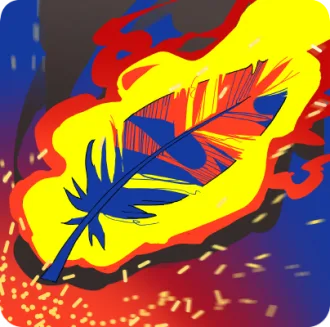

# 灰烬之羽
> 分类：卡牌/手牌
> 编号：21022
> 类型：curse
> 来源：https://wiki.biligame.com/starengine/%E7%81%B0%E7%83%AC%E4%B9%8B%E7%BE%BD

## 卡牌效果

合作挑战（PVE）：不能被使用。回合开始时,
获得1层【温焰】。
移除4层【温焰】：此卡转变为【彩羽】。

## 资料

- **编号**：21022
- **类型**：curse
- **英文名**：Ashen Feather
- **来源**：地图卡牌:园林中庭

## 详解

注意：灰烬之羽仅在合作挑战模式的地图园林中庭中作为失控凤凰线的专属卡牌出现。

卡牌中的温焰效果是一个施加给角色的效果，其效果为：

回合结束时受到2点伤害。受到治疗时，减少1层。并使攻击力+1，持续1回合。

当玩家在手牌中拥有灰烬之羽并累计移除了4层温焰后，该卡牌将会转化为彩羽，关于卡牌彩羽的相关信息，请查阅对应页面。

角色阿尔通过主动技能给予友方灰烬之羽时，灰烬之羽的累计层数会重置为4层。

玩家在丢弃卡牌时，灰烬之羽显示为4层默认层数。

## 历史

*2026年4月17日
**将卡牌正式确定为“诅咒牌”，不再借用标准对战模式中个人命运的图标“凶”。
**修复了角色吉尔·斯汀雷通过主动技能丢弃该卡牌后不会触发被动技能中效果的Bug。现在角色吉尔·斯汀雷的主动技能选择该卡牌时可以恢复生命值并触发被动技能。
*2026年3月13日
**引入。

## 图片

