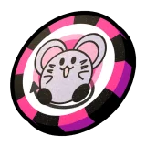

# 米米小补给
> 分类：活动
> 来源：https://wiki.biligame.com/starengine/%E7%B1%B3%E7%B1%B3%E5%B0%8F%E8%A1%A5%E7%BB%99

## 活动任务与奖励

参加派对！累计参与PVE天数≥1天 ×50 参加派对！累计参与PVE天数≥3天 ×100 参加派对！累计参与PVE天数≥7天 ×150 参加派对！累计参与PVE天数≥10天 ×200 参加派对！完成1场标准或合作模式的对局 ×1 参加派对！完成3场标准或合作模式的对局 ×2 参加派对！完成5场标准或合作模式的对局 ×3 参加派对！完成7场标准或合作模式的对局 ×4 参加派对！完成10场标准或合作模式的对局 ×5 吉星小镇吉星小镇胜利≥1次 ×3 吉星小镇吉星小镇胜利≥3次 ×5 吉星小镇吉星小镇胜利≥5次 ×2 点赞玩家完成游戏后为其他玩家点赞≥1次 ×200 点赞玩家完成游戏后为其他玩家点赞≥5次 ×200 点赞玩家完成游戏后为其他玩家点赞≥10次 ×200 点赞玩家完成游戏后为其他玩家点赞≥15次 ×200 点赞玩家完成游戏后为其他玩家点赞≥20次 ×200
