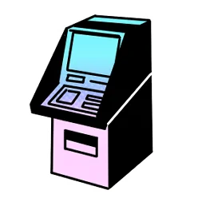

# ATM机
> 分类：筹码
> 编号：50042
> 品质：蓝
> 类别：星光类筹码
> 来源：https://wiki.biligame.com/starengine/ATM%E6%9C%BA

## 效果

转账时，自身与目标同时获得 1 星光与1星币。

## 资料

- **品质**：蓝
- **编号**：50042
- **类别**：星光类筹码

## 详解

该筹码属于星光类筹码，详细机制请参考游戏内说明。

当远野汉娜处在漂浮状态且经过其他角色时，可以触发该筹码的效果。

## 历史

*2026年7月30日
**将效果调整为“转账时，自身与目标同时获得 1 星光与1星币。”
*2026年4月17日
**修复了合作挑战模式中特定情况下拥有筹码【ATM机】时转账效果未触发的问题。
*2026年2月6日
**对文本进行了标准化，由“当前角色与目标同时获得1星光”调整为“自身与目标同时获得1星光”。
*2025年1月24日
**引入游戏。

## 图片

