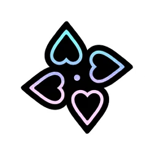

# 友情微章
> 分类：筹码
> 编号：50041
> 品质：紫
> 类别：治愈类筹码
> 来源：https://wiki.biligame.com/starengine/%E5%8F%8B%E6%83%85%E5%BE%AE%E7%AB%A0

## 效果

转账或治疗友方角色时，自身与目标同时获得 2 层治愈。

## 资料

- **品质**：紫
- **编号**：50041
- **类别**：治愈类筹码

## 详解

该筹码属于治愈类筹码，详细机制请参考游戏内说明。

当远野汉娜处在漂浮状态且经过其他角色时，可以触发该筹码的效果。

## 历史

*2026年2月6日
**修改了文本，由“当前角色与目标同时获得 2 层治愈”调整为“自身与目标同时获得 2 层治愈”。
*2025年1月24日
**将该筹码加入游戏。

## 图片

