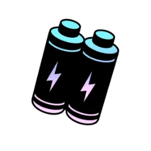

# 额外电池
> 分类：筹码
> 编号：50025
> 品质：紫
> 类别：通用类筹码
> 来源：https://wiki.biligame.com/starengine/%E9%A2%9D%E5%A4%96%E7%94%B5%E6%B1%A0

## 效果

主动技能冷却缩减 1。

## 资料

- **品质**：紫
- **编号**：50025
- **类别**：通用类筹码

## 详解

该筹码属于通用类筹码，详细机制请参考游戏内说明。

## 历史

*2026年2月6日
**修改了文本，由“技能冷却 -1”调整为“主动技能冷却缩减 1”。
*2024年8月16日
**将该筹码加入游戏。

## 图片

