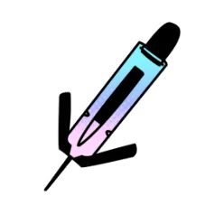

# 肾上腺素-一般
> 分类：筹码
> 来源：https://wiki.biligame.com/starengine/%E8%82%BE%E4%B8%8A%E8%85%BA%E7%B4%A0-%E4%B8%80%E8%88%AC

本页面描述的是游戏中已于2026-09-03被移除的内容，在当前版本不适用!

肾上腺素-一般 效果 生命值低于 50% 时，攻击力 +3，且无法被反击。 肾上腺素-一般 是游戏《吉星派对（p5174.md）》的一种筹码，品质为紫色，属于已移除筹码。

## 详解

该筹码曾经属于通用类筹码，现已移除。 
潜能激发的帕帕拉（p576.md）使用主动技能后，在主动技能生效期间始终可以触发该筹码的效果。

## 历史

- 2026年9月3日
  - 移除。
- 2026年2月6日
  - 对文本进行了标准化，由“生命值低于50%时，攻击力+3，且无法被反击”调整为“生命值低于50%时，攻击力+3，且无法被反击”。
- 2025年8月1日
  - 由“生命值低于50%时，攻击力+3”调整为“生命值低于50%时，攻击力+3，且无法被反击”。
- 2024年8月16日
  - 引入游戏。
