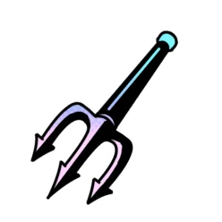

# 三叉戟
> 分类：筹码
> 编号：50055
> 品质：紫
> 类别：地图筹码:星趴·梦想号
> 来源：https://wiki.biligame.com/starengine/%E4%B8%89%E5%8F%89%E6%88%9F

## 效果

使用主动技能时，使一名未被强化的友方角色攻击力+1，防御力+1。

## 资料

- **品质**：紫
- **编号**：50055
- **类别**：地图筹码:星趴·梦想号

## 详解

该筹码属于地图筹码,为地图星趴·梦想号专属，详细机制请参考游戏内说明。

## 历史

*2026年2月6日
**修改了文本，由“使用技能时，使一名未被强化的友方角色攻击力+1，防御力+1”调整为“使用主动技能时，使一名未被强化的友方角色攻击力+1，防御力+1”。
*2025年6月6日
**将该筹码加入游戏。

## 图片

