# 玲玲（怪力乱神）
> 分类：角色 · 编号 128 · 女
> 来源：https://wiki.biligame.com/starengine/%E7%8E%B2%E7%8E%B2

蓝海晴和露佳的大学同学，好闺蜜。人有点疯癫的超级大力女。她有可能随手抓起任何东西来攻击人。据她自己说小时候得了一场大病，可能被什么东西给附身了。但是除了怪力和能控制电流外也没什么副作用就没往心里去。机器人换装同好会的原会长。

## 战斗数值

| 攻击 | 防御 | 生命 |
| --- | --- | --- |
| 2 | 2 | 10 |

## 技能

### 主动技能：阻拦冲撞（冷却 3）

下次移动改为冲锋移动。在1-5中选择一个数字，作为下次冲锋移动的最终点数。

冲锋时挟持经过的所有角色，使挟持的角色防御力-3，持续1轮。停留后依次决定是否挑战他们。

**PVE**：下次移动改为冲锋移动。在1-7中选择一个数字，作为下次冲锋移动的最终点数。

冲锋时挟持经过的所有怪物，停留后依次决定是否挑战它们。如果冲锋时经过了强化拒止则使挟持的怪物防御力-2，自身攻击力+2，持续2轮。

### 被动技能：拦截者

轮次奖励额外获得1张路障。经过路障后，主动技能冷却时间-2，下次移动速度+2。

**PVE**：自身的路障转变为强化拒止，游戏开始时额外获得2张强化拒止。

经过路障后，获得1张强化拒止。

## 基础资料

- 姓名：娇玲玲
- 英文名：Lingling
- 日文名：リンリン
- 从属组织：光礼大学
- 上线时间：202604171000
- 生日：3月11日
- 喜欢食物：土豆泥
- 初始骰子：玲玲骰子
- 礼物：浴室鸭、漂亮的洋装、陈年的红酒
- 徽章：阴影、阳炎

## PVE 特性

- 达到1星时攻击力+1
- 达到2星时攻击力+1、移动速度+1
- 达到3星时攻击力+1、防御力+1、移动速度+1

## 皮肤（共 3 套）

> 皮肤编号取自素材文件名；「默认」「羁绊皮肤」也是独立皮肤。

### 1. 默认（初始）

- 素材编号：128
- 立绘：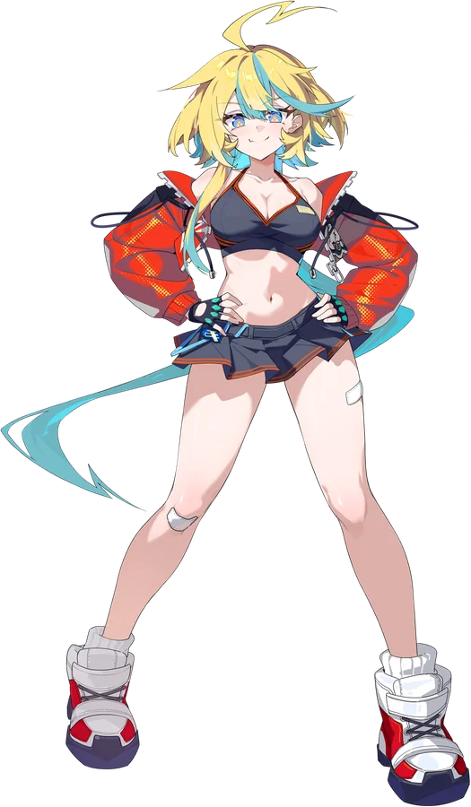
- 立绘（和谐版）：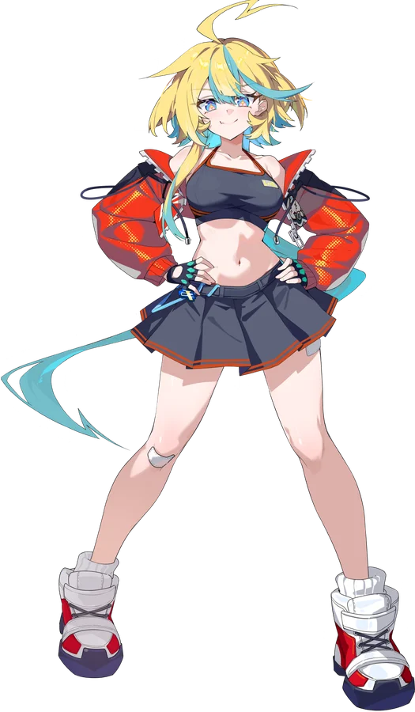
- Q版立绘：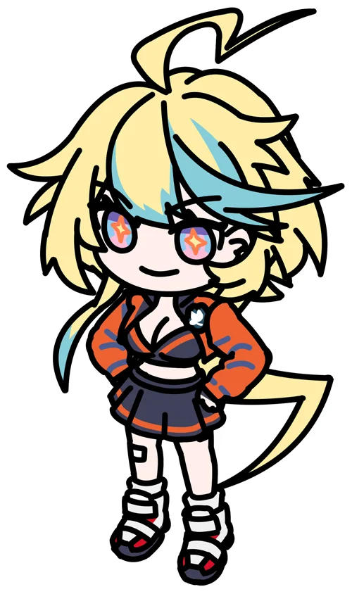
- 头像：
- Q版头像：
- 半身像（星币<20）：
- 半身像（星币≥20）：

### 2. 羁绊皮肤（羁绊解锁）

- 素材编号：128_Max
- 立绘：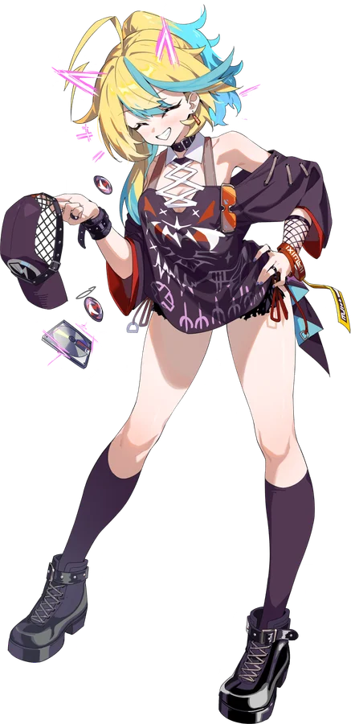
- 立绘（和谐版）：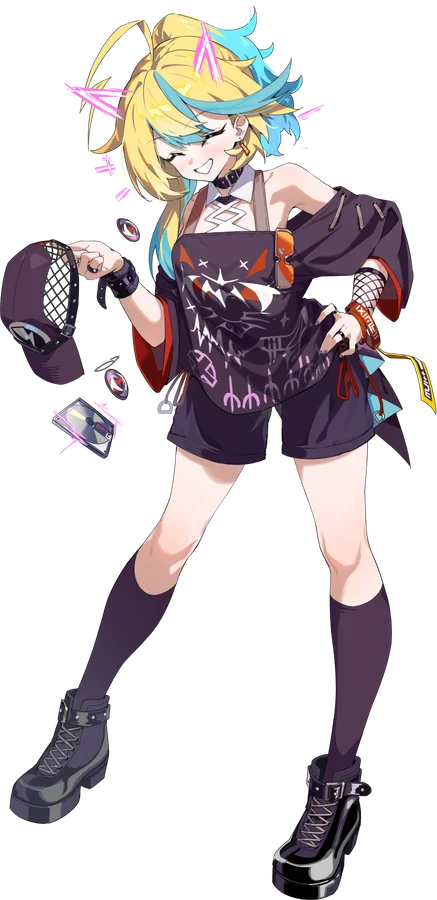
- Q版立绘：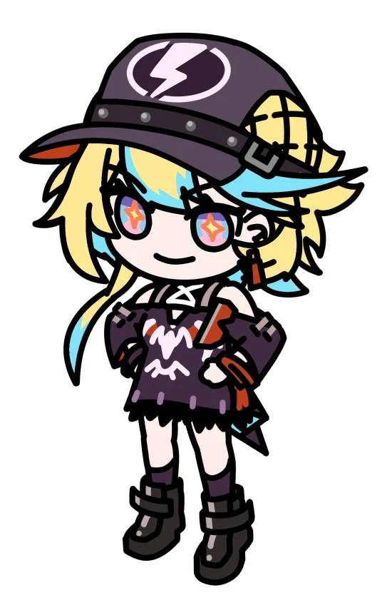
- 头像：
- Q版头像：
- 半身像（星币<20）：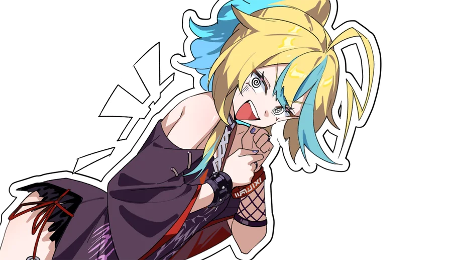
- 半身像（星币≥20）：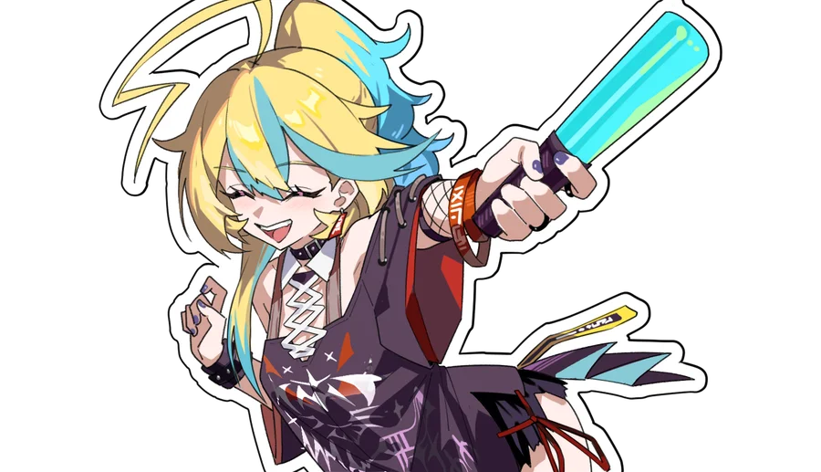

### 3. 安全员（蓝品质）

- 素材编号：128_01
- 立绘：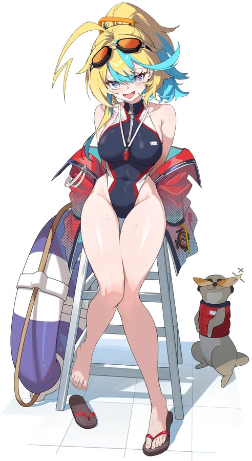
- 立绘（和谐版）：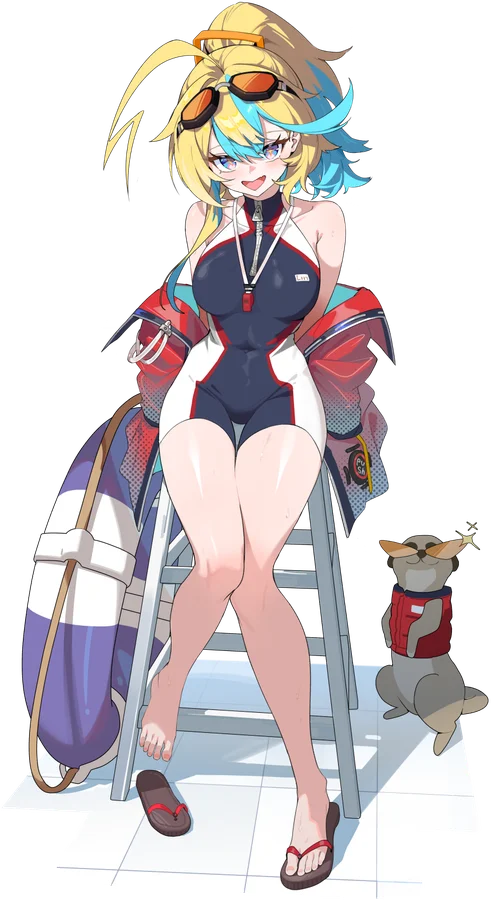
- Q版立绘：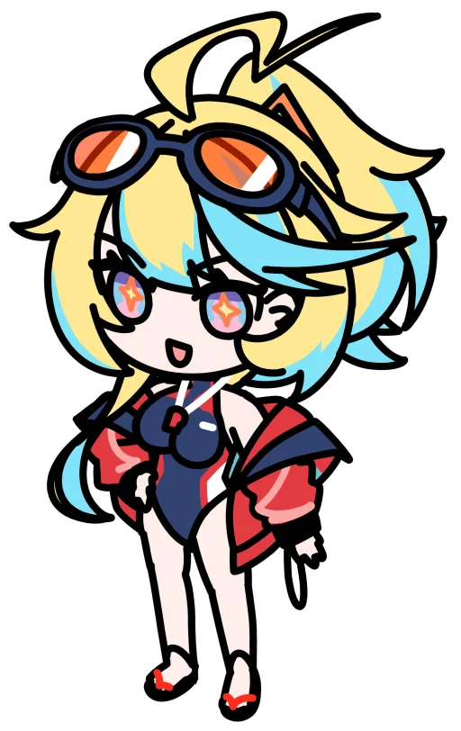
- 头像：
- Q版头像：
- 半身像（星币<20）：
- 半身像（星币≥20）：

**皮肤故事**：作为大学老师的玲玲，有一项闺蜜们无法比拟的优势——带薪休假的暑假。

 但暑假也不能整天无所事事，她便当起了附近小学开放泳池的安全员。

 别小瞧安全员的职责，会游泳的人也未必能胜任这份工作。

 所谓的泳池安全员，不仅需要精湛的游泳技巧，还需掌握专业的救生知识。

 而玲玲作为大学体育老师，这些技能她自然轻车熟路且非常专业。

 在此期间，泳池还因她的到来推出了免费的儿童游泳课。

 小学生们在暑假可以在这里学习游泳知识和基础的救生技巧。

 玲玲每天都会在这里，教授孩子们各种实用知识，也帮助那些怕水不敢下水的孩子克服恐惧，让他们重新认识游泳的趣味。

 只要有她在，即便发生意外，她也能妥善应对，绝不会让孩子们遇到危险——这就是她的能力。

 现在，可以开心地游泳啦！

## 表情（共 8 个）

| # | 名称 | 品质 | 获取方式 | 图片 |
| --- | --- | --- | --- | --- |
| 1 | 表情1 |  |  |  |
| 2 | 表情2 |  |  |  |
| 3 | 表情3 |  |  |  |
| 4 | 表情4 |  |  |  |
| 5 | 表情5 |  |  |  |
| 6 | 表情6 |  |  |  |
| 7 | 表情7 |  |  |  |
| 8 | 表情8 |  |  |  |

## 装扮

官方 wiki 未提供该角色的 /获取 页，头像、名片、卡牌、骰子清单暂缺。

## 人物传记

毕业后留校工作，和露佳以及蓝海晴经常见面。

## 画廊其他素材

- 起始点：
- 像素头像：
- Lv4羁绊等级奖励：
- Lv5羁绊等级奖励：
- 缔结契约名片奖励：
- 安全员皮肤名片：
