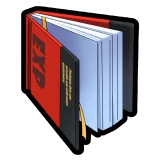

# 水乡古镇极限
> 分类：活动
> 来源：https://wiki.biligame.com/starengine/%E6%B0%B4%E4%B9%A1%E5%8F%A4%E9%95%87%E6%9E%81%E9%99%90

## 活动任务

活动任务活动任务04.17~05.20 
×20 完成1场合作挑战模式（每日刷新） 1/1   
×10 累计参与PVE天数≥1天 1/1   
×20 累计参与PVE天数≥3天 3/3   
×30 累计参与PVE天数≥5天 5/5   
×40 累计参与PVE天数≥7天 7/7   
×50 累计参与PVE天数≥10天 10/10   
×20 水乡古镇普通或更高难度胜利 ≥1次 1/1   
×30 水乡古镇普通或更高难度胜利 ≥3次 3/3   
×50 水乡古镇普通或更高难度胜利 ≥5次 5/5   
×50 水乡古镇普通或更高难度胜利 ≥10次 10/10   
×20 队伍在水乡古镇中击败舞狮嘎呜 ≥1次 1/1   
×30 队伍在水乡古镇中击败舞狮嘎呜 ≥3次 1/1   
×50 队伍在水乡古镇中击败舞狮嘎呜 ≥5次 1/1   
×1 【水乡古镇】极限难度胜利1次 1/1   
×100 队伍在水乡古镇中击败合体舞狮嘎呜 ≥1次 1/1   
×20 队伍在水乡古镇中击败三联爆竹呱 ≥2次 1/1   
×30 队伍在水乡古镇中击败三联爆竹呱 ≥5次 1/1   
×50 队伍在水乡古镇中击败三联爆竹呱 ≥8次 1/1   
×100 队伍在水乡古镇中击败三联爆竹呱 ≥10次 1/1  

## 活动商店

名片-极限水乡（动态） ×1 限购1300 终结特效-魂魄冲击 ×1 限购1300 名片-极限水乡 ×1 限购150 头像-像素水乡 ×1 限购150 头像-像素怨 ×1 限购150 头像-像素戮 ×1 限购150 抽奖券 ×1 限购1010 时装券 ×1 限购1010 中级战斗宝典 ×1 限购1010 蓝色材料自选箱 ×1 限购105 鼠鼠筹码 ×50 限购105 星币 ×1 1
