# 帕露南（商业之主）
> 分类：角色 · 编号 101 · 时期 第一期 · 女
> 来源：https://wiki.biligame.com/starengine/%E5%B8%95%E9%9C%B2%E5%8D%97

联合城的商业传奇，帝国集团的所有者。克里西亚家族是久负盛名的传统家族财团，帕露南让这个帝国更加繁荣，使联合城的各种产业都遍布了克里西亚家族的身影。

## 战斗数值

| 攻击 | 防御 | 生命 |
| --- | --- | --- |
| 1 | 2 | 10 |

## 技能

### 主动技能：网络购物（冷却 2）

远程打开商店，购买卡牌。

### 被动技能：传奇商人

商店可购买的战斗牌数量+1，每次进入商店可获得1星币。

**潜能激发**：所有角色商店的可购买战斗卡牌数量+1，且每张卡牌都有10%的概率降价至1星币。

帕露南转账后，使当前商店内的一张卡牌降价至1星币。

**技能细节**：

潜能激发的帕露南在场时，商店内降价至1星币的卡牌右上角会有特定的图案进行标记（如右图）。

<gallery>LandShop 00.png</gallery>

## 基础资料

- 姓名：帕露南・克里西亚
- 英文名：Parunan
- 日文名：パルナン
- 从属组织：联合城,帝国集团,克里西亚家族
- 上线时间：202402291000
- 生日：6月14日
- 喜欢食物：看起来贼贵的
- 初始骰子：箱包骰子
- 礼物：商品巧克力、礼盒巧克力、手作巧克力
- 徽章：月光、阳炎

## PVE 特性

- 达到1星时立刻获得10星币
- 初始星币+6
- 达到3星时攻击力+1、防御力+1、移动速度+1

## 皮肤（共 4 套）

> 皮肤编号取自素材文件名；「默认」「羁绊皮肤」也是独立皮肤。

### 1. 默认（初始）

- 获取方式：抽奖
- 素材编号：101
- 立绘：
- Q版立绘：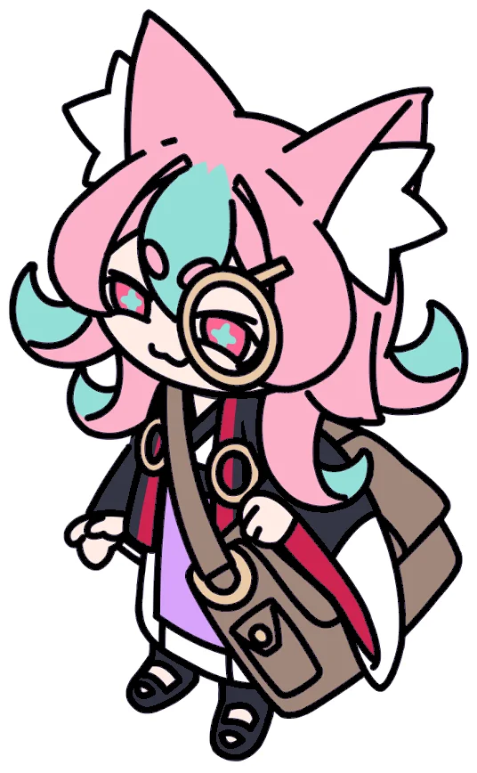
- 头像：
- Q版头像：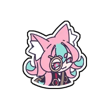
- 半身像（星币<20）：
- 半身像（星币≥20）：

### 2. 羁绊皮肤（羁绊解锁）

- 获取方式：帕露南缔结契约后使用
- 素材编号：101_Max
- 立绘：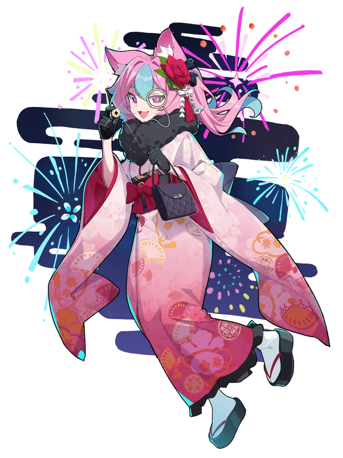
- Q版立绘：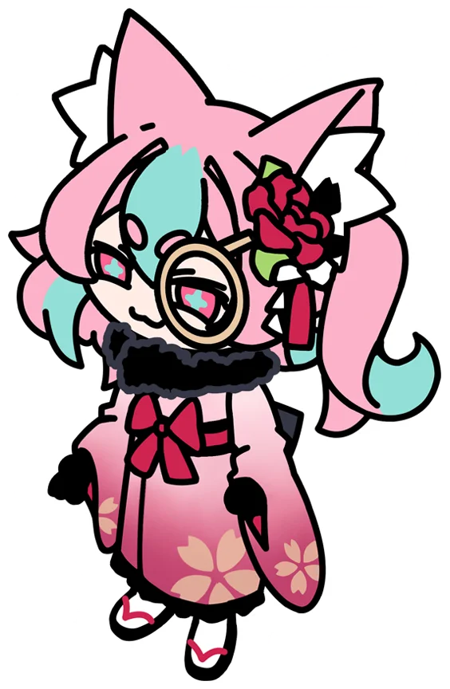
- 头像：
- Q版头像：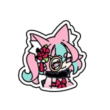
- 半身像（星币<20）：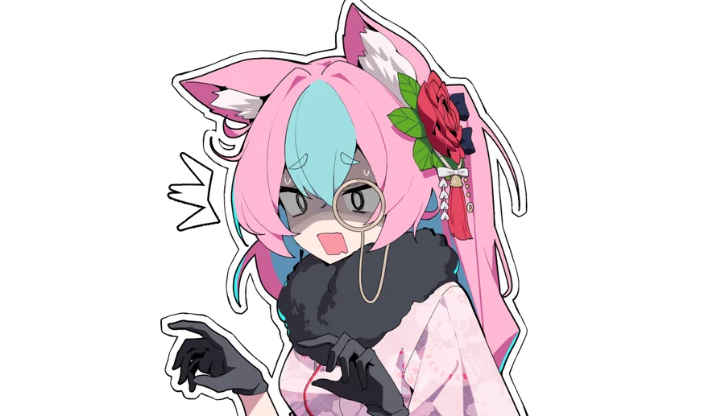
- 半身像（星币≥20）：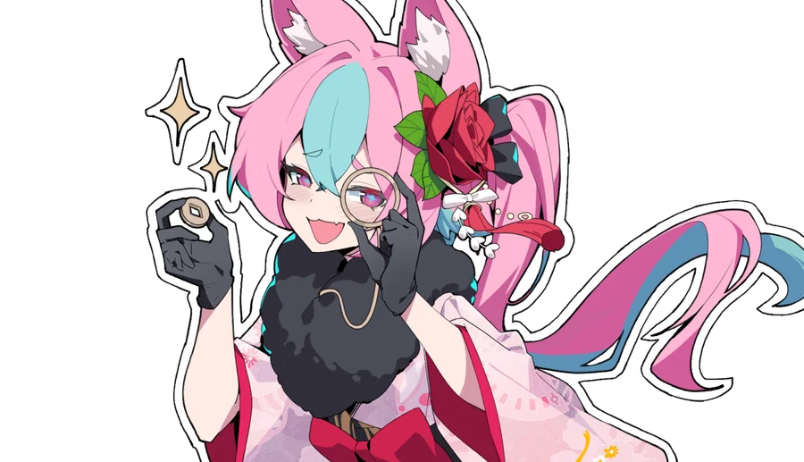

### 3. 时尚达人（蓝品质）

- 获取方式：在商城中以666购入
- 素材编号：101_01
- 立绘：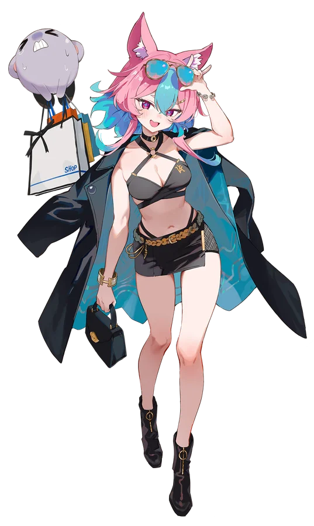
- 立绘（和谐版）：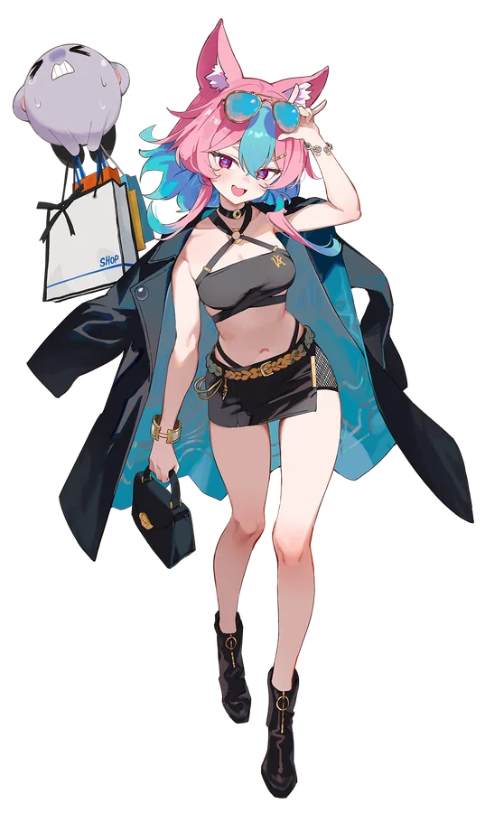
- Q版立绘：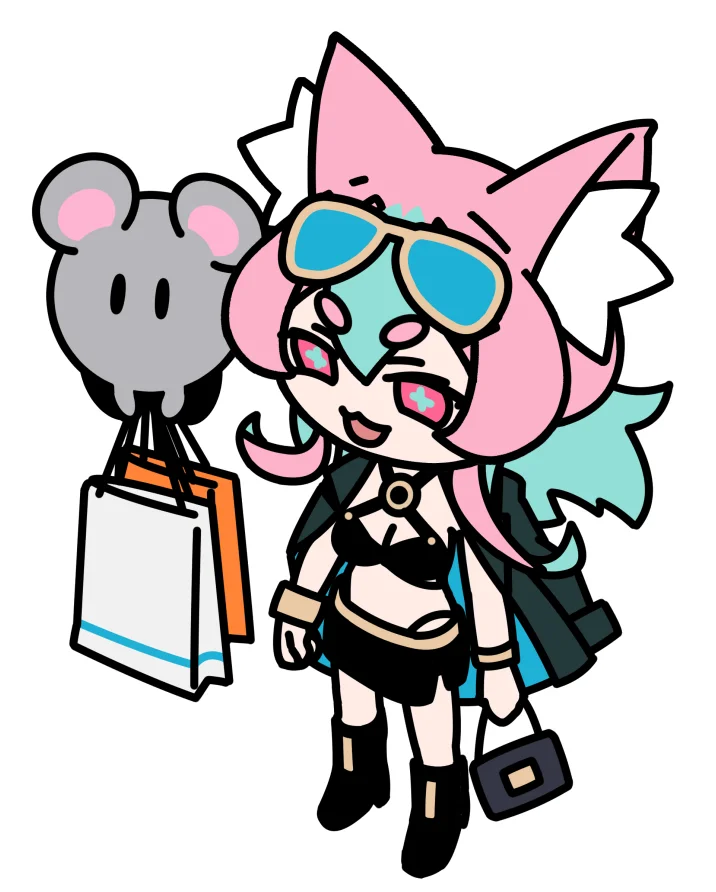
- 头像：
- Q版头像：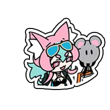
- 半身像（星币<20）：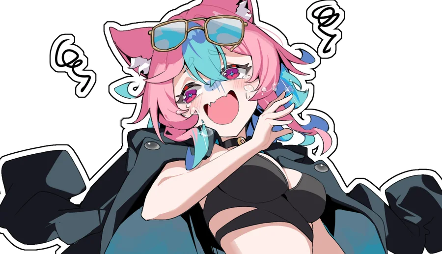
- 半身像（星币≥20）：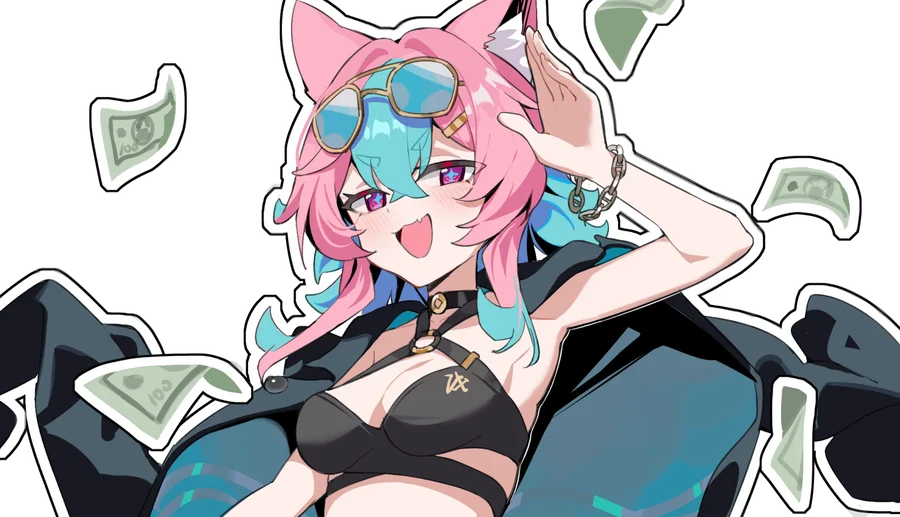

**皮肤故事**：“接下来准备去干什么呢。”

帕露南·克里西娅难得有闲暇时光出来购物，但此时周围的狗仔已经把她盯上了。还好周围有保镖在，这些人还没有大胆到逼近“偷拍”。

按理说这样的装扮在帕露南看来在简单不过，无非就是从衣柜和饰品柜子里挑选出来自己心仪的进行排列组合罢了。

自己随意的穿搭很可能就成为下个季度整个联合城女性们争相模仿的“潮流”。这就是商业帝国的掌舵者，时尚风向标的力量。

站在原地愣了一会儿的帕露南突然回过神来，周围对着她拍照的人也是越来越多。帕露南本人也毫不吝啬自己的形象，抬起太阳镜，以笑容回应那些拍摄自己的人。

“可恶的个人魅力，哈哈。”

### 4. 善财天官（紫品质）

- 获取方式：在活动龙宫秘宝争夺战中抽奖或以666购入
- 素材编号：101_02
- 立绘：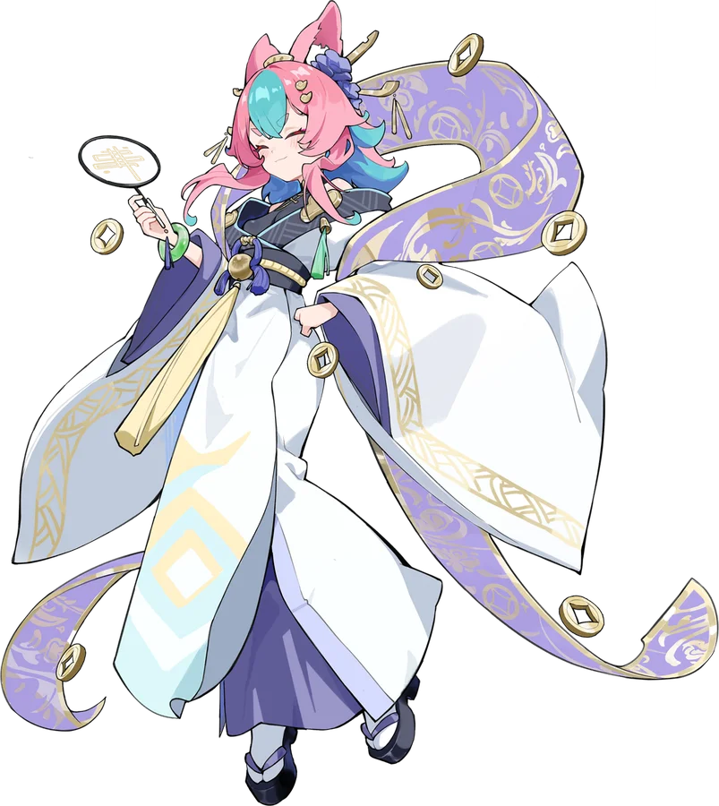
- Q版立绘：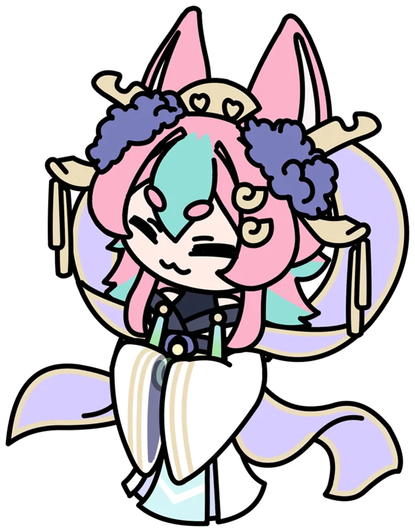
- 头像：
- Q版头像：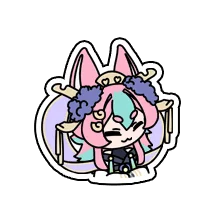
- 半身像（星币<20）：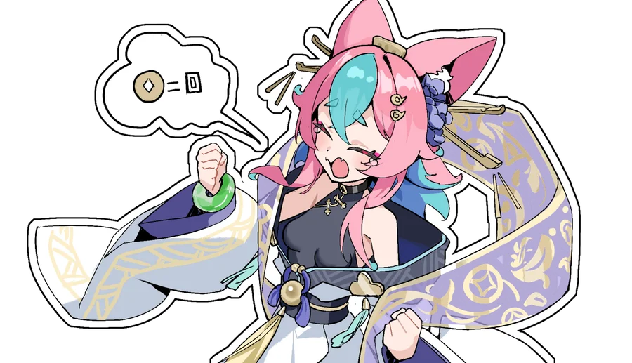
- 半身像（星币≥20）：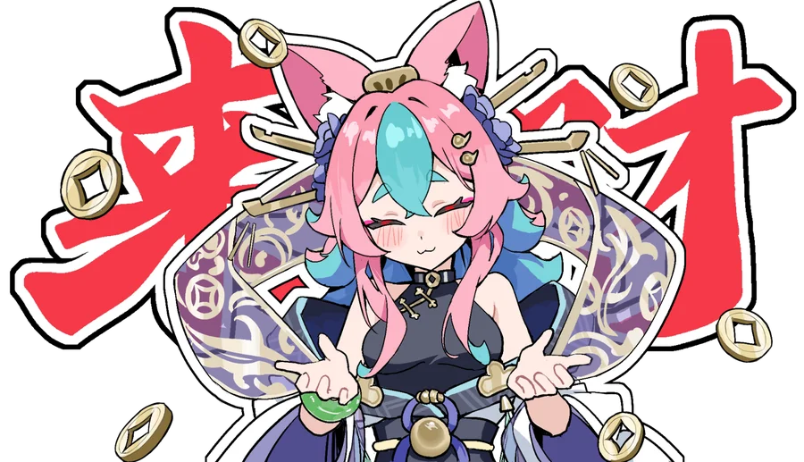

**皮肤故事**：“集团的年会我到底穿什么衣服呢？”

坐在衣柜前的帕露南眉头紧锁。

“我也算是个有头有脸的人物，但是平时穿的基本都那样，有没有什么特殊的呢？”

想到这里，帕露南开始思考起来，精英人士、商业大佬、财神…财…

“唉还是打电话问问吧。”

她拨通了电话。

“我这年会想不同寻常点。”

“你来我这里吧，我这有个合适你的。”

“什么啊？什么样子的？”

“你来就行了，20分钟后见。”

“啊？”姬梦枫只说了20分钟后见就挂了电话。

几天后的年会，帕露南的着装完美的成为各大新闻争相报道的焦点。

可恶，又让她装到了。

## 表情（共 14 个）

| # | 名称 | 品质 | 获取方式 | 图片 |
| --- | --- | --- | --- | --- |
| 1 | 商业之主表情1 | 绿 | 获取角色时获取 |  |
| 2 | 商业之主表情2 | 绿 | 获取角色时获取 |  |
| 3 | 商业之主表情3 | 绿 | 获取角色时获取 |  |
| 4 | 商业之主表情4 | 绿 | 获取角色时获取 |  |
| 5 | 商业之主表情5 | 绿 | 帕露南羁绊1级解锁后使用 |  |
| 6 | 商业之主表情6 | 绿 | 帕露南羁绊2级解锁后使用 |  |
| 7 | 商业之主表情7 | 绿 | 帕露南羁绊3级解锁后使用 |  |
| 8 | 商业之主表情8 | 绿 | 帕露南羁绊3级解锁后使用 |  |
| 9 | 商业之主表情9 | 橙 | 参与众筹 |  |
| 10 | 商业之主表情10 | 橙 | 在活动龙宫秘宝争夺战中抽奖或以100购入 |  |
| 11 | 商业之主表情11 | 橙 | 在活动龙宫秘宝争夺战中抽奖或以100购入 |  |
| 12 | 商业之主表情12 | 绿 | 在活动龙宫秘宝争夺战中完成活动任务：轮次≤5抢夺到秘宝 |  |
| 13 | 商业之主表情13 | 绿 | 在活动龙宫秘宝争夺战中完成活动任务：龙宫游乐园疯狂难度胜利≥1次 |  |
| 14 | 表情8_JP（日服） |  |  |  |

## 装扮

### 头像（3）

| 名称 | 品质 | 获取方式 |
| --- | --- | --- |
| 头像-鼠鼠帕露南 | 紫 | 帕露南羁绊4级解锁后使用 |
| 头像-天官鼠 | 橙 | 在活动龙宫秘宝争夺战中抽奖或以120购入 |
| 头像-像素帕露南 | 紫 | 在商城中以20购入 |

### 名片（7）

| 名称 | 品质 | 获取方式 |
| --- | --- | --- |
| 名片-商业之主 | 紫 | 帕露南羁绊5级解锁后使用 |
| 名片-帕露南缔结契约 | 橙 | 帕露南缔结契约后使用 |
| 名片-时尚达人 | 紫 | 在商城中购入皮肤时尚达人-帕露南时获取 |
| 名片-善财天官 | 橙 | 在活动龙宫秘宝争夺战中抽奖或以60购入 |
| 名片-善财天官（动态） | 橙 | 在活动龙宫秘宝争夺战中抽奖或以500购入 |
| 名片-利益至上 | 紫 | 在商城中以54购入 |
| 名片-吃瓜 | 紫 | 抽奖 |

### 卡牌（1）

| 名称 | 品质 | 获取方式 |
| --- | --- | --- |
| 卡牌-像素小人 | 紫 | 抽奖 |

### 骰子（2）

| 名称 | 品质 | 获取方式 |
| --- | --- | --- |
| 箱包骰子 | 紫 | 帕露南缔结契约后使用 |
| 商业之主骰子 | 橙 | 在商城中以399购入 |

### 主页背景（1）

| 名称 | 品质 | 获取方式 |
| --- | --- | --- |
| 背景：财富管理-帕露南 | 紫 | 帕露南友情加深后使用 |

## 人物传记

帕露南很少出现在公共场合，只有很多年前报纸留下的采访照片。

## 画廊其他素材

- 起始点：
- 像素头像：
- Lv4羁绊等级奖励：
- Lv5羁绊等级奖励：
- 缔结契约名片奖励：
- 时尚达人皮肤名片：
- 善财天官皮肤名片：
