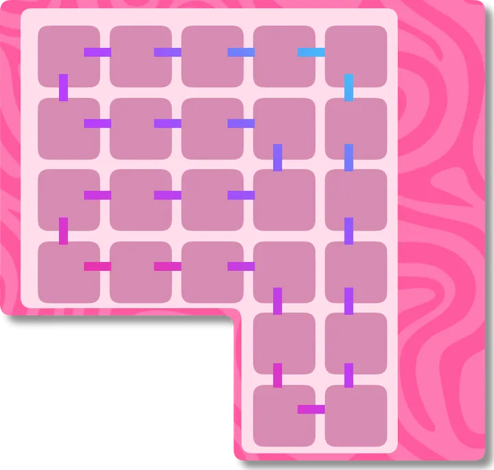

# 骰骰乐
> 分类：活动
> 来源：https://wiki.biligame.com/starengine/%E9%AA%B0%E9%AA%B0%E4%B9%90

## 活动内容

 
 
 
 
 
 
 
 
 
 
 
 1
 
 
 
 
 
 2
 
 
 
 
 
 3
 
 
 
 
 
 4
 
 
 
 
 
 5
 
 
 
 
 
 24
 
 
 
 
 
 23
 
 
 
 
 
 22
 
 
 
 
 
 21
 
 
 
 
 
 6
 
 
 
 
 
 17
 
 
 
 
 
 18
 
 
 
 
 
 19
 
 
 
 
 
 20
 
 
 
 
 
 7
 
 
 
 
 
 16
 
 
 
 
 
 15
 
 
 
 
 
 14
 
 
 
 
 
 13
 
 
 
 
 
 8
 
 
 
 
 
 12
 
 
 
 
 
 9
 
 
 
 
 
 11
 
 
 
 
 
 10
 
 
 
 
 
 第 0 圈
 
 
 投骰子
 放开玩吧！
 
 
 
 
 点击“投骰子”开始游戏！

## 活动任务

×1 完成每日登录 1/1   
×1 点赞玩家（每日刷新） 1/1   
×1 完成1场标准或合作模式（每日刷新） 1/1   
×1 获得1场合作模式的胜利（每日刷新） 1/1   
×1 骰骰乐活动中累计完成1圈 1/1   
×1 骰骰乐活动中累计完成3圈 3/3   
×2 骰骰乐活动中累计完成5圈 5/5   
×2 骰骰乐活动中累计完成8圈 8/8   
×3 骰骰乐活动中累计完成10圈 10/10   
×1 完成1场标准或合作模式的对局 1/1   
×1 完成3场标准或合作模式的对局 3/3   
×2 完成5场标准或合作模式的对局 5/5   
×2 完成7场标准或合作模式的对局 7/7   
×3 完成10场标准或合作模式的对局 10/10   
×2 和好友累计完成1局游戏 1/1   
×2 和好友累计完成2局游戏 2/2   
×2 和好友累计完成3局游戏 3/3   
×1 队伍在水乡古镇中击败指挥平台 ≥1次 1/1   
×2 队伍在水乡古镇中击败指挥平台 ≥3次 3/3   
×3 队伍在水乡古镇中击败舞狮嘎呜 ≥1次 1/1   
×1 队伍在水乡古镇中击败舞狮嘎呜 ≥3次 3/3   
×2 队伍在水乡古镇中击败三联爆竹呱 ≥1次 1/1   
×3 队伍在水乡古镇中击败合体舞狮嘎呜 ≥1次 1/1   
×5 【水乡古镇】极限难度胜利1次 1/1  

## 活动奖励

| 地格 | 可能的奖励 |
| --- | --- |
|  | ×50
（仅需经过该地格） |
|  | ×10
 ×20
 ×1
 ×2
 ×3
 ×20 |
|  | ×100
 ×10
 ×30
 ×1
 ×30
 ×1
 ×1 |
|  | 再次投移动骰，进行移动 |
|  | ×10 |

| 进度 | 奖励 |
| --- | --- |
| 100 | ×3 |
| 150 | ×2 |
| 200 | ×1 |
| 250 | ×8 |
| 300 | ×300 |
| 400 | ×3 |
| 450 | ×2 |
| 500 | ×1 |
| 550 | ×1 |
| 600 | ×5 |
