# 芬妮（古怪神探）
> 分类：角色 · 编号 102 · 时期 第一期 · 女
> 来源：https://wiki.biligame.com/starengine/%E8%8A%AC%E5%A6%AE

格雷森侦探事务所是整个联合城数一数二的私人侦探事务所，芬妮则是事务所的核心。她办理过无数非常级棘手的案件，而这些案件无一例外都得到了完美的解决。不光如此，她还是一位资深的法学博士，拥有联合城颁发的双证。

## 战斗数值

| 攻击 | 防御 | 生命 |
| --- | --- | --- |
| 1 | 2 | 10 |

## 技能

### 主动技能：麻烦制造者（冷却 3）

本回合停留后，额外触发1次事件。

### 被动技能：华点发现！

芬妮触发事件后，获得3星币。

**潜能激发**：使用主动技能时，从2个随机事件中选择一个触发。

**技能细节**：当芬妮在PVP或在PVE未潜能激发时，若芬妮使用技能后踩到事件地块，地块的全员事件会先触发，然后才是技能的事件。

## 基础资料

- 姓名：芬妮・克雷格
- 英文名：Fanny
- 日文名：ファニィ
- 从属组织：格雷森侦探事务所
- 事件经历：天王落
- 上线时间：202402291000
- 生日：2月17日
- 喜欢食物：草莓蛋糕
- 初始骰子：快递骰子
- 礼物：浴室鸭、小熊玩偶、小怪兽手办
- 徽章：冰原、山峦

## PVE 特性

- 达到1星时立刻获得10星币
- 初始星币+6
- 达到3星时攻击力+1、防御力+1、移动速度+1

## 皮肤（共 6 套）

> 皮肤编号取自素材文件名；「默认」「羁绊皮肤」也是独立皮肤。

### 1. 默认（初始）

- 获取方式：默认
- 素材编号：102
- 立绘：
- Q版立绘：
- 头像：
- Q版头像：
- 半身像（星币<20）：
- 半身像（星币≥20）：

### 2. 羁绊皮肤（羁绊解锁）

- 获取方式：芬妮缔结契约后使用
- 素材编号：102_Max
- 立绘：
- Q版立绘：
- 头像：
- Q版头像：
- 半身像（星币<20）：
- 半身像（星币≥20）：

### 3. 清凉盛夏（紫品质）

- 获取方式：购买通行证并且通行证等级达到40级
- 素材编号：102_01
- 立绘：
- 立绘（和谐版）：
- Q版立绘：
- 头像：
- Q版头像：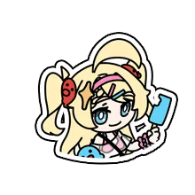
- 半身像（星币<20）：
- 半身像（星币≥20）：

**皮肤故事**：“这是她什么时候的照片啊？”恋拿着照片问道。
“我记得好像是…哦对了，几年前事务所的聚会吧。”
“那天事务所老大为了让我们玩得尽兴，专门包下了黄金海岸的一片沙滩。”某个声音回答道，并接过照片看了起来。
“唉..真好啊，我也想去沙滩。”恋若有所思道。
“她那天因为穿这身泳衣被同事吐槽搭配太少女了。”
“唉…我倒觉得蛮可爱的，还想看她穿一次呢。”恋回答道。
“老大坚信前辈并没有离开我们，肯定在某个地方拿着她心爱的放大镜在找寻线索呢。”

### 4. 超然解析（蓝品质）

- 获取方式：在活动超级侦探超然解析中以300购入
- 素材编号：102_02
- 立绘：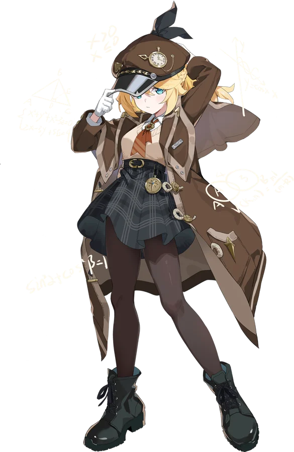
- Q版立绘：
- 头像：
- Q版头像：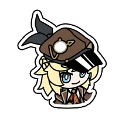
- 半身像（星币<20）：
- 半身像（星币≥20）：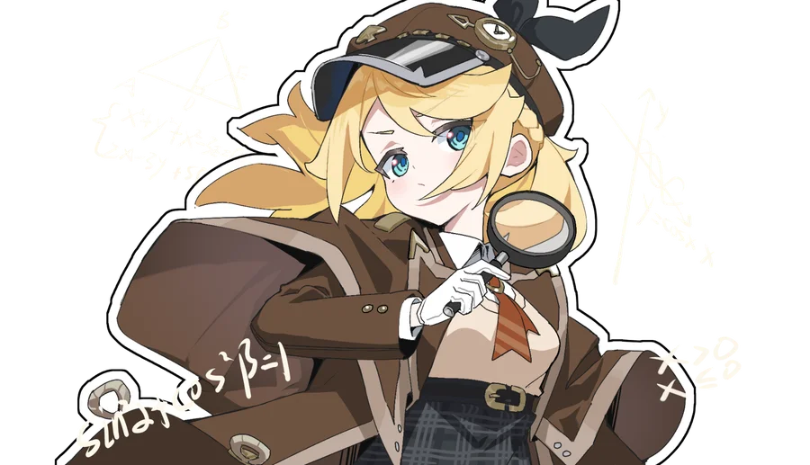

**皮肤故事**：虽然整个世界当中存在诸多的魔法元素。但是能完美掌握的人少之又少。
在这个世界上，会激发出这些魔力的人才能完美的将这些魔法作用于现实世界当中。
其中芬妮克雷格就是解析魔法的佼佼者，她运用自身的魔力和经验，解决了很多棘手的案件，以至于很多人都不将她称为侦探，而是称为“超然解析的魔法师”。
至于这里面的学问，那你得去光礼大学学习整套课程才能知晓了。

### 5. 科学怪探（紫品质）

- 获取方式：在活动魔怪舞会中抽奖或以666购入
- 素材编号：102_03
- 立绘：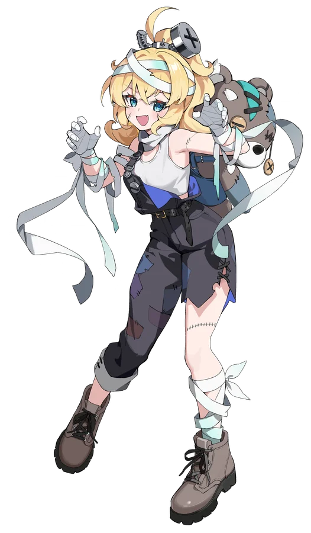
- Q版立绘：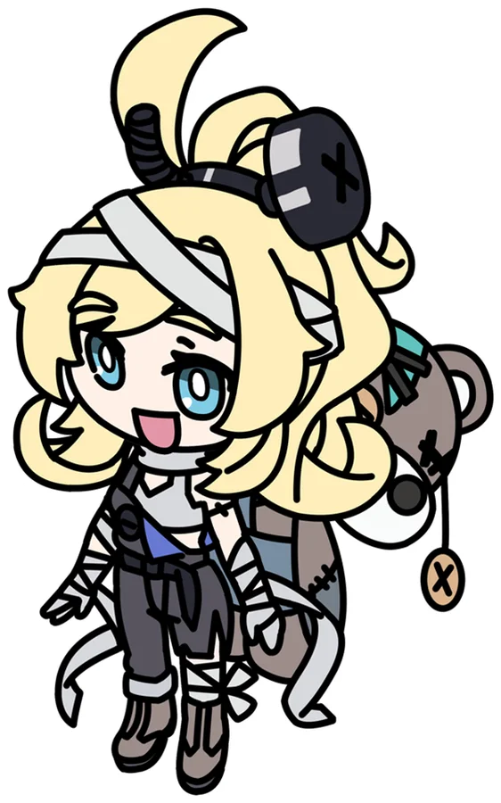
- 头像：
- Q版头像：
- 半身像（星币<20）：
- 半身像（星币≥20）：

**皮肤故事**：今年的御魂庆典，后街举办了盛大的“魔怪舞会”表演。
吃喝玩乐、游园表演一条龙，是一场大型的节日庆典活动。
当然，每年的御魂庆典都少不了化装舞会。
来自五湖四海的玩家不远万里来到联合城，只为参加这一年的盛大活动。在这一天，你穿得再怪也没关系，只要不违法，都可以在大街上自由地表演。芬妮每年都会穿着稀奇古怪的衣服来参加活动。据她自己说，她是个非常喜欢此类活动的人，不仅限于御魂庆典，只要是变装、化装舞会，她只要有空都会去参加。
她说，这源于从前办案时常常需要穿上案发现场相关人员的衣服，进行“换位思考”。渐渐地，她觉得穿着古怪衣服扮演角色是一件很好玩的事，这种爱好也从工作扩展到了生活中。
“当你设身处地地穿上这身衣服，变成这个角色的时候，思考也会随之发生变化。”
虽然不知道变成绷带僵尸到底有没有脑子思考，但总之她很开心。

### 6. 悠闲假日（蓝品质）

- 获取方式：在商城中以333购入
- 素材编号：102_04
- 立绘：
- Q版立绘：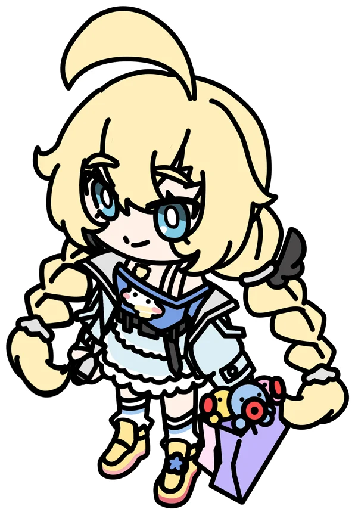
- 头像：
- Q版头像：
- 半身像（星币<20）：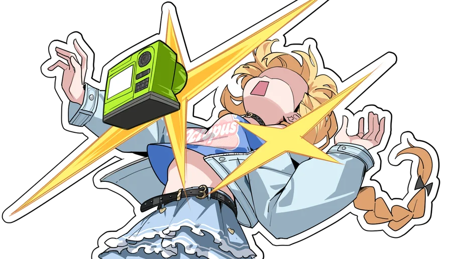
- 半身像（星币≥20）：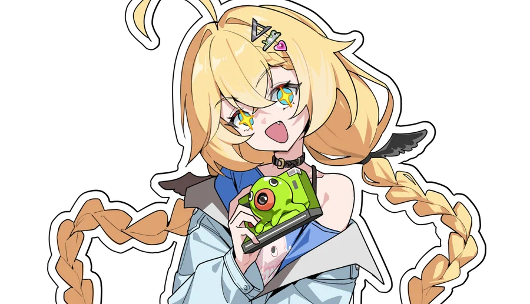

**皮肤故事**：对于侦探而言，从不存在真正的周末或节假日休息。忙起来时，只要有案件就会忙个没完；没有案件时，又可能闲到无所事事。今天比较特殊，案件刚好结案，又是难得的假日，因此决定出去放松一下。穿上自己喜爱的休闲装，搭配可爱的装饰，开启一场只属于自己的悠闲周末。

先去到之前常去的网红打卡点，用相机好好拍几张照片，扩充自己的摄影相册。接着去游戏中心，享受抓娃娃机无限制的快乐，照着喜欢的娃娃疯狂抓取。玩累了，找个地方吃点甜点，想想就觉得很完美！

“晚饭吃什么呢？不过还早，要么看看有什么电影？看完再去吃也不迟？”这么想着，她掏出手机准备搜索最近上映的电影。

然后，某个人的电话恰好打了进来。

## 表情（共 18 个）

| # | 名称 | 品质 | 获取方式 | 图片 |
| --- | --- | --- | --- | --- |
| 1 | 古怪神探表情1 | 绿 | 获取角色时获取 |  |
| 2 | 古怪神探表情2 | 绿 | 获取角色时获取 |  |
| 3 | 古怪神探表情3 | 绿 | 获取角色时获取 |  |
| 4 | 古怪神探表情4 | 绿 | 获取角色时获取 |  |
| 5 | 古怪神探表情5 | 绿 | 芬妮羁绊1级解锁后使用 |  |
| 6 | 古怪神探表情6 | 绿 | 芬妮羁绊2级解锁后使用 |  |
| 7 | 古怪神探表情7 | 绿 | 芬妮羁绊3级解锁后使用 |  |
| 8 | 古怪神探表情8 | 绿 | 芬妮羁绊3级解锁后使用 |  |
| 9 | 古怪神探表情9 | 紫 | 购买通行证并且通行证等级达到20级 |  |
| 10 | 古怪神探表情10 | 橙 | 购买升级版通行证并且通行证等级达到15级 |  |
| 11 | 古怪神探表情11 | 紫 | 购买通行证并且通行证等级达到15级 |  |
| 12 | 古怪神探表情12 | 橙 | 购买升级版通行证并且通行证等级达到20级 |  |
| 13 | 古怪神探表情13 | 橙 | 参与众筹 |  |
| 14 | 古怪神探表情14 | 橙 | 在活动魔怪舞会中抽奖或以100购入 |  |
| 15 | 古怪神探表情15 | 橙 | 在活动魔怪舞会中抽奖或以100购入 |  |
| 16 | 古怪神探表情16 | 绿 | 在活动魔怪舞会中完成活动任务：在幽魂暗巷中使用糖果≥20次 |  |
| 17 | 古怪神探表情17 | 绿 | 在活动魔怪舞会中完成活动任务：幽魂暗巷噩梦及以上难度胜利≥1次 |  |
| 18 | 表情11_JP（日服） |  |  |  |

## 装扮

### 头像（5）

| 名称 | 品质 | 获取方式 |
| --- | --- | --- |
| 头像-鼠鼠芬妮 | 紫 | 芬妮羁绊4级解锁后使用 |
| 头像-清凉鼠 | 蓝 | 购买通行证并且通行证等级达到10级 |
| 头像-怪探鼠鼠 | 橙 | 在活动魔怪舞会中抽奖或以120购入 |
| 头像-像素芬妮 | 紫 | 完成成就“团队坦克” |
| 头像-周年徽冠 | 紫 | 活动二周年星运周期间邮件赠送 |

### 名片（12）

| 名称 | 品质 | 获取方式 |
| --- | --- | --- |
| 名片-古怪神探 | 紫 | 芬妮羁绊5级解锁后使用 |
| 名片-芬妮缔结契约 | 橙 | 芬妮缔结契约后使用 |
| 名片-清凉盛夏 | 紫 | 购买通行证并且通行证等级达到39级 |
| 名片-清凉盛夏（动态） | 橙 | 购买升级版通行证并且通行证等级达到39级 |
| 名片-超然解析 | 紫 | 在活动超级侦探超然解析中以50购入 |
| 名片-怪探狂欢 | 橙 | 在活动魔怪舞会中抽奖或以60购入 |
| 名片-怪探狂欢（动态） | 橙 | 在活动魔怪舞会中抽奖或以500购入 |
| 名片-悠闲假日 | 紫 | 在商城中购入皮肤悠闲假日-芬妮时获取 |
| 名片-华点 | 紫 | 抽奖 |
| 名片-我错了 | 紫 | 抽奖 |
| 名片-幸运星争夺战 | 紫 | 在活动幸运星争夺战中以200购入 |
| 名片-疑点重重 | 紫 | 签到活动 |

### 卡牌（4）

| 名称 | 品质 | 获取方式 |
| --- | --- | --- |
| 卡牌-像素小人 | 紫 | 抽奖 |
| 卡牌-沙滩精灵 | 紫 | 购买通行证并且通行证等级达到25级 |
| 卡牌-金色海岸（动态） | 橙 | 购买升级版通行证并且通行证等级达到25级 |
| 卡牌-幸运星争夺战 | 紫 | 在活动幸运星争夺战中以200购入 |

### 骰子（2）

| 名称 | 品质 | 获取方式 |
| --- | --- | --- |
| 快递骰子 | 紫 | 芬妮缔结契约后使用 |
| 古怪神探骰子 | 橙 | 在商城中以399购入 |

### 主页背景（1）

| 名称 | 品质 | 获取方式 |
| --- | --- | --- |
| 背景：风雨无阻-芬妮 | 紫 | 芬妮友情加深后使用 |

## 人物传记

在“天王落”事件后失踪，录入的形象是很久之前的。

## 画廊其他素材

- 起始点：
- 像素头像：
- Lv4羁绊等级奖励：
- 头像鼠：
- Lv5羁绊等级奖励：
- 缔结契约名片奖励：
- 清凉盛夏皮肤名片：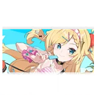
- 超然解析皮肤名片：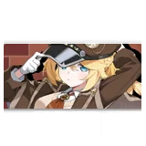
- 科学怪探皮肤名片：
- 悠闲假日皮肤名片：

## 语音台词（21 条，中文）

| 场景 | 台词 |
| --- | --- |
| 角色介绍 | 欸，什么什么，你找我要解决麻烦的事件吗？嘿，看我的吧！ |
| 角色选择 | 什么，有事件要解决？交给我吧！ |
| 角色入场 | 开始搜寻线索。 |
| 角色入场（邦妮在场时） | 这不是捣蛋鬼嘛。 |
| 使用技能 | 搜索，解析，确定！ |
| 使用卡牌 | 用这个就对啦。 / 这玩意感觉不错哦~ |
| 移动 | 继续前进！ / Go Go Go！ |
| 欢呼 | 嗯哼哼~ / 感觉不错！ |
| 负面事件 | 呜啊…… |
| 商店 | 购买些有用的家伙事儿。 |
| 事件 | 嗯？什么什么？ |
| 升级 | 果然还得是我呀！ |
| 受伤 | 好疼！ / 呃啊…… |
| 死亡 | 人家是无辜的！ |
| 骰点攻击 | 可别想逃跑哦？ / 可别让我逮到你哦！ |
| 骰点防御 | 动手可不好哦。 |
| 攻击 （除 羁绊皮肤、悠闲假日 外） | 嗨呀！ |
| 攻击胜利 | 真凶，缉拿归案！ |
| 奖励（未使用） | 欸——欸嘿。 |
| 胜利 | 顺利结案，好耶！ |
| 最大羁绊解锁 | 你果然发现了盲点，干得不错！ |
