# 阿兰娜（社恐修女）
> 分类：角色 · 编号 103 · 时期 第一期 · 女
> 来源：https://wiki.biligame.com/starengine/%E9%98%BF%E5%85%B0%E5%A8%9C

联合城星辉院的修女长。星辉院是联合城政府资助具有孤儿院性质的机构，里面收养了星辉位面各地区的孤儿，阿兰娜也是孤儿的一员。

## 战斗数值

| 攻击 | 防御 | 生命 |
| --- | --- | --- |
| 1 | 1 | 9 |

## 技能

### 主动技能：铁处女（冷却 3）

使用主动技能后，无法被挑战并免疫陷阱，持续1轮。自身没有触发被动时，额外获得被动效果。

### 被动技能：鼓起勇气！

若上个回合没有受到伤害，则攻击力+3（不叠加，受伤后清除）。

**潜能激发**：使用主动技能后，本回合不会受到伤害，也无法被反击。

## 基础资料

- 姓名：阿兰娜・格瑞斯塔
- 英文名：Alana
- 日文名：アランナ
- 从属组织：联合城,星辉院,战斗修女团
- 事件经历：退魔之夜
- 上线时间：202402291000
- 生日：2月21日
- 喜欢食物：芋头
- 初始骰子：手风琴骰子
- 礼物：商品巧克力、礼盒巧克力、手作巧克力
- 徽章：川河、大气

## PVE 特性

- 达到1星时攻击力+1
- 达到2星时攻击力+2
- 达到3星时攻击力+1、移动速度+2

## 皮肤（共 5 套）

> 皮肤编号取自素材文件名；「默认」「羁绊皮肤」也是独立皮肤。

### 1. 默认（初始）

- 获取方式：抽奖
- 素材编号：103
- 立绘：
- 立绘（和谐版）：
- Q版立绘：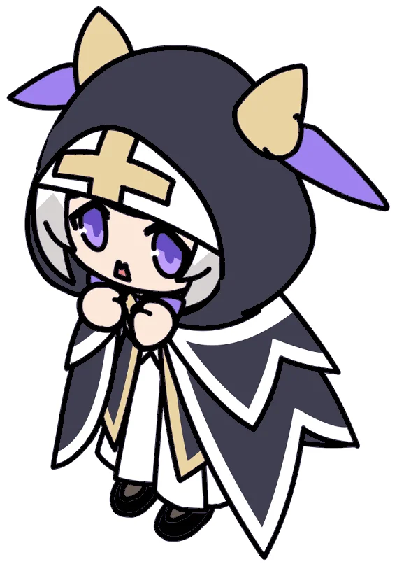
- 头像：
- Q版头像：
- 半身像（星币<20）：
- 半身像（星币≥20）：

### 2. 羁绊皮肤（羁绊解锁）

- 获取方式：阿兰娜缔结契约后使用
- 素材编号：103_Max
- 立绘：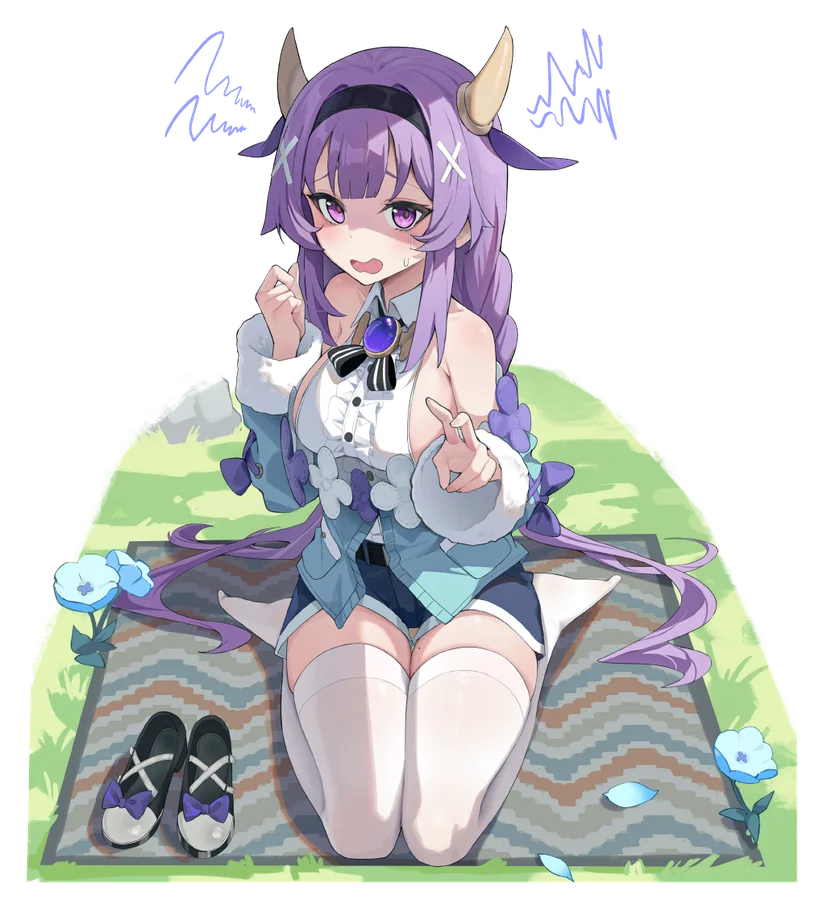
- 立绘（和谐版）：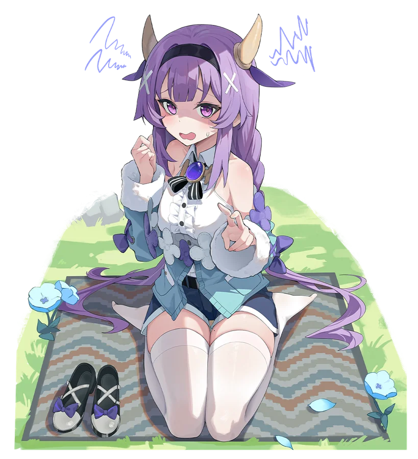
- Q版立绘：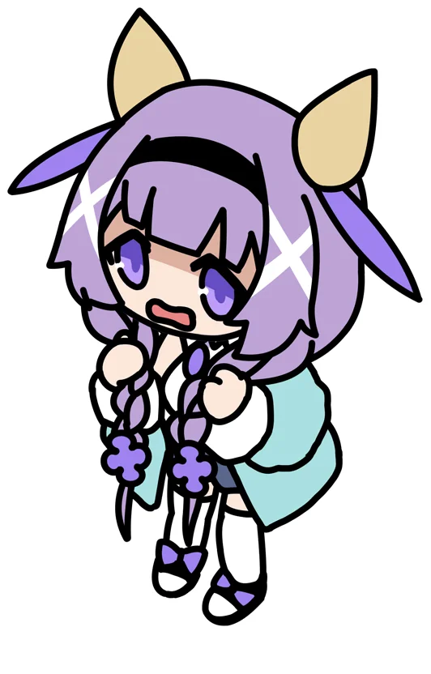
- 头像：
- Q版头像：
- 半身像（星币<20）：
- 半身像（星币≥20）：

### 3. 悸动沙滩（紫品质）

- 获取方式：购买通行证并且通行证等级达到40级
- 素材编号：103_01
- 立绘：
- 立绘（和谐版）：
- Q版立绘：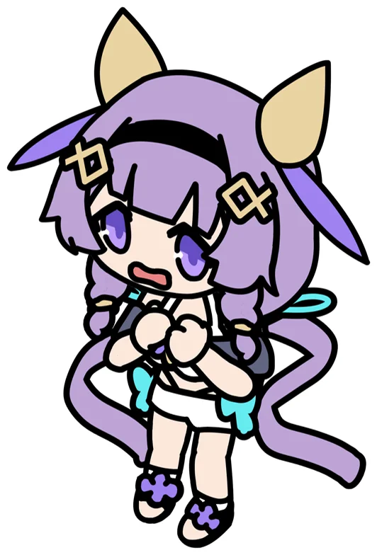
- 头像：
- Q版头像：
- 半身像（星币<20）：
- 半身像（星币≥20）：

**皮肤故事**：“别…别跑那么快啊！毛毯！毛毯要掉下来了啊！！”阿兰娜发出悲鸣，此时她正被另一个女孩拉扯着快速跑向沙滩。
“又不是没穿衣服，你裹这么大个毯子干嘛！”女孩一边拽着阿兰娜身上的毛毯一边说到。
“可是.可是作为修女的我们..呀..你不要拽了..呜呜..”阿兰娜紧紧的抓着即将脱落的毛毯。
“你怕什么…好身材不就是用来给人看的嘛！”
“但是这身泳装是不是太羞耻了！”阿兰娜死命的护着身上的毯子。话还没说完。阿兰娜一个重心不稳，踉跄的躺倒在了沙滩上。身上的毯子也飞到了边，露出了完美的身体。
“呜鸣鸣…神啊…请原谅我这不洁的信徒吧…”
阿兰娜双手交合胸前，像是做了什么错事一样祈祷起来。
当然，如此虔诚的孩子怎么会被责怪呢？

### 4. 冒失少女（蓝品质）

- 获取方式：在商城中以666购入
- 素材编号：103_02
- 立绘：
- Q版立绘：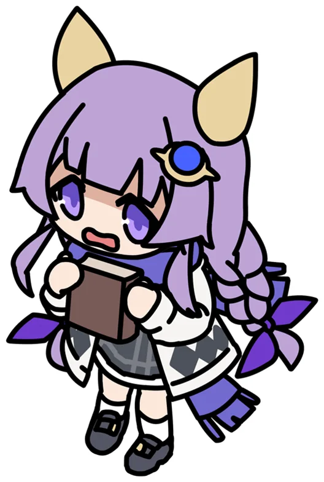
- 头像：
- Q版头像：
- 半身像（星币<20）：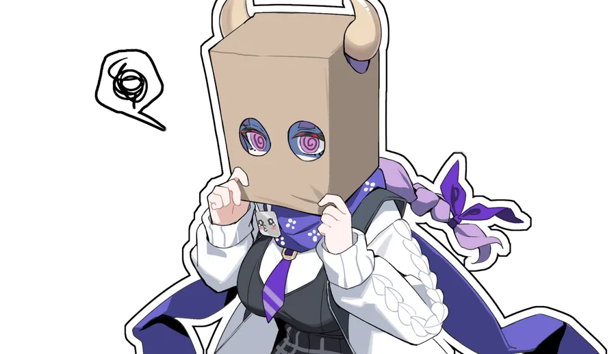
- 半身像（星币≥20）：

**皮肤故事**：作为一个大学生还在大学里穿高中制服，是很不常见的现象，至少在光礼大学是这样的。
虽然格瑞斯塔本人并不介意穿什么，然而穿着一身高中制服的她其实在整个学院里都格外显眼，毕竟作为大学生她完全可以自由地穿搭任何喜欢的衣服。
可能是出于方便？也可能是因为没有什么着装要求？格瑞斯塔很少更换衣物。见过她的同学基本只见过她穿着那身高中时期的校服，在校园里表演平地摔。

### 5. 魔女兵器（紫品质）

- 获取方式：（日服限定）在魔女兵器联动期间以1400日元单独购入或以2200日元在捆绑包中购入
- 素材编号：103_03
- 立绘：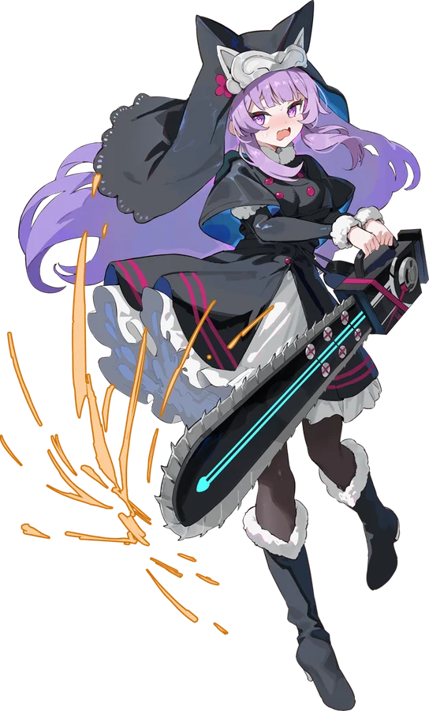
- Q版立绘：
- 头像：
- Q版头像：
- 半身像（星币<20）：
- 半身像（星币≥20）：

## 表情（共 13 个）

| # | 名称 | 品质 | 获取方式 | 图片 |
| --- | --- | --- | --- | --- |
| 1 | 社恐修女表情1 | 绿 | 获取角色时获取 |  |
| 2 | 社恐修女表情2 | 绿 | 获取角色时获取 |  |
| 3 | 社恐修女表情3 | 绿 | 获取角色时获取 |  |
| 4 | 社恐修女表情4 | 绿 | 获取角色时获取 |  |
| 5 | 社恐修女表情5 | 绿 | 阿兰娜羁绊1级解锁后使用 |  |
| 6 | 社恐修女表情6 | 绿 | 阿兰娜羁绊2级解锁后使用 |  |
| 7 | 社恐修女表情7 | 绿 | 阿兰娜羁绊3级解锁后使用 |  |
| 8 | 社恐修女表情8 | 绿 | 阿兰娜羁绊3级解锁后使用 |  |
| 9 | 社恐修女表情9 | 紫 | 购买通行证并且通行证等级达到15级 |  |
| 10 | 社恐修女表情10 | 橙 | 购买升级版通行证并且通行证等级达到15级 |  |
| 11 | 社恐修女表情11 | 紫 | 购买通行证并且通行证等级达到20级 |  |
| 12 | 社恐修女表情12 | 橙 | 购买升级版通行证并且通行证等级达到20级 |  |
| 13 | 社恐修女表情13 | 橙 | 参与众筹 |  |

## 装扮

### 头像（3）

| 名称 | 品质 | 获取方式 |
| --- | --- | --- |
| 头像-鼠鼠阿兰娜 | 紫 | 阿兰娜羁绊4级解锁后使用 |
| 头像-悸动鼠 | 蓝 | 购买通行证并且通行证等级达到10级 |
| 头像-像素阿兰娜 | 紫 | 完成成就“死神” |

### 名片（8）

| 名称 | 品质 | 获取方式 |
| --- | --- | --- |
| 名片-社恐修女 | 紫 | 阿兰娜羁绊5级解锁后使用 |
| 名片-阿兰娜缔结契约 | 橙 | 阿兰娜缔结契约后使用 |
| 名片-悸动沙滩 | 紫 | 购买通行证并且通行证等级达到39级 |
| 名片-悸动沙滩（动态） | 橙 | 购买升级版通行证并且通行证等级达到39级 |
| 名片-冒失少女 | 紫 | 在商城中购入皮肤冒失少女-阿兰娜时获取 |
| 名片-魔女兵器阿兰娜 | 紫 | 在魔女兵器联动期间购入皮肤魔女兵器-阿兰娜时获取 |
| 名片-社恐发作 | 紫 | 抽奖 |
| 名片-祈祷 | 紫 | 抽奖 |

### 卡牌（3）

| 名称 | 品质 | 获取方式 |
| --- | --- | --- |
| 卡牌-像素小人 | 紫 | 抽奖 |
| 卡牌-羞涩 | 紫 | 购买通行证并且通行证等级达到25级 |
| 卡牌-悸动之心（动态） | 橙 | 购买升级版通行证并且通行证等级达到25级 |

### 骰子（1）

| 名称 | 品质 | 获取方式 |
| --- | --- | --- |
| 手风琴骰子 | 紫 | 阿兰娜缔结契约后使用 |

### 主页背景（1）

| 名称 | 品质 | 获取方式 |
| --- | --- | --- |
| 背景：祈祷时刻-阿兰娜 | 紫 | 阿兰娜友情加深后使用 |

## 人物传记

“退魔之夜”事件后加入战斗修女团。她一直帮助维护修道院的日常运营，很少在外露面。

## 画廊其他素材

- 起始点：
- 像素头像：
- Lv4羁绊等级奖励：
- 头像鼠：
- Lv5羁绊等级奖励：
- 缔结契约名片奖励：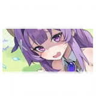
- 悸动沙滩皮肤名片：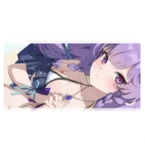
- 冒失少女皮肤名片：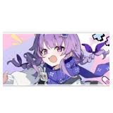
- 魔女兵器皮肤名片：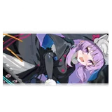
